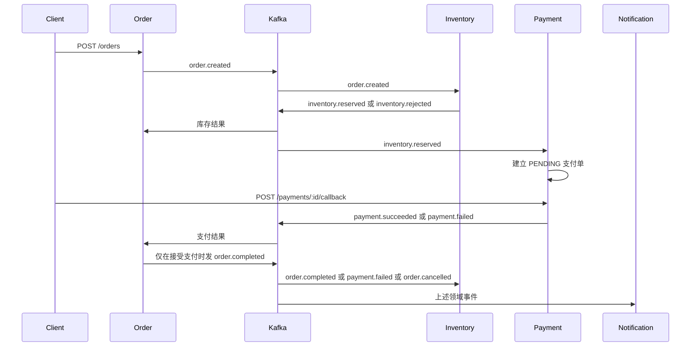

# 订单履约中台设计

日期：2026-10-17  
状态：已与使用方确认，可以按此实现

## 目标

做一个 Go 多服务项目，把 Gin、MySQL、Redis、Kafka 放进同一条订单履约链路。每个中间件都有真实职责：Gin 接请求，MySQL 做各服务自己的账，Redis 做幂等、库存锁和可售计数，Kafka 在服务之间传递领域事件。

## 已确认的决定

- 业务是订单履约，不是秒杀，也不是通知平台。
- 按限界上下文拆成四个进程：订单、库存、支付、通知。
- 每个服务独占一个 MySQL 库。服务之间不查对方的库，也不互相调用 HTTP 做主链路。
- 一个 Git 仓库、一个 Go module、四个可执行文件。
- 第一期用 Docker Compose 在本地把四个进程和 MySQL、Redis、Kafka 一次拉起来。

## 服务与数据归属

| 服务 | 端口 | 职责 | MySQL | Redis | 发出的事件 |
| --- | --- | --- | --- | --- | --- |
| order | 8081 | 创建、查询、取消订单，并接收库存和支付结果 | 订单、明细、outbox、已处理事件、死信 | 下单幂等键、订单短缓存 | `order.created`、`order.cancelled`、`order.completed` |
| inventory | 8082 | 维护 SKU，预占、确认、释放库存 | SKU、预占、预占明细，以及 outbox、已处理事件、死信 | SKU 锁、可售计数 | `inventory.reserved`、`inventory.rejected`、`inventory.confirmed`、`inventory.released` |
| payment | 8083 | 为已预占订单创建支付单，接收模拟回调 | 支付单，以及 outbox、已处理事件、死信 | 回调幂等 | `payment.succeeded`、`payment.failed` |
| notification | 8084 | 记录投递日志，供查询 | 投递记录、已处理事件、死信 | 事件去重 | 不发布业务事件 |

`order.completed` 是写入实现计划前补上的一件事件。库存只有收到它才确认预占。这样支付成功必须先被订单接受，库存不会在订单已经取消后仍把货扣实。

## 主链路



成功路径：下单 → 预占 → 支付成功 → 订单完成 → 确认库存 → 通知有记录。  
失败路径：库存不足、支付失败或取消 → 订单 `CLOSED` 并带原因 → 已预占的库存被释放 → 通知有记录。

## HTTP 接口

除 `GET /health` 外，请求都要带 `X-Api-Key`，值来自该服务配置。第一期没有登录和用户表。下单正文里的 `user_id` 由调用方传入。

错误正文统一为：

```json
{"error":"conflict","message":"order cannot be cancelled"}
```

`error` 取值：`unauthorized`、`bad_request`、`not_found`、`conflict`、`internal`。

### 订单服务

`POST /api/v1/orders`

请求头 `Idempotency-Key` 必填，长度 8 到 128。

```json
{"user_id":"u1","items":[{"sku_id":"sku-1","quantity":2}]}
```

校验：`user_id` 非空，至少一行，`sku_id` 非空，`quantity >= 1`。成功返回 `201`，状态为 `PENDING`。同一个键再次请求返回第一次创建的订单，状态码 `200`。

`GET /api/v1/orders/:id` 返回订单、明细和状态。不存在返回 `404`。

`POST /api/v1/orders/:id/cancel` 只允许 `PENDING` 和 `RESERVED`。成功后状态为 `CLOSED`，原因 `CANCELLED`。已完成或已关闭返回 `409`。

### 库存服务

`POST /api/v1/skus`

```json
{"sku_id":"sku-1","available":10}
```

写入 MySQL，并把 Redis 可售计数设为同一个值。`available` 必须大于等于 0。

`GET /api/v1/skus/:id` 先读 Redis。未命中时读 MySQL 并回填 Redis。

预占、确认、释放没有 HTTP 接口。

### 支付服务

库存预占成功后，支付服务自己创建支付单，调用方不直接创建。

`GET /api/v1/payments?order_id=` 用来在订单进入 `RESERVED` 后找到支付单。没有则 `404`。

`POST /api/v1/payments/:id/callback`

```json
{"result":"success"}
```

`result` 只能是 `success` 或 `fail`。首次回调把支付单变为 `SUCCEEDED` 或 `FAILED`，并写 outbox。相同结果的重复回调返回 `200` 且不发第二次事件。相反结果返回 `409`。

### 通知服务

`GET /api/v1/deliveries?order_id=` 按时间顺序列出该订单的投递记录。没有记录时返回空数组。

## 状态机

订单：

- 创建后是 `PENDING`。
- `inventory.reserved`：`PENDING` → `RESERVED`。
- `inventory.rejected`：`PENDING` → `CLOSED`，原因 `OUT_OF_STOCK`。未知 SKU 也走这条，库存事件里的原因仍是 `OUT_OF_STOCK`。
- `payment.succeeded`：`RESERVED` → `COMPLETED`，同一事务写 `order.completed`。
- `payment.failed`：`RESERVED` → `CLOSED`，原因 `PAYMENT_FAILED`。
- 取消：`PENDING` 或 `RESERVED` → `CLOSED`，原因 `CANCELLED`，同一事务写 `order.cancelled`。
- 状态不匹配的迟到事件不再改订单，也不补发新的完成或取消事件。

预占：

- 预占成功后是 `RESERVED`。
- `order.completed`：`RESERVED` → `CONFIRMED`，发布 `inventory.confirmed`。
- `payment.failed` 或 `order.cancelled`：`RESERVED` → `RELEASED`，把数量加回 SKU，发布 `inventory.released`。
- 当前不是 `RESERVED` 时，确认和释放都是空操作。

支付：

- 收到 `inventory.reserved` 后创建，状态 `PENDING`。同一 `order_id` 只创建一次。
- 回调成功：`PENDING` → `SUCCEEDED`。
- 回调失败：`PENDING` → `FAILED`。

## 事件

主题三个：`order.events`、`inventory.events`、`payment.events`。

信封：

```json
{
  "event_id": "uuid",
  "event_type": "order.created",
  "aggregate_id": "order-id",
  "occurred_at": "2026-10-17T00:00:00Z",
  "payload": {}
}
```

消费关系：

| 消费者 | 主题 | 处理 |
| --- | --- | --- |
| inventory | `order.events` | `order.created` 预占；`order.cancelled` 释放；`order.completed` 确认 |
| payment | `inventory.events` | `inventory.reserved` 创建支付单 |
| order | `inventory.events` | 预占成功或失败，推进订单 |
| order | `payment.events` | 支付成功或失败，推进订单 |
| notification | 三个主题 | 写下投递记录 |

负载里都带 `order_id`，方便通知服务索引。

- `order.created`：`order_id`、`user_id`、`items[{sku_id,quantity}]`
- `order.cancelled`：`order_id`、`reason`
- `order.completed`：`order_id`
- `inventory.reserved`：`order_id`、`reservation_id`
- `inventory.rejected`：`order_id`、`reason`
- `inventory.confirmed`：`order_id`、`reservation_id`
- `inventory.released`：`order_id`、`reservation_id`
- `payment.succeeded` 和 `payment.failed`：`order_id`、`payment_id`

## 失败与并发

下单幂等：Redis `SET idempo:order:{key} {orderID} NX EX 86400`。键已存在就读出订单 ID 并返回那张订单。

回调幂等：支付单当前状态是事实来源。Redis `SET idempo:payment:{id} {result} NX EX 86400` 挡住短时间重复请求。状态已是终态时，相同结果直接返回，相反结果返回 `409`。

消费者幂等：每个服务有 `processed_events.event_id` 主键。处理业务和插入已处理记录放在同一个 MySQL 事务里。主键冲突就提交空事务并跳过。

发事件：业务写入和 outbox 插入是同一个事务。每个进程里有一个受 `context` 取消控制的 relay，轮询 `published_at IS NULL` 的记录，发给 Kafka 后再填 `published_at`。语义是至少一次。

消费失败：进程内按次重试，间隔 200ms、1s、3s。三次仍失败就把原始消息写入本库 `dead_letters`，然后提交偏移，避免堵住分区。

库存预占：按 `sku_id` 排序后逐个 `SET lock:sku:{id} NX PX 5000`。MySQL 用 `UPDATE skus SET available = available - ? WHERE id = ? AND available >= ?` 扣减。任一 SKU 不足则整单拒绝，不留下部分扣减。MySQL 提交成功后，再把 Redis 可售计数写成新的 `available`。进程在提交后、写 Redis 前退出时，Redis 可能偏大；下一次预占会被 MySQL 条件更新拦住。

取消和支付结果撞车：订单行用条件更新，只有一个请求能把 `RESERVED` 推走。支付已经让订单变成 `COMPLETED` 时，取消返回 `409`。订单已经 `CLOSED` 时，迟到的 `payment.succeeded` 被忽略，并且不会发出 `order.completed`。

预占行同样用条件更新。确认和释放只有一个能成功。库存服务不直接根据 `payment.succeeded` 确认库存。

## 表结构

四个库：`order_db`、`inventory_db`、`payment_db`、`notification_db`。

每个会发事件的服务都有同一张 outbox 表。四个服务都有 `processed_events` 和 `dead_letters`。

订单库额外有 `orders`、`order_items`。库存库额外有 `skus`、`reservations`、`reservation_items`。支付库额外有 `payments`，`order_id` 唯一。通知库额外有 `deliveries`，`event_id` 唯一。

订单短缓存键是 `cache:order:{id}`，TTL 30 秒。取消和状态变化时删除该键。

## 仓库与进程

```text
cmd/order
cmd/inventory
cmd/payment
cmd/notification
internal/platform/configx
internal/platform/eventx
internal/platform/kafkax
internal/platform/outbox
internal/platform/httpserver
internal/order
internal/inventory
internal/payment
internal/notification
migrations/order
migrations/inventory
migrations/payment
migrations/notification
config/*.yaml
deploy/docker-compose.yml
deploy/mysql/init.sql
```

每个 `internal/<服务>` 内部分 `handler`、`app`、`store`、`consumer`。状态迁移放在 `app`，不依赖 Gin、GORM 和 Kafka。

平台包只放事件信封、Kafka 读写、outbox relay、配置加载，以及请求 ID、恢复、Zap 访问日志和 API Key 中间件。

启动时用 golang-migrate 执行本服务的 SQL 迁移。relay 和消费者随进程一起启动，随 `context` 一起停止。

## 技术选型

- Go module：`order-fulfillment`
- Gin、GORM、`gorm.io/driver/mysql`
- `github.com/redis/go-redis/v9`
- `github.com/segmentio/kafka-go`
- Viper、`go.uber.org/zap`
- `github.com/google/uuid`
- `github.com/golang-migrate/migrate/v4`
- MySQL 8、Redis 7、Kafka KRaft 单节点

每个服务一份 YAML。Viper 用服务前缀读取环境变量，例如 `ORDER_MYSQL_DSN`，点号替换成下划线。Compose 内部用服务名，宿主机调试用 `localhost`。

## 验证

不依赖 Docker 的 `go test ./...` 覆盖：

- 订单、预占、支付的状态迁移，包括非法迁移和迟到事件。
- 事件信封的 JSON 字段。
- 幂等键第一次写入、第二次读回。
- API Key 缺失时 `401`，`/health` 不要求密钥。

Compose 起来后跑四条端到端：

1. SKU 库存 10，下单数量 1，回调成功。订单变为 `COMPLETED`，MySQL 可售变为 9，通知里能查到该订单。
2. 可售为 0 时下单。订单变为 `CLOSED`，原因 `OUT_OF_STOCK`。
3. 同一个 `Idempotency-Key` 返回同一个订单 ID。
4. 订单处于 `RESERVED` 时取消。订单原因是 `CANCELLED`，预占变为 `RELEASED`，可售恢复。

每个服务提供 `GET /health`，不查下游依赖，只说明进程在接收请求。

## 第一期不做

- 用户注册、JWT、API 网关。
- Prometheus、OpenTelemetry。
- 支付超时扫表。
- 死信自动重放接口。
- 前端页面。
