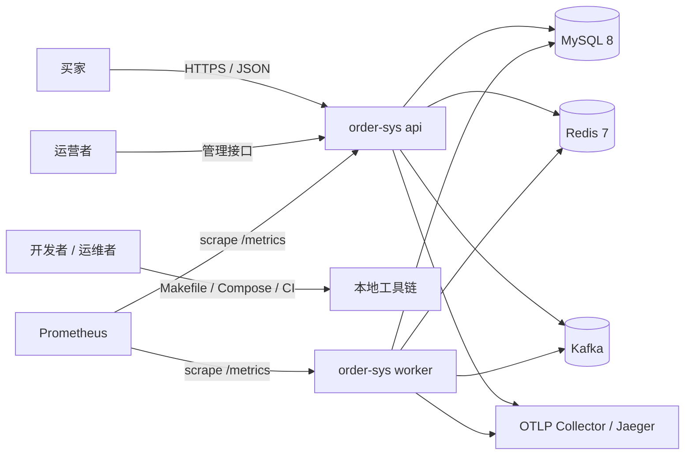
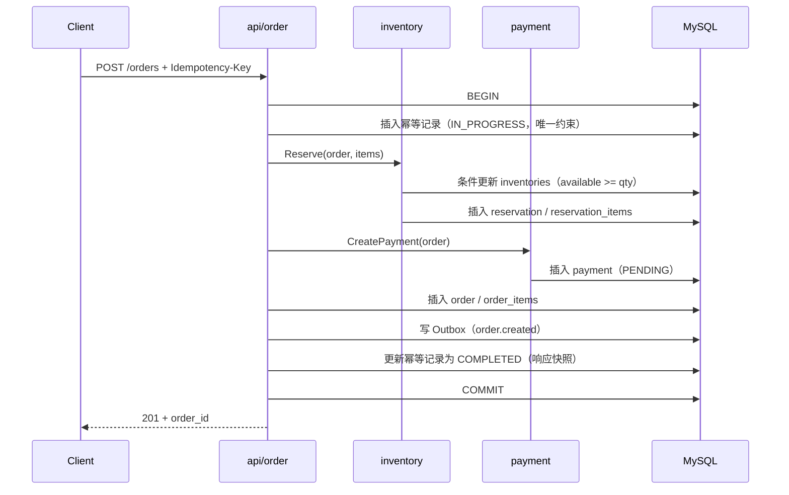
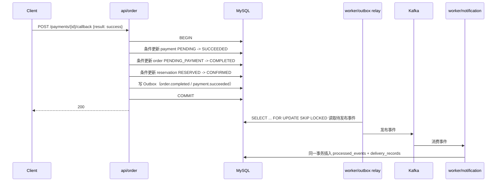
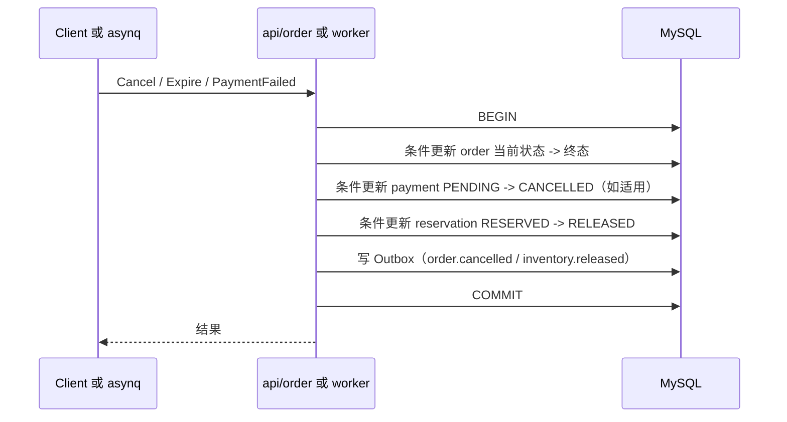
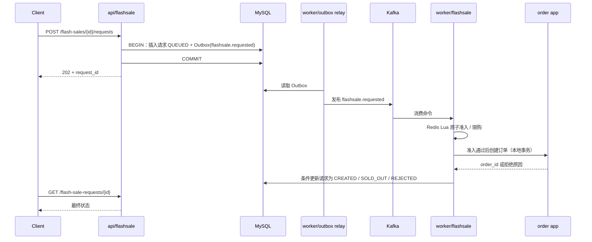
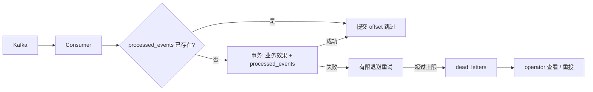
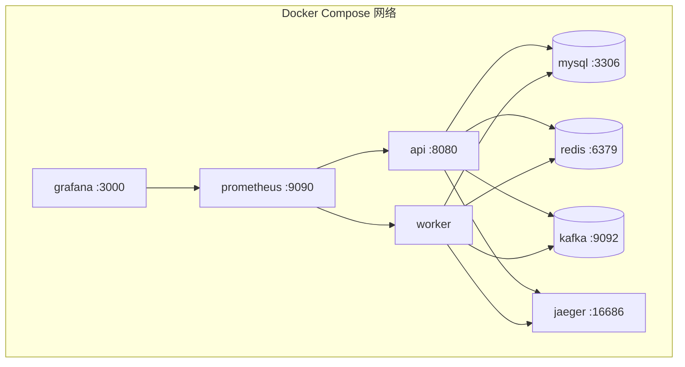

# Go 订单系统：企业级需求规格与交付路线

| 项目 | 内容 |
| --- | --- |
| 文档编号 | REQ-ORDER-SYS-001 |
| 文档版本 | v3.1 |
| 日期 | 2026-10-19 |
| 状态 | 需求基线（技术栈已冻结，可进入设计与实施） |
| 项目名称 | order-sys |
| 代码仓库 | `github.com/vevila2020/order-sys` |
| 适用范围 | 个人能力提升项目，按企业级交付标准组织；后端优先，前端暂不实现 |
| 业务主线 | 电商订单与秒杀；进阶专题：虚拟订单簿与撮合引擎 |
| 技术基线 | 见 §3；全周期冻结，不中途换库 |

## 0. 文档说明

### 0.1 目的

本文档是 `order-sys` 的需求基线，定义项目要交付什么、边界在哪里、如何验收，以及按什么路线交付。设计文档、ADR、里程碑计划和测试用例都从本文档派生；发生冲突时，以本文档为准，直到按 §16 完成正式变更。

### 0.2 读者与用途

- 开发者：据此拆分任务、实现、测试和验收。
- 评审者（自审或 AI 评审）：据此检查实现是否偏离需求、是否满足质量门禁。
- 后续维护者：理解系统为什么这样设计、哪些约束不能突破。
- 模拟买家/运营者：据此执行验收场景。

### 0.3 需求编号与优先级

- `FR-xxx`：功能需求，描述可测试的系统行为。
- `NFR-xxx`：非功能需求，描述质量属性与工程约束。
- `AC-xxx`：端到端验收场景。
- `RISK-xxx`：风险登记项。
- “一期”：M0–M6 必须交付；“进阶”：M7 交付；M8 为结项验收与复盘。
- 所有一期需求均为发布准入条件；进阶需求在 M7 单独验收。

### 0.4 变更记录

| 版本 | 日期 | 变更说明 |
| --- | --- | --- |
| v1.0 | 2026-10-18 | 初始需求与学习路线。 |
| v2.0 | 2026-10-19 | 技术路线定稿；引入 GORM + 显式 SQL 边界。 |
| v3.0 | 2026-10-19 | 按企业级软件需求规格重组；冻结完整第三方库清单，明确全周期不换库；新增 NFR、风险登记册、DoR/DoD、需求追踪矩阵和发布准入清单。 |
| v3.1 | 2026-10-19 | 应用全部企业级补强：架构与核心流程视图、数据字典、审计与数据保留、SLO/错误预算、超时重试与舱壁矩阵、API 示例、配置项清单、ADR 清单、威胁模型与数据分级、备份恢复与演练目录、容量模型、测试数据管理、质量度量、环境矩阵和逐条需求追踪。 |

## 1. 项目定位与目标

### 1.1 背景

构建一个可逐步运行、测试、部署、观测和演进的 Go 订单后端。项目以企业实际交付标准约束每个环节：明确的事务与并发边界、可重复的迁移、可靠异步事件、可观测、可回滚、有测试和文档。每项基础设施都必须解决文档定义的问题，并由自动化测试或可观察的运行结果验证。

本项目是学习用的模拟业务系统：不处理真实资金，不接真实支付渠道，不承诺互联网生产环境的合规性。支付通过测试回调模拟；撮合只使用虚拟资产。

### 1.2 项目目标

1. 交付一条可运行的订单履约主链路：普通下单、库存预占、模拟支付、订单完成或关闭。
2. 交付一条可验证的秒杀链路：原子准入、请求持久化、异步处理、结果查询、库存对账。
3. 用 Outbox、幂等消费、有限重试和死信证明异步可靠性，而不是只把 Kafka 接进来。
4. 用日志、指标、追踪和运行手册证明系统可观测、可运维、可恢复。
5. 用单元、组件、集成、并发、端到端和负载测试证明正确性优先于吞吐。
6. 以模块化单体起步，保持边界清晰；进阶专题实现独立的虚拟订单簿与撮合引擎。

### 1.3 成功标准

- 一期 FR 和 NFR 全部通过 §14 验收。
- 并发与故障测试中不出现超卖、重复订单、重复扣减、部分预占或已接受请求丢失。
- CI 全部门禁通过；核心领域包覆盖率不低于 80%，整体不低于 60%（起步门槛，后续只升不降）。
- 从 `request_id` 或 `order_id` 可以检索 HTTP → 服务 → MySQL/Redis/Kafka → 消费者的完整链路。
- 新克隆的仓库按 README/运行手册即可在本地启动、迁移、跑测试和执行压测。
- 一期 SLI/SLO（§12.6）在固定硬件和固定数据集下达成，错误预算消耗有记录。
- 管理操作全部可审计；数据保留与清理策略可执行、可验证。
- 备份恢复演练和关键故障演练（§12.8）按计划完成并留存证据。
- 撮合引擎在固定与随机命令序列下满足价格时间优先、数量守恒和确定性回放。

### 1.4 范围

#### 一期（M0–M6）

- 可配置、可本地运行的 HTTP API 与 Docker Compose 依赖环境（MySQL、Redis、Kafka）。
- SKU 与库存管理、普通下单、订单查询、取消、模拟支付。
- 订单、库存预占、支付状态机，由领域层强制约束。
- MySQL 持久化与显式事务边界；Redis 用于并发准入、幂等快速判定与缓存；Kafka 用于可靠异步事件；asynq 用于定时与修复任务。
- 事务 Outbox、消费侧幂等、有限退避重试、死信管理、可重复执行的数据库迁移。
- 秒杀活动、原子准入、异步受理、结果查询、库存对账。
- 结构化日志、指标、链路追踪，`request_id` / `order_id` / `event_id` 贯穿全链路。
- CI 质量门禁：格式化、静态检查、单元测试与竞态检测、集成测试、迁移可重复性、镜像构建。
- 单元、组件、集成、并发测试，以及可复现的负载测试与基线报告。
- 管理操作审计、数据保留与清理任务。
- 容器化与运维手册：启动、停止、迁移、备份恢复、排障、死信处理。
- SLI/SLO、错误预算、告警与演练目录。

#### 进阶（M7）

- 虚拟订单簿与撮合引擎：限价单、价格时间优先、部分成交、撤单、命令去重、确定性回放。
- 撮合引擎作为独立模块，保持纯逻辑，不依赖 HTTP、数据库和消息中间件。

#### 明确不做

- 真实支付、真实资金清结算、优惠券、复杂营销、多仓物流。
- 真实证券/加密资产交易或真实买卖盘。
- 一期引入 Kubernetes、服务网格、分布式锁集群、多云部署。
- 前端应用；API 与状态定义需支持未来页面展示。
- 多数据库、分库分表、跨机房、CQRS 读写分离、事件溯源作为主存储。
- 独立进程、独立数据库的通知服务；一期在 `worker` 内实现通知记录消费者，用于验证集成事件、消费幂等、重试和死信，但不拆独立部署单元。
- 互联网生产环境合规性与 SLA 承诺；本项目按企业级方法交付，但运行环境为本地学习环境。

### 1.5 干系人与职责

| 角色 | 职责 | 说明 |
| --- | --- | --- |
| 开发者 | 需求所有者、手写实现、测试、文档、发布 | 唯一人类开发者 |
| AI 助手 | 方案建议、接口约定、测试用例建议、代码评审 | 不直接写入业务实现 |
| 评审者 | 自审 + AI 评审；检查质量门禁与需求追踪 | 通过 PR checklist 执行 |
| 模拟买家/运营者 | 执行验收场景、压测和故障演练 | 本地脚本或手工操作 |

### 1.6 项目约束

- 单仓库、单开发者、按里程碑串行交付；未通过当前里程碑退出标准，不进入下一层。
- 业务代码由开发者本人手写；AI 输出只作为设计、测试和评审输入。
- 支付为模拟流程，不接真实渠道，不处理真实资金。
- 本地开发使用 Docker Compose；CI 使用 testcontainers；生产部署不在本项目范围内，但配置结构保持兼容。
- 仓库中名为 `go-gin-starter` 的脚手架只作为参考模板；合并后统一为项目 module，并遵守本文档的技术基线，不得借模板引入新的框架或替换既定选型。
- 技术栈一次性冻结，禁止中途替换实现库；能力可以按里程碑逐步启用，见 §3。

## 2. 业务场景与用户故事

### 2.1 用户角色

- 买家：浏览 SKU 与活动、提交普通订单或秒杀请求、查看状态、支付模拟订单、在允许的状态下取消订单。
- 运营者：创建和维护 SKU、库存与限量活动，查询订单及失败记录，执行对账与死信重投。
- 开发者/运维者：启动、停止、配置服务，运行测试和迁移，观测请求与异步处理，恢复可重试的失败。

### 2.2 核心用例

| 用例 | 参与者 | 场景 | 期望结果 |
| --- | --- | --- | --- |
| UC-01 | 买家 | 提交普通订单 | 校验商品和数量，防止库存重复扣减，创建待支付订单并返回订单编号。 |
| UC-02 | 买家 | 并发争抢有限活动库存 | 按活动和用户去重，创建订单数不超过活动库存，所有已接受请求都可查询最终结果。 |
| UC-03 | 买家 | 支付模拟订单或支付失败 | 只允许一个终态生效，并据此确认或释放库存。 |
| UC-04 | 买家/系统 | 取消订单或待支付超时 | 合法状态迁移；释放预占最多一次；迟到支付不能重新打开订单。 |
| UC-05 | 客户端 | 重试、消息重复投递、服务重启或消息乱序 | 不创建重复订单、不重复扣减库存；迟到或非法迁移被识别并记录。 |
| UC-06 | 运维者 | 关闭消息代理或消费者后恢复服务 | 积压消息恢复处理；无法处理的消息进入可追踪的死信，不静默丢失。 |
| UC-07 | 运营者 | 库存对账与死信重投 | 发现 MySQL 与 Redis 的计数偏差；安全重建缓存；重投不产生重复业务效果。 |
| UC-08 | 买家 | 向虚拟订单簿提交限价买卖单（进阶） | 按价格优先、同价时间优先撮合，支持部分成交、撤单与确定性回放。 |

## 3. 技术基线（全周期冻结）

### 3.1 冻结原则

1. 本节清单在 M0 冻结，是项目全周期唯一的第三方技术选型。核心库在对应能力的里程碑写入 `go.mod` 并锁定版本（GORM、migrate 在 M1，Redis、Kafka、asynq 在 M3）；一旦写入，只扩大使用范围，不替换、不删除、不回退到自研实现。
2. 里程碑可以“启用能力”，但不能“更换技术品类”。例如 Outbox 表在 M1 建立、relay 在 M3 启用，这是能力启用；不允许 M1 使用内存队列、M3 再换成 Kafka。
3. 版本升级遵循：patch/minor 通过依赖升级 PR 和完整 CI；major 升级必须提交 ADR，说明兼容性、迁移、回滚和验证结果。
4. 允许为新能力新增不与既有库职责重叠的辅助依赖，但必须经过评审并记录在 ADR 中；不得用新增依赖替代本清单中的核心选型。
5. 如果某个库确实不适合，必须走“停线变更”：提交 ADR、影响分析、迁移与回滚方案，更新本文档和变更记录；禁止静默替换。
6. 参考模板 `go-gin-starter` 只提供工程骨架参考，不是技术选型的第二来源。

### 3.2 冻结清单

| 领域 | 选定技术/库 | 模块路径 | 用途与约束 | 首次启用 |
| --- | --- | --- | --- | --- |
| 语言 | Go 1.26.x（当前 1.26.9） | `go.mod` | 以 `go.mod` 为准，跟随官方支持的两个次版本；所有 I/O 传递 `context.Context` | M0 |
| HTTP | Gin | `github.com/gin-gonic/gin` | 路由分组、中间件链、参数绑定与校验；handler 不写业务逻辑 | M0 |
| 配置 | Viper | `github.com/spf13/viper` | YAML 默认值 + 环境变量覆盖 + 启动校验 | M0 |
| 日志 | zap | `go.uber.org/zap` | JSON 结构化日志；字段约定见 FR-028 | M0 |
| 数据库 | MySQL 8 | — | InnoDB、`utf8mb4`、UTC；事务与行锁的权威存储 | M0（Compose）/ M1（表结构） |
| 持久化访问 | GORM + MySQL 驱动 | `gorm.io/gorm`、`gorm.io/driver/mysql` | 常规 CRUD 使用 GORM API；关键交易使用显式 SQL，边界见 §3.4 | M1 |
| 迁移 | golang-migrate | `github.com/golang-migrate/migrate/v4` | 版本化 SQL，前向 + 回滚；禁用 GORM `AutoMigrate` | M1 |
| 缓存/准入 | Redis 7 + go-redis | `github.com/redis/go-redis/v9` | Lua 原子脚本；缓存可重建；Redis 不作为库存正确性的唯一证明 | M3 |
| 业务消息 | Kafka（KRaft，开发单机）+ kafka-go | `github.com/segmentio/kafka-go` | 业务事件主链路；至少一次投递；消费侧幂等；纯 Go、无 CGO | M3 |
| 后台任务 | asynq | `github.com/hibiken/asynq` | 超时关单、对账、死信重投等定时/修复任务；任务本身幂等 | M3 |
| 标识 | google/uuid | `github.com/google/uuid` | 服务端生成全局唯一 ID；优先 UUIDv7 | M0 |
| 认证 | golang-jwt/jwt v5 | `github.com/golang-jwt/jwt/v5` | 本地模拟身份；生产方案不在范围内 | M0 |
| 指标 | Prometheus client_golang | `github.com/prometheus/client_golang` | 业务指标与基础设施指标统一暴露 `/metrics` | M0（骨架）/ M5（完整） |
| 追踪 | OpenTelemetry + OTLP | `go.opentelemetry.io/otel` 及同项目 exporter/instrumentation | HTTP → 服务 → MySQL/Redis/Kafka → 消费者全链路 | M5 |
| 测试 | Go `testing`、`-race`、testcontainers-go | `github.com/testcontainers/testcontainers-go` | 分层测试；单元测试不依赖 Docker | M1 |
| 负载测试 | k6 | 外部工具 | 普通下单与秒杀场景；报告硬件、规模、吞吐、错误率、p95/p99 | M5 |
| 本地环境 | Docker Compose、Makefile | — | 一条命令拉起依赖并执行迁移 | M0 |
| 静态检查 | gofmt、goimports、golangci-lint | 外部工具 | CI 门禁；启用 `govet`、`staticcheck`、`errcheck`、`gosec`、`bodyclose`、`contextcheck`、`sqlclosecheck` | M0 |

**能力启用与换库的区别：**

- Outbox 表从 M1 开始写入；relay 与第一个消费组在 M3 启用（秒杀受理链路），M4 加固可靠性与恢复；事件契约不变。
- Redis 从 M3 开始承担秒杀准入和缓存；M1/M2 的数据库正确性不依赖 Redis。
- Kafka 从 M3 开始承载秒杀命令与集成事件；M1/M2 只写 Outbox，不发布。
- asynq 从 M3 开始用于对账，M4 扩展到超时关单和死信重投。
- 以上均为同一套库的能力逐步启用，不是更换实现。

### 3.3 架构原则

- **模块化单体优先。** 一期一个部署单元内按限界上下文分模块；事件契约稳定后再评估拆分独立服务，不提前引入分布式复杂度。
- **依赖方向由外向内。** `http` → `app` → `domain`；`infra` 实现 `app`/`domain` 定义的端口；`domain` 不 import Gin、GORM、Kafka、Redis 等框架。
- **依赖注入在 `main` 组装。** 业务层不使用包级全局变量；模板中的全局 `database.DB` 不进入新代码。
- **事务边界明确。** 统一通过 `TransactionManager` 抽象；事务内所有操作使用同一 `*gorm.DB`；禁止在事务内调用 Kafka、HTTP 等外部 I/O。
- **事件通过 Outbox。** 业务状态变更与待发布事件在同一数据库事务内落库；外部发布由 relay 完成。
- **模块不直接写对方数据。** 跨模块协作通过应用服务接口或领域事件；数据库表的所有权见 §7.1。
- **Redis 是派生数据。** 缓存、准入计数和幂等快速判定都可以由 MySQL 重建；不能用 Redis 锁证明不超卖。
- **Kafka 至少一次。** 通过 Outbox、消费侧幂等和唯一业务键实现业务效果去重，不宣称端到端“恰好一次”。
- **契约先行。** API、事件、错误码和状态机在实现前固定；破坏性变更走版本化流程。

### 3.4 GORM 与显式 SQL 的强制边界

以下规则适用于每个 PR 的代码评审：

1. 涉及 `SELECT ... FOR UPDATE`、`UPDATE ... WHERE status = ?` 条件迁移、`INSERT ... ON DUPLICATE KEY`、库存/余额增减、批量更新，必须显式写带参数的 SQL（`db.Raw` / `db.Exec`），并附注释说明锁定顺序与并发语义。
2. 金融与库存相关实体（Order、OrderItem、Inventory、Reservation、Payment、Outbox、FlashSale、FlashSaleRequest）禁止使用 GORM `DeletedAt` 软删除；状态由业务字段表达。用户等参考数据可以使用软删除。
3. 事务统一通过 `TransactionManager`（`func(ctx, fn)`）执行；事务内不得调用 Kafka、HTTP、Redis 等外部 I/O；事件通过 Outbox 在事务内落库。
4. 表名、字段名通过显式 `TableName()` 和迁移文件固定，不依赖 GORM 自动复数或命名推断。
5. 禁用 `AutoMigrate`；所有表结构变更必须走迁移文件。
6. 连接池参数、`context` 超时、慢查询阈值统一由配置管理；新增索引必须在 PR 中说明查询场景。
7. GORM API 只用于无字符串拼接的简单 CRUD；任何动态条件必须参数化。

### 3.5 不中途换库的硬性约束

#### 禁止的路线

- 先 `database/sql` 手写全部 SQL，后续再引入 GORM。
- 先使用 GORM，后续再整体替换为 sqlx/ent。
- 先用内存队列或 Redis Stream，后续再换成 Kafka。
- 先单库单表，后续再分库分表。
- 先 Gin，后续再换 Echo/Fiber。
- 先 zap，后续再换 slog 或其他日志库。
- 先自研任务调度，后续再换 asynq。
- 任何“第一阶段先凑合、第二阶段再换正确实现”的技术替换。

#### 允许的变化

- 同一核心库的版本升级（按 §3.1 规则）。
- 新能力的适配层和配置项，例如启用 Kafka relay、增加消费者、增加指标。
- 非核心、无职责重叠的辅助依赖，例如测试工具或代码生成工具，但必须经过评审和 ADR 记录。
- 为未来拆分服务预留接口，但一期不实际拆分。

### 3.6 系统上下文与容器视图

**系统上下文（C4 Level 1）：**



**容器视图（C4 Level 2）：**

| 容器 | 进程 | 职责 | 依赖 | 明确不负责 |
| --- | --- | --- | --- | --- |
| `api` | `cmd/api` | 同步 HTTP 用例、认证、校验、事务编排、Outbox 写入、指标与追踪 | MySQL、Redis、Kafka（仅生产事件） | 长耗时后台任务、事件消费、定时任务 |
| `worker` | `cmd/worker` | Outbox relay、Kafka 消费组、asynq 服务端、秒杀异步处理、通知记录、对账、超时关单 | MySQL、Redis、Kafka | 对外业务 HTTP |
| `mysql` | 容器 | 权威持久化与事务 | — | 缓存、队列、事件传输 |
| `redis` | 容器 | 准入、限流、短期缓存、asynq 队列 | — | 权威数据、正确性证明 |
| `kafka` | 容器 | 事件与命令传输 | — | 事实来源、长期存储 |
| `observability` | 容器 | Prometheus、Grafana、Jaeger（本地） | — | 业务逻辑 |

**同步与异步边界：**

- `api` 内完成：普通下单、支付回调、取消、查询、秒杀受理落库（返回 202）。
- `worker` 内完成：Outbox 发布、秒杀准入与建单、通知记录、超时关单、对账、死信重投。
- 两个进程共享同一套 `internal` 模块和 `TransactionManager`，但连接池、并发度和超时独立配置，避免相互拖垮。

### 3.7 关键流程时序

**普通下单（同步、单事务）：**



任一步失败：事务回滚，不留下订单、预占、支付单或事件。唯一约束和条件更新是并发兜底。

**支付成功（同步终态 + 异步集成事件）：**



**取消 / 支付失败 / 超时关闭（释放最多一次）：**



若订单或预占已处于终态，条件更新影响行数为 0，操作视为幂等 no-op，不重复释放。

**秒杀受理（异步）：**



**事件消费（至少一次 + 去重 + 死信）：**



### 3.8 本地部署视图



- 所有容器通过 Compose 内部 DNS 互相发现；只有 `api`、Grafana、Jaeger 暴露宿主机端口。
- 数据卷：`mysql-data` 是唯一需要备份的卷；Redis 与 Kafka 数据可以重建。
- 迁移以一次性容器或 `make migrate-up` 执行，必须先于 `api` 和 `worker` 启动。

## 4. 领域模型与状态机

### 4.1 模块与数据所有权

| 模块 | 职责 | 拥有的数据 | 发布事件 | 消费事件 |
| --- | --- | --- | --- | --- |
| `order` | 订单创建、查询、取消、完成、关闭；订单级幂等 | Order、OrderItem | `order.created`、`order.completed`、`order.cancelled` | 无（一期同步编排）；拆分服务后消费 `inventory.*`、`payment.*` |
| `inventory` | SKU、权威库存、预占、确认、释放 | SKU、Inventory、Reservation | `inventory.reserved`、`inventory.rejected`、`inventory.confirmed`、`inventory.released` | 无（一期同步编排）；拆分服务后消费 `order.completed`、`order.cancelled`、`payment.failed` |
| `payment` | 模拟支付单创建、回调处理、支付终态 | Payment | `payment.succeeded`、`payment.failed` | 无（一期由订单用例在本地事务内同步创建支付单） |
| `flashsale` | 活动配置、活动库存、限购、请求受理与结果 | FlashSale、FlashSaleRequest | `flashsale.requested`、`flashsale.accepted`、`flashsale.rejected` | 无（worker 作为入站适配器，调用 `flashsale` 应用服务执行准入） |
| `notification` | 订阅集成事件并记录投递结果；消费幂等、重试、死信 | DeliveryRecord | 无 | `order.*`、`inventory.*`、`payment.*` |
| `matching`（进阶） | 虚拟订单簿、撮合、成交记录 | BookOrder、Trade（内存 + 命令日志） | `matching.trade_executed` | 无 |
| `platform` | 配置、日志、数据库、缓存、事件、可观测性、任务 | OutboxEvent、ProcessedEvent、DeadLetter、IdempotencyRecord | 无 | 无 |

模块之间不直接读写对方表。一期是模块化单体：普通下单、支付回调、取消和超时关单由 `order` 应用服务在同一个本地事务内依次调用 `inventory` 和 `payment` 的端口；秒杀准入成功后，worker 通过 `order` 应用服务的下单端口创建订单，同样在本地事务内完成预占和支付单创建。各模块只写自己的表，事务由统一的 `TransactionManager` 保证。这样订单、预占和支付终态要么全部生效、要么全部回滚，不把本可原子完成的工作拆成最终一致。

领域事件用于两类场景：一是**集成事件**，把已提交的业务事实通知给下游（通知、审计、分析、未来的独立服务）；二是**本身就需要异步受理的工作流**，例如秒杀请求从 202 受理到最终结果。事件不承担核心订单状态迁移的正确性；即使事件消费暂时停止，订单主链路仍然确定。拆分独立服务时，同步端口改为显式 API/消息契约，数据所有权不变。

### 4.2 逻辑实体

| 实体 | 所有者 | 关键字段 | 约束 |
| --- | --- | --- | --- |
| SKU | inventory | `sku_id`、名称、整数价格、状态、时间戳、版本 | 价格非负；状态可停用；历史订单不受改价影响 |
| Inventory | inventory | `sku_id`、可售量、活动划拨量、预占量、已售量、版本、更新时间 | 各数量非负；`available + allocated + reserved + sold = total` |
| Order | order | `order_id`、用户、状态、总金额快照、关闭原因、版本、时间 | 状态只能由领域方法迁移；金额为整数最小单位 |
| OrderItem | order | `order_id`、`sku_id`、数量、单价快照、金额 | 数量为正；同一 SKU 行合并或拒绝 |
| Reservation | inventory | `reservation_id`、`order_id`、状态、明细 | 每个订单最多一个有效预占；状态迁移最多一次 |
| Payment | payment | `payment_id`、`order_id`、状态、时间 | 每个订单最多一个有效模拟支付单 |
| FlashSale | flashsale | `sale_id`、`sku_id`、活动库存、开始/结束时间、单用户限购 | 活动库存不得超过 SKU 可分配库存 |
| FlashSaleRequest | flashsale | `request_id`、`sale_id`、`user_id`、数量、状态、阶段时间 | `(sale_id, user_id)` 幂等；最终结果唯一 |
| DeliveryRecord | notification | `delivery_id`、`event_id`、`consumer_group`、`order_id`、事件类型、投递时间 | 与 `ProcessedEvent` 去重一致；只记录，不改变订单状态 |
| AuditLog | platform | `audit_id`、操作者、角色、动作、目标类型/ID、结果、`request_id`、时间 | 只追加，不更新、不删除；管理操作必须写入 |
| OutboxEvent | platform | `event_id`、类型、聚合、负载、状态、创建/发布时间 | 与业务变更同事务写入；至少一次发布 |
| ProcessedEvent | platform | `consumer_group`、`event_id`、处理时间 | 唯一约束保证消费去重 |
| DeadLetter | platform | 原始消息、错误、topic/partition/offset、失败时间、重投状态 | 上下文完整；重投幂等 |
| IdempotencyRecord | platform | `scope`、`user_id`、`key`、请求指纹、响应快照、过期时间 | `(scope, user_id, key)` 唯一 |
| BookOrder / Trade（进阶） | matching | 订单、方向、价格、数量、成交明细 | 数量守恒；同价 FIFO；与电商库存隔离 |

通用约定：金额以整数最小货币单位存储；时间统一 UTC 存储、展示层转换；ID 由服务端生成、全局唯一；不使用浮点数表示金额。

### 4.3 状态机

#### 普通订单

```text
PENDING_PAYMENT -> COMPLETED
PENDING_PAYMENT -> CANCELLED
PENDING_PAYMENT -> PAYMENT_FAILED
PENDING_PAYMENT -> PAYMENT_EXPIRED
```

- `COMPLETED`、`CANCELLED`、`PAYMENT_FAILED`、`PAYMENT_EXPIRED` 为终态，不可再次迁移。
- 库存校验或请求校验失败发生在订单创建前，返回明确错误，不伪造已创建订单。
- `REJECTED` 是秒杀请求结果，不是普通订单终态。
- 状态迁移只能由订单聚合的领域方法执行；handler 和消息反序列化不得直接赋值。
- 取消与支付成功竞争时，只允许符合状态机的一方完成终态迁移；已完成订单不可取消，已关闭订单不能被迟到支付事件重新打开。

#### 库存预占

```text
RESERVED -> CONFIRMED
RESERVED -> RELEASED
```

- 确认与释放必须是条件状态迁移，保证最多执行一次。
- 支付成功本身不能直接扣实库存；库存确认由订单完成用例发起，并以订单域已接受的完成状态为前提。一期在同一本地事务内同步执行，`order.completed` 事件只用于下游集成。
- 取消、支付失败、支付超时触发的释放同样以订单已进入对应终态为前提，并由订单用例在本地事务内发起。

#### 支付

```text
PENDING -> SUCCEEDED
PENDING -> FAILED
PENDING -> CANCELLED
```

- 每个订单最多一个有效支付单。
- 相同结果的重复回调幂等；相反结果不能覆盖已有终态。
- 订单取消或超时后，由订单用例在本地事务内将仍为 `PENDING` 的支付单转为 `CANCELLED`；迟到回调被拒绝并记录。
- `SUCCEEDED`、`FAILED`、`CANCELLED` 为终态，不可再次迁移。

#### 秒杀请求

```text
QUEUED -> CREATED
QUEUED -> SOLD_OUT
QUEUED -> REJECTED
```

- 接口返回“已受理”只代表请求已可靠进入处理链路，不代表抢购成功。
- 客户端凭 `request_id` 查询最终结果；相同 `sale_id`、`user_id` 的重复请求返回同一结果。

#### 虚拟订单簿（进阶）

```text
OPEN -> PARTIALLY_FILLED -> FILLED
OPEN / PARTIALLY_FILLED -> CANCELLED
OPEN -> REJECTED
```

- 成交量、剩余量与成交记录守恒；同价 FIFO；与电商库存和支付状态隔离。

### 4.5 数据字典

以下为逻辑数据字典，物理类型以迁移文件为准。所有表使用 `BIGINT UNSIGNED` 自增主键或 `CHAR(36)` UUID 作为业务主键，统一 `utf8mb4_0900_ai_ci`，时间列为 `DATETIME(6)` 且存 UTC。

**`skus`（所有者 inventory）**

| 列 | 类型 | 约束 | 说明 |
| --- | --- | --- | --- |
| `id` | BIGINT UNSIGNED | PK, AUTO_INCREMENT | 物理主键 |
| `sku_id` | CHAR(36) | UNIQUE, NOT NULL | 业务 ID |
| `name` | VARCHAR(200) | NOT NULL | 商品名称 |
| `price_cents` | BIGINT UNSIGNED | NOT NULL, >= 0 | 整数最小货币单位 |
| `status` | VARCHAR(20) | NOT NULL | `ACTIVE` / `INACTIVE` |
| `version` | BIGINT UNSIGNED | NOT NULL, DEFAULT 0 | 乐观锁 |
| `created_at` / `updated_at` | DATETIME(6) | NOT NULL | UTC |
| `deleted_at` | DATETIME(6) | NULL | 仅参考数据允许软删除 |

索引：`uk_skus_sku_id (sku_id)`；`idx_skus_status (status)`。

**`inventories`（所有者 inventory）**

| 列 | 类型 | 约束 | 说明 |
| --- | --- | --- | --- |
| `id` | BIGINT UNSIGNED | PK | |
| `sku_id` | CHAR(36) | UNIQUE, NOT NULL | 与 skus 一一对应 |
| `total` | BIGINT UNSIGNED | NOT NULL | 权威总量 |
| `available` | BIGINT UNSIGNED | NOT NULL | 普通订单可售量 |
| `allocated` | BIGINT UNSIGNED | NOT NULL | 已划拨给活动、尚未被活动订单消耗的额度 |
| `reserved` | BIGINT UNSIGNED | NOT NULL | 普通与活动订单的预占量 |
| `sold` | BIGINT UNSIGNED | NOT NULL | 已确认销量 |
| `version` | BIGINT UNSIGNED | NOT NULL | 乐观锁 / 审计 |
| `updated_at` | DATETIME(6) | NOT NULL | |
| 约束 | CHECK | `available + allocated + reserved + sold = total`，各列非负 | 迁移与条件更新共同保证 |

索引：`uk_inventories_sku_id (sku_id)`。核心条件更新：

- 普通下单预占：`UPDATE inventories SET available = available - ?, reserved = reserved + ?, version = version + 1 WHERE sku_id = ? AND available >= ? AND version = ?`。
- 创建活动划拨额度：`UPDATE inventories SET available = available - ?, allocated = allocated + ?, version = version + 1 WHERE sku_id = ? AND available >= ? AND version = ?`。
- 活动订单预占：`UPDATE inventories SET allocated = allocated - ?, reserved = reserved + ?, version = version + 1 WHERE sku_id = ? AND allocated >= ? AND version = ?`。
- 活动结束退回未用额度：`UPDATE inventories SET allocated = allocated - ?, available = available + ?, version = version + 1 WHERE sku_id = ? AND allocated >= ? AND version = ?`。
- 确认预占：`reserved - ?, sold + ?`；释放预占：`reserved - ?`，普通订单回 `available`，活动订单回 `allocated`。
- 所有更新必须校验影响行数为 1，并在同一事务内完成相关订单、预占和支付变更。

**`orders`（所有者 order）**

| 列 | 类型 | 约束 | 说明 |
| --- | --- | --- | --- |
| `id` | BIGINT UNSIGNED | PK | |
| `order_id` | CHAR(36) | UNIQUE, NOT NULL | 业务 ID |
| `user_id` | VARCHAR(64) | NOT NULL | 来自 JWT `sub` |
| `status` | VARCHAR(32) | NOT NULL | 见 §4.3 |
| `total_cents` | BIGINT UNSIGNED | NOT NULL | 金额快照 |
| `currency` | CHAR(3) | NOT NULL | 一期固定 `CNY` |
| `close_reason` | VARCHAR(64) | NULL | 终态原因 |
| `version` | BIGINT UNSIGNED | NOT NULL | 条件迁移辅助 |
| `created_at` / `updated_at` | DATETIME(6) | NOT NULL | |

索引：`uk_orders_order_id (order_id)`；`idx_orders_user_created (user_id, created_at DESC)`；`idx_orders_status_updated (status, updated_at)`（超时扫描）。

**`order_items`（所有者 order）**

| 列 | 类型 | 约束 | 说明 |
| --- | --- | --- | --- |
| `id` | BIGINT UNSIGNED | PK | |
| `order_id` | CHAR(36) | NOT NULL | 关联 orders.order_id |
| `sku_id` | CHAR(36) | NOT NULL | |
| `quantity` | INT UNSIGNED | NOT NULL, > 0 | |
| `unit_price_cents` | BIGINT UNSIGNED | NOT NULL | 下单快照 |
| `amount_cents` | BIGINT UNSIGNED | NOT NULL | `quantity * unit_price_cents` |

索引：`idx_order_items_order_id (order_id)`；唯一约束 `uk_order_items_order_sku (order_id, sku_id)` 防止重复行。

**`reservations` / `reservation_items`（所有者 inventory）**

| 列 | 类型 | 约束 | 说明 |
| --- | --- | --- | --- |
| `reservation_id` | CHAR(36) | UNIQUE, NOT NULL | |
| `order_id` | CHAR(36) | UNIQUE, NOT NULL | 每单最多一个有效预占 |
| `status` | VARCHAR(20) | NOT NULL | `RESERVED` / `CONFIRMED` / `RELEASED` |
| `created_at` / `updated_at` | DATETIME(6) | NOT NULL | |
| 明细 `sku_id` / `quantity` | — | 与订单明细一致 | |

**`payments`（所有者 payment）**

| 列 | 类型 | 约束 | 说明 |
| --- | --- | --- | --- |
| `payment_id` | CHAR(36) | UNIQUE, NOT NULL | |
| `order_id` | CHAR(36) | UNIQUE, NOT NULL | 每单最多一个有效支付单 |
| `amount_cents` | BIGINT UNSIGNED | NOT NULL | 与订单总额一致 |
| `status` | VARCHAR(20) | NOT NULL | `PENDING` / `SUCCEEDED` / `FAILED` / `CANCELLED` |
| `provider_ref` | VARCHAR(128) | NULL | 模拟回调参考号 |
| `created_at` / `updated_at` / `finished_at` | DATETIME(6) | | |

**`flash_sales` / `flash_sale_requests`（所有者 flashsale）**

| 列 | 类型 | 约束 | 说明 |
| --- | --- | --- | --- |
| `sale_id` | CHAR(36) | UNIQUE | |
| `sku_id` | CHAR(36) | NOT NULL | |
| `quota` | INT UNSIGNED | NOT NULL, > 0 | 从 SKU 总量划拨 |
| `per_user_limit` | INT UNSIGNED | NOT NULL, >= 1 | |
| `starts_at` / `ends_at` | DATETIME(6) | NOT NULL | `starts_at < ends_at` |
| `request_id` | CHAR(36) | UNIQUE | |
| `sale_id` + `user_id` | — | UNIQUE | 幂等 |
| `status` | VARCHAR(20) | NOT NULL | `QUEUED` / `CREATED` / `SOLD_OUT` / `REJECTED` |
| `order_id` | CHAR(36) | NULL | 成功时填写 |
| `queued_at` / `admitted_at` / `persisted_at` / `finished_at` | DATETIME(6) | NULL | 阶段时间 |

索引：`uk_flash_sale_requests_sale_user (sale_id, user_id)`；`uk_flash_sale_requests_request_id (request_id)`；`idx_flash_sale_requests_status_queued (status, queued_at)`。

**`outbox_events`（所有者 platform）**

| 列 | 类型 | 约束 | 说明 |
| --- | --- | --- | --- |
| `id` | BIGINT UNSIGNED | PK, AUTO_INCREMENT | 发布顺序 |
| `event_id` | CHAR(36) | UNIQUE | 事件 ID |
| `event_type` | VARCHAR(100) | NOT NULL | |
| `aggregate_type` / `aggregate_id` | VARCHAR | NOT NULL | |
| `payload` | JSON | NOT NULL | 含 `schema_version` |
| `status` | VARCHAR(20) | NOT NULL | `PENDING` / `PUBLISHED` / `FAILED` |
| `attempts` | INT UNSIGNED | NOT NULL, DEFAULT 0 | |
| `available_at` | DATETIME(6) | NOT NULL | 退避调度 |
| `created_at` / `published_at` | DATETIME(6) | | |

索引：`idx_outbox_pending (status, available_at, id)`；relay 使用 `FOR UPDATE SKIP LOCKED` 批量取件。

**`processed_events`（所有者 platform）**

| 列 | 类型 | 约束 | 说明 |
| --- | --- | --- | --- |
| `consumer_group` | VARCHAR(100) | 联合 PK | |
| `event_id` | CHAR(36) | 联合 PK | |
| `processed_at` | DATETIME(6) | NOT NULL | |

**`dead_letters`（所有者 platform）**

| 列 | 类型 | 约束 | 说明 |
| --- | --- | --- | --- |
| `id` | BIGINT UNSIGNED | PK | |
| `event_id` | CHAR(36) | NOT NULL | |
| `consumer_group` / `topic` / `partition` / `offset` | — | NOT NULL | 来源定位 |
| `payload` | JSON | NOT NULL | 原始消息 |
| `error` | TEXT | NOT NULL | 失败原因 |
| `failed_at` | DATETIME(6) | NOT NULL | |
| `replay_status` | VARCHAR(20) | NOT NULL | `PENDING` / `REPLAYED` / `FAILED` |
| `replayed_at` / `replayed_by` | — | NULL | 审计 |

**`idempotency_records`（所有者 platform，按 scope）**

| 列 | 类型 | 约束 | 说明 |
| --- | --- | --- | --- |
| `scope` | VARCHAR(50) | 联合唯一 | 如 `order.create` |
| `user_id` | VARCHAR(64) | 联合唯一 | 按用户隔离 |
| `key` | VARCHAR(128) | 联合唯一 | 请求头值 |
| `request_hash` | CHAR(64) | NOT NULL | 请求体指纹 |
| `status` | VARCHAR(20) | NOT NULL | `IN_PROGRESS` / `COMPLETED` |
| `response_snapshot` | JSON | NULL | 首次结果 |
| `expires_at` | DATETIME(6) | NOT NULL | 保留期 |

索引：`uk_idempotency (scope, user_id, key)`；`idx_idempotency_expires (expires_at)` 供清理任务。

**`delivery_records`（所有者 notification）**

| 列 | 类型 | 约束 | 说明 |
| --- | --- | --- | --- |
| `delivery_id` | CHAR(36) | UNIQUE | |
| `event_id` | CHAR(36) | NOT NULL | |
| `consumer_group` | VARCHAR(100) | NOT NULL | |
| `order_id` | CHAR(36) | NULL | 可检索 |
| `event_type` | VARCHAR(100) | NOT NULL | |
| `delivered_at` | DATETIME(6) | NOT NULL | |

**`audit_logs`（所有者 platform，只追加）**

| 列 | 类型 | 约束 | 说明 |
| --- | --- | --- | --- |
| `audit_id` | CHAR(36) | UNIQUE | |
| `actor_id` / `actor_role` | VARCHAR | NOT NULL | 操作者 |
| `action` | VARCHAR(100) | NOT NULL | 如 `dead_letter.replay` |
| `target_type` / `target_id` | VARCHAR | NOT NULL | 目标 |
| `result` | VARCHAR(20) | NOT NULL | `SUCCESS` / `FAILED` |
| `request_id` / `trace_id` | VARCHAR | NULL | 关联 |
| `detail` | JSON | NULL | 不含敏感信息 |
| `created_at` | DATETIME(6) | NOT NULL | |

索引：`idx_audit_created (created_at DESC)`；`idx_audit_actor (actor_id, created_at DESC)`；`idx_audit_target (target_type, target_id)`。

跨表规则：金额列一律 `BIGINT UNSIGNED`；状态列使用受控字符串并由迁移 CHECK 或应用枚举约束；禁止级联删除业务表；表间关联使用业务 ID 而非物理主键；任何新增列默认可空并通过扩展/收缩迁移转为非空。


- **下单校验：** 至少一个 SKU 和正整数数量；重复 SKU 行必须合并或按契约拒绝，不得因重复行绕过库存校验。
- **原子预占：** 多 SKU 下单必须全单原子化；任一 SKU 不足时全部不扣减，不留下半成品订单。
- **幂等：** 同一幂等键 + 相同请求体重复提交返回同一订单；同键不同请求体返回冲突。幂等键按用户隔离。
- **价格快照：** 订单明细使用下单时的价格快照；后续 SKU 改价不影响已有订单。
- **支付终态：** 每个订单只有一次有效支付终态；成功支付后订单完成并确认预占；失败、取消或超时后关闭订单并释放尚未确认的预占。
- **释放最多一次：** 取消、支付失败、支付超时和重复任务竞争时，库存释放最多执行一次。
- **秒杀名额：** 活动名额从 SKU 总库存中分配且不重复计入普通可售量；所有有效占用（活动 + 普通订单，含预占）不得超过 SKU 权威库存。
- **秒杀限购：** 同一活动、同一用户最多一个有效请求和一个有效订单，请求数量不得超过单用户限购；并发重复请求返回同一结果。
- **撮合守恒：** 一笔订单可与多笔对手单部分成交；成交量、剩余量、簿数量和成交记录必须一致。

## 5. 功能需求

### 5.1 商品、库存与订单

| ID | 需求 | 验收标准 |
| --- | --- | --- |
| FR-001 | 创建、读取、更新 SKU 基础信息及初始可售库存；库存不得为负。 | 创建后可按 ID 查询；初始库存小于 0 返回 `VALIDATION_FAILED`；更新不影响历史订单价格快照。 |
| FR-002 | 普通下单接口校验用户、SKU、数量、请求格式，返回订单编号、状态和明细。 | 非法用户/SKU/数量返回明确错误；成功返回 201、`order_id` 和 `PENDING_PAYMENT`。 |
| FR-003 | 普通下单支持幂等键：首次和同键重试最多创建一个订单、一次预占；键由请求头提供，按用户隔离。 | 同键同体且已完成返回同一 `order_id`（200）；首次仍在处理返回 409 `IDEMPOTENCY_IN_PROGRESS`；同键异体返回 409 `IDEMPOTENCY_CONFLICT`；不同用户同键互不影响。 |
| FR-004 | 按订单编号查询状态、明细、金额快照、关闭原因和创建时间。 | 不存在返回 404；金额与下单快照一致；已创建支付时返回 `payment_id` 与 `payment_status`。 |
| FR-005 | 仅允许可取消状态的订单取消；重复取消返回稳定结果；终态冲突返回可识别的冲突错误。 | `PENDING_PAYMENT` 取消成功；已完成订单取消返回 409 `INVALID_STATE_TRANSITION`；释放最多一次。 |
| FR-006 | 模拟支付成功/失败回调；重复相同回调不重复产生领域结果；相反结果不能覆盖已有终态。 | 首次成功使订单 `COMPLETED`；重复成功返回 200 且无副作用；成功后失败回调返回 409。 |
| FR-007 | 价格以整数最小货币单位存储；订单明细使用下单时快照，后续 SKU 改价不影响已有订单。 | 改价后历史订单金额不变；全链路无浮点金额。 |
| FR-008 | 库存预占全单原子化：任一 SKU 不足时全部不扣减。 | 多 SKU 中一行不足时，所有库存与预占保持原值。 |
| FR-009 | 待支付订单超时关闭并释放预占；超时任务重复执行（asynq 重试、多实例并发）不得重复释放。 | 超时后订单为 `PAYMENT_EXPIRED`；并发执行任务只释放一次；迟到支付被拒绝。 |

### 5.2 秒杀与并发

| ID | 需求 | 验收标准 |
| --- | --- | --- |
| FR-010 | 运营者创建限量活动：SKU、活动库存、开始/结束时间、单用户限购。 | 非法时间、库存或限购返回 `VALIDATION_FAILED`；活动库存不得超过 SKU 可分配库存。 |
| FR-011 | 未开始、已结束、无剩余名额、超出限购时返回明确结果，不生成成功订单。 | 各状态返回稳定错误码或可查询的拒绝结果；成功订单数为 0。 |
| FR-012 | 提交接口先持久化 `request_id`、`QUEUED` 与 Outbox 命令（同一事务），提交成功后才返回 202；可查询 `QUEUED` / `CREATED` / `SOLD_OUT` / `REJECTED`；重试只产生一个最终结果。 | 202 仅在事务提交后返回；重复提交返回同一 `request_id`；最终状态可查询。 |
| FR-013 | 同一活动、同一用户的并发重复请求最多产生一个有效请求和一个有效订单；请求数量不得超过单用户限购。 | 并发测试成功订单数不超限购；重复请求返回同一 `request_id`，不重复扣减。 |
| FR-014 | 活动名额从 SKU 总库存中分配且不重复计入普通可售量；所有有效占用（活动 + 普通订单，含预占）不得超过 SKU 权威库存。 | 活动与普通订单预占总和不超过权威库存；对账无负库存。 |
| FR-015 | 记录排队、准入、持久化、完成时间，可计算排队时长、成功率、拒绝原因和库存差异。 | 查询结果包含阶段时间；指标和报表可核对。 |
| FR-016 | Redis 或 Kafka 不可用时不返回虚假成功；普通下单与秒杀的降级策略须可区分、可测试。 | Redis 故障时秒杀返回 503 且不落成功请求；Kafka 故障时请求可成功但 Outbox 积压；故障测试覆盖。 |

### 5.3 事件、可靠性与恢复

| ID | 需求 | 验收标准 |
| --- | --- | --- |
| FR-017 | 业务状态变更与其待发布事件在同一数据库事务内提交（Outbox）。 | 事务回滚时无事件；提交后 relay 可读取；不存在状态已变但事件丢失。 |
| FR-018 | 消费端按事件 ID 去重；去重记录与业务更新在同一事务，或采用等价原子方式。 | 同一事件重复消费只产生一次业务效果。 |
| FR-019 | 事件携带稳定 `event_id`、`event_type`、`aggregate_id`、`occurred_at`、`version` 与带 schema 版本的负载；同一聚合的事件顺序可解释。 | 契约测试校验字段；缺失或非法事件进入死信。 |
| FR-020 | 消费失败执行有限退避重试；最终失败保留原始消息、错误原因、来源 topic/partition/offset 和失败时间。 | 重试次数有上限；死信记录上下文完整；告警指标可见。 |
| FR-021 | 死信支持人工查看与安全重投；重复重投不重复扣库存、不重复建支付单、不重复通知。 | 管理接口可列出并重投；重投两次只产生一次效果；操作有审计记录。 |
| FR-022 | 服务重启后，未发布的 Outbox、未确认消费和待恢复任务继续处理。 | `kill -9` 后重启，积压自动追平；已接受请求不丢失。 |
| FR-023 | 提供库存对账任务（asynq 定时）比较 MySQL 权威库存与 Redis 活动计数，能安全重建可重建的缓存。 | 人为制造偏差可被发现；重建后计数一致；任务重复执行幂等。 |

### 5.4 接口、可观测性与运维

| ID | 需求 | 验收标准 |
| --- | --- | --- |
| FR-024 | 统一响应：错误码、可读信息、`request_id`；参数错误、未授权、不存在、冲突、依赖故障可区分。用户身份来自认证上下文。 | 所有错误符合统一结构；用户 ID 不取自请求体；错误码稳定。 |
| FR-025 | `/health/live` 只检查进程；`/health/ready` 检查依赖就绪；短暂依赖故障不得导致重启风暴。 | API：MySQL 断开时 ready 失败；Redis/Kafka 断开时 ready 仍可用但标记 `degraded`；worker：任一关键依赖断开则 ready 失败；live 始终只反映进程。 |
| FR-026 | 监听地址、数据库、Redis、Kafka、asynq、日志级别、OTLP 端点等全部支持环境变量覆盖；生产密钥不入库。 | 启动时配置校验；仓库无明文密钥；示例配置可运行。 |
| FR-027 | 请求超时、取消传递、连接池上限、有限并发；关机时停止接流量并完成在途请求（宽限期可配置）。 | 超时返回明确错误；SIGTERM 后停止接收新请求并完成在途请求；宽限期可配置。 |
| FR-028 | 日志包含 `service_name`、`env`、`version`、`request_id`、`trace_id`、`span_id`、`order_id`/`event_id` 等关联标识与错误上下文；不记录密钥、密码或完整 DSN。 | 日志可按关联 ID 检索；敏感字段扫描无命中。 |
| FR-029 | 迁移、启动、停止可由 Compose 在空环境重复执行；禁止手工逐条改库。 | 空数据卷 `docker compose up` 成功；迁移可重复执行；CI 验证。 |
| FR-037 | 暴露 Prometheus 指标：HTTP 请求量/延迟/错误、订单各终态计数、秒杀受理与结果、库存不一致数、Outbox 积压与发布延迟、消费失败与死信数、asynq 任务成败、Kafka 消费 lag。 | `/metrics` 可抓取；面板能区分成功、售罄、失败和积压。 |
| FR-038 | 追踪覆盖 HTTP 入口、数据库、Redis、Kafka 生产与消费；日志自动携带 `trace_id`，可从 `request_id` 或 `order_id` 检索完整链路。 | 端到端测试中入口到消费者共享同一 trace；日志包含 `trace_id`。 |
| FR-039 | 所有管理操作（死信查看/重投、库存对账、SKU 状态变更、活动创建/停用）写入只追加的审计记录，包含操作者、角色、动作、目标、结果、`request_id`/`trace_id` 和时间。 | 每类管理操作至少一条审计记录；记录不可更新或删除；审计查询可按操作者、目标和时间过滤。 |
| FR-040 | 数据保留与清理：幂等记录、已发布 Outbox、已处理事件、死信、投递记录和审计记录各有可配置保留期；清理任务幂等、有指标、不删除未发布事件和未处理死信。 | 过期数据按配置清理；未发布/未处理数据不被误删；清理任务重复执行结果一致。 |

### 5.5 虚拟订单簿与撮合（进阶）

| ID | 需求 | 验收标准 |
| --- | --- | --- |
| FR-030 | 限价买卖单与撤单：校验正数量、有效价格、虚拟账户额度。 | 非法输入和额度不足被拒绝；订单簿状态不变。 |
| FR-031 | 买盘价格降序、卖盘价格升序；同价按时间先后。 | 固定用例验证价格优先和同价 FIFO。 |
| FR-032 | 一笔订单可与多笔对手单部分成交；成交量、剩余量、簿数量、成交记录相互一致。 | 守恒断言通过；随机用例通过。 |
| FR-033 | 撮合命令有唯一命令 ID；重放相同命令不重复成交。 | 同一 `command_id` 重复摄取只成交一次。 |
| FR-034 | 相同初始快照 + 相同有序命令日志，重放后订单状态、订单簿、成交序列逐字段一致。 | 确定性回放测试通过。 |
| FR-035 | 撤单与撮合并发时，同一剩余量不得同时被撤销与成交；由撮合引擎串行化规则决定。 | 并发测试无双重处理。 |
| FR-036 | 撮合引擎为纯逻辑，不依赖 HTTP、DB、Kafka，可独立单测；持久化与事件发布为后续适配层。 | 单测无 Docker 和外部依赖。 |

## 6. 非功能需求

| ID | 类别 | 要求 | 验证方式 |
| --- | --- | --- | --- |
| NFR-001 | 性能 | 普通下单建立 100 并发场景；秒杀建立 1,000 并发抢 100 名额场景；报告成功/失败数、错误率、吞吐、p95/p99；固定硬件、数据集和稳态时长；未声明硬件不判定绝对 TPS。 | k6 报告归档；同一场景前后对比。 |
| NFR-002 | 资源边界 | 所有队列、goroutine、重试、批次和连接池都有容量或时限边界；具备背压和超时；不允许无限增长。 | 代码评审 + 压测 + 故障测试。 |
| NFR-003 | 可用性与恢复 | 已接受请求不丢失；崩溃或重启后可恢复；依赖故障可降级；优雅退出。 | `kill -9`、依赖停机、SIGTERM 演练。 |
| NFR-004 | 数据一致性 | 不超卖、不重复建单、不部分预占、不重复扣减；订单、预占、支付状态迁移唯一。 | 并发、重放、故障测试。 |
| NFR-005 | 安全 | 密钥仅环境变量；JWT 身份；输入校验、请求体上限、限流；SQL 参数化；日志无敏感信息；依赖与镜像扫描。 | 安全评审 + CI 扫描 + 负向测试。 |
| NFR-006 | 可观测性 | 日志、指标、追踪覆盖关键路径；`request_id` / `order_id` / `event_id` 可关联；告警规则可执行。 | 端到端 trace + 面板/告警演练。 |
| NFR-007 | 可维护性 | 模块边界清晰、无循环依赖；`domain` 不依赖框架；覆盖率门槛；lint 零告警；关键决策有 ADR。 | CI + 架构评审。 |
| NFR-008 | 可测试性 | 单元测试不依赖 Docker；集成测试通过 build tag 隔离；并发测试可重复；无长期 flaky 测试。 | CI 分层执行；flaky 记录与修复。 |
| NFR-009 | 可部署性 | 一条命令拉起本地依赖；容器以非 root 运行；12-factor 配置；迁移可重复。 | 空环境 Compose + 镜像检查。 |
| NFR-010 | 兼容与变更 | API v1 兼容；事件 schema 版本化；数据库采用扩展/收缩迁移；镜像可回滚。 | 契约测试 + 迁移/回滚演练。 |
| NFR-011 | 数据保留与隐私 | 不使用真实个人信息；日志和死信保留期可配置；清理任务可审计。 | 配置检查 + 清理任务测试。 |
| NFR-012 | 可操作性 | 启动、停止、迁移、备份恢复、死信处理、对账和压测均有运行手册。 | 新环境按手册演练。 |
| NFR-013 | 可演进性 | 模块化单体；撮合模块隔离；事件和 API 契约稳定后可拆分服务。 | 架构评审 + 依赖检查。 |
| NFR-014 | 文档完整性 | 需求、ADR、API 契约、运行手册和变更记录与代码同步。 | DoD 检查。 |
| NFR-015 | 审计与可追溯 | 管理操作只追加审计；业务状态迁移有日志与事件；可从任意终态追溯到触发者、请求和链路。 | 审计查询 + 端到端追溯测试。 |
| NFR-016 | 服务目标 | 一期在固定硬件与数据集下满足 §12.6 的 SLI/SLO；错误预算消耗有记录；不承诺生产 SLA。 | 压测与稳态观测报告。 |
| NFR-017 | 超时、重试与隔离 | 所有外部调用有超时、有限重试和退避；重试只用于幂等操作；关键依赖之间有舱壁隔离，单依赖变慢不拖垮全部请求。 | 代码评审 + 故障注入 + 超时测试。 |
| NFR-018 | 容量可解释 | 连接池、并发度、队列深度、Kafka 分区数和批次大小有容量模型（§12.7），并与压测结果一致。 | 容量评审 + 压测对比。 |

## 7. 数据、一致性与故障预算

### 7.1 事实来源与数据所有权

| 数据 | 事实来源 | 所有者 | 派生/缓存 |
| --- | --- | --- | --- |
| Order / OrderItem | MySQL | `order` | 可选短期缓存；不作为正确性依据 |
| SKU / Inventory / Reservation | MySQL | `inventory` | Redis 可售计数、准入计数 |
| Payment | MySQL | `payment` | 无 |
| FlashSale / FlashSaleRequest | MySQL | `flashsale` | Redis 活动计数、用户限购计数 |
| DeliveryRecord | MySQL | `notification` | 无 |
| AuditLog | MySQL | `platform` | 无；只追加 |
| Outbox / ProcessedEvent / DeadLetter | MySQL | `platform` | 无 |
| IdempotencyRecord | MySQL | `platform`（按模块 scope） | Redis 快速判定（可选） |
| BookOrder / Trade（进阶） | 内存 + 命令日志 | `matching` | 无 |
| Kafka | 传输通道 | — | 不作为事实来源 |

### 7.2 一致性原则

- MySQL 是请求、订单、支付、预占终态和权威库存的持久事实来源。秒杀只有在请求与 Outbox 同事务提交后才返回 202。
- Redis 用于原子准入、幂等快速判定、短期缓存和限流；重试必须取回原准入结果；缓存可由权威数据重建。分布式锁不是不超卖的正确性证明。
- Kafka 为至少一次投递；通过 Outbox、幂等消费者和唯一业务键实现业务效果去重，不宣称端到端“恰好一次”。
- 同一数据库内、可在单事务原子完成的核心生命周期使用本地事务，不为了“看起来分布式”而拆成最终一致；无法放入单事务的异步工作流（秒杀受理、下游通知、未来的服务拆分）使用可观测的 Saga/补偿；各模块不得直接写对方数据。
- 所有状态变更需处理重复、乱序、竞争、进程崩溃与重启；无法安全处理的事件进入死信并产生告警指标。
- 异步结果必须可查询；最终一致性的窗口通过指标和阶段时间可观测。

### 7.3 事务与并发规则

- 所有事务通过 `TransactionManager` 执行；事务内使用同一 `*gorm.DB` 实例。
- 关键库存和状态迁移使用条件更新或行锁；在 PR 中说明隔离级别、锁定顺序和死锁处理。
- 多行加锁按稳定顺序（如 SKU ID 排序）执行，减少死锁；死锁可做有限次重试，重试仍失败返回可识别错误。
- 幂等键、唯一业务键和状态迁移条件必须由数据库唯一约束或条件更新兜底，不能只依赖应用层判断。
- 禁止在事务内持有锁调用 Kafka、HTTP、Redis 等外部 I/O。
- 批量操作、重试次数、并发度和超时都必须有上限。
- 连接池大小、慢查询阈值、事务超时由配置管理。

### 7.4 幂等与去重矩阵

| 操作 | 幂等键/唯一键 | 作用域 | 机制 | 重复行为 |
| --- | --- | --- | --- | --- |
| 普通下单 | `Idempotency-Key` | 用户 | `IdempotencyRecord` 唯一约束 + 响应快照 | 返回同一订单；不同请求体返回 409 |
| 秒杀提交 | `(sale_id, user_id)` | 活动 + 用户 | `FlashSaleRequest` 唯一约束 | 返回同一 `request_id` 和最终结果 |
| 支付回调 | `payment_id` + 目标终态 | 支付单 | 条件更新 | 相同结果幂等；相反结果 409 |
| 事件消费 | `(consumer_group, event_id)` | 消费组 | `ProcessedEvent` 唯一约束 | 跳过重复事件，不重复产生业务效果 |
| Outbox 发布 | `event_id` | 主题 | 至少一次发布 + 消费去重 | 允许重复发布，不允许重复业务效果 |
| 超时关单 | `order_id` + 当前状态 | 订单 | 条件更新 | 已终态则 no-op，不重复释放 |
| 死信重投 | 原始 `event_id` | 消费组 | `ProcessedEvent` 去重 | 重复重投不重复扣减/建单/通知 |
| 撮合命令 | `command_id` | 引擎实例/命令日志 | 命令去重表或有序日志 | 同一命令只成交一次 |

### 7.5 故障预算

| 故障 | 期望行为 | 验证方式 |
| --- | --- | --- |
| Redis 不可用 | 秒杀返回 503 且不落成功请求；普通下单继续，但准入缓存降级为数据库校验 | 集成测试关闭 Redis |
| Kafka 不可用 | 业务请求仍成功，Outbox 积压并产生指标；恢复后自动追平 | 暂停 broker 测试 |
| DB 提交后进程崩溃 | 重启后 Outbox 续发、秒杀请求可查询最终结果 | `kill -9` 测试 |
| DB 提交前进程崩溃 | 不返回虚假成功；客户端用同一幂等键/请求 ID 重试后得到唯一结果 | 提交前中止进程测试 |
| 消费者重复或乱序 | 幂等消费；迟到事件记录为忽略而非错误终态 | 重放测试 |
| 任务重复执行 | asynq 重试与多实例不造成重复释放/重复扣减 | 并发任务测试 |
| MySQL 不可用 | readiness 失败；请求不返回虚假成功；恢复后可继续 | 停库测试 |
| 死信重投 | 重投幂等；上下文和审计记录完整 | 重投两次测试 |
| 网络超时/结果不确定 | 通过幂等键查询或重试得到确定结果，不产生重复业务效果 | 故障注入 + 重复请求测试 |
| Outbox relay 崩溃 | 未发布事件保留；重启后继续发布；不丢事件 | 杀 relay 进程测试 |

### 7.6 超时、重试与舱壁矩阵

| 调用/操作 | 超时 | 重试策略 | 上限 | 幂等前提 | 隔离与失败行为 |
| --- | --- | --- | --- | --- | --- |
| HTTP 入口读取 | 读 10s / 写 15s | 不自动重试 | — | 由客户端幂等键保证 | 超时返回 504；服务端继续完成或安全中止 |
| 下单/支付/取消事务 | 5s | 不自动重试整个事务 | — | 幂等键 | 超时回滚并返回明确错误；客户端可安全重试 |
| MySQL 查询/更新 | 2s | 仅死锁/锁等待超时重试 | 3 次，指数退避 + 抖动 | 条件更新/唯一约束 | 连续失败返回 503/409；不无限重试 |
| Redis 准入/缓存 | 300ms | 幂等读可重试 | 2 次 | Lua 原子 | 失败时秒杀快速失败，不降级为虚假成功 |
| Kafka 生产（Outbox relay） | 5s | 退避重试 | 5 次，最大 30s | `event_id` 去重 | 失败保留 `PENDING`，不丢事件；积压告警 |
| Kafka 消费处理 | 10s/条 | 处理失败退避重试 | 5 次 | `ProcessedEvent` 去重 | 超限进死信；分区内不并行处理 |
| asynq 任务 | 30s | 退避重试 | 5 次 | 任务幂等键 | 超限失败并记录；不阻塞其他队列 |
| 健康检查依赖探测 | 1s/依赖 | 不重试 | — | — | readiness 失败摘流量，不影响 liveness |
| 外部 HTTP（一期无） | 3s | 仅幂等 GET 重试 | 2 次 | 请求幂等 | 熔断/舱壁，防止级联故障 |

**舱壁与资源隔离：**

- 秒杀提交与普通下单使用独立的路由级并发上限和 Redis 连接池，秒杀过载不耗尽普通下单资源。
- `worker` 的 Kafka 消费、asynq 任务、Outbox relay 使用独立 goroutine 池和独立错误通道；一类任务阻塞不影响其他任务。
- 数据库连接池、Redis 连接池、Kafka 生产/消费并发均有上限；排队超过上限时快速失败或背压，不无限堆积。
- 所有重试带指数退避和抖动；重试预算计入容量模型，避免重试风暴。

## 8. API 契约

前缀 `/api/v1`。字段可在设计阶段细化，业务语义与幂等要求不变。

### 8.1 通用约定

- **传输与格式：** JSON，UTF-8；时间使用 RFC 3339 UTC；金额使用整数最小货币单位；ID 为字符串。
- **认证：** `Authorization: Bearer <JWT>`。本地/CI 提供 `POST /api/v1/auth/token` 模拟签发；非 local/ci 环境必须关闭该端点。用户身份取自 JWT `sub`，不取自请求体。
- **支付回调认证：** 模拟渠道回调使用 `X-Simulated-Payment-Token`（来自环境变量 `PAYMENT_CALLBACK_TOKEN`），不使用 buyer JWT；缺失或不匹配返回 401，且不泄露期望值。
- **角色：** `buyer`、`operator`。订单和秒杀接口允许 `buyer`；管理接口要求 `operator`。授权矩阵如下：

| 能力 | buyer | operator |
| --- | --- | --- |
| 创建/查询/取消自己的订单 | 允许 | 允许 |
| 查询他人订单 | 拒绝（403/404） | 允许 |
| 创建/修改 SKU 与活动 | 拒绝 | 允许 |
| 提交秒杀、查询自己的请求结果 | 允许 | 允许 |
| 死信查看/重投、对账、审计查询 | 拒绝 | 允许 |

  用户只能访问自己的订单和秒杀请求；管理接口的拒绝统一返回 403，不泄露资源是否存在。
- **请求 ID：** 客户端可传 `X-Request-ID`；服务端没有则生成，并在响应头和响应体中返回。
- **幂等键：** `POST /orders` 必须带 `Idempotency-Key`，长度 8–128，限定字符集，按用户隔离。
- **请求体上限、超时和限流：** 由配置控制；超限返回 413/429/504 等明确错误。
- **成功响应：** `{"request_id": "...", "data": ...}`。
- **错误响应：** `{"request_id": "...", "error": {"code": "...", "message": "...", "details": {...}}}`；`details` 可选，不泄露内部堆栈、SQL 或 DSN。
- **分页：** 管理类列表使用 `limit` + `cursor`，`limit` 默认 20、最大 100。

### 8.2 端点

| 方法与路径 | 用途 | 预期行为 |
| --- | --- | --- |
| POST `/api/v1/auth/token` | 本地模拟签发 JWT | 仅 local/ci；输入 `user_id`、`role`；返回 token 与过期时间 |
| POST `/api/v1/skus` | 创建 SKU 与初始库存 | 校验；返回 201 和 SKU |
| GET `/api/v1/skus/{sku_id}` | 查询 SKU 与可售量 | 不存在 404 |
| PATCH `/api/v1/skus/{sku_id}` | 更新名称、价格或状态 | 携带 `version`；版本冲突 409；不影响历史订单 |
| POST `/api/v1/orders` | 普通下单 | 必须带 `Idempotency-Key`；首次 201；同键重试 200；冲突 409 |
| GET `/api/v1/orders/{order_id}` | 查询订单 | 状态、金额快照、明细、`payment_id`/`payment_status`、关闭原因 |
| POST `/api/v1/orders/{order_id}/cancel` | 取消订单 | 仅合法迁移；成功 200；冲突 409 |
| POST `/api/v1/payments/{payment_id}/callback` | 模拟支付回调 | 需 `X-Simulated-Payment-Token`；相同终态重复调用幂等；相反结果 409 |
| POST `/api/v1/flash-sales` | 创建限量活动 | 校验库存、限购、时间；返回 201 |
| POST `/api/v1/flash-sales/{sale_id}/requests` | 提交秒杀请求 | 事务提交后 202 + `request_id`，初始 `QUEUED`；重复提交返回同一结果 |
| GET `/api/v1/flash-sale-requests/{request_id}` | 查询秒杀结果 | `QUEUED` / `CREATED` / `SOLD_OUT` / `REJECTED`；成功时附订单号 |
| GET `/api/v1/admin/dead-letters` | 查看死信 | 仅 operator；分页；包含失败上下文 |
| POST `/api/v1/admin/dead-letters/{id}/replay` | 安全重投死信 | 仅 operator；幂等；写审计记录 |
| POST `/api/v1/admin/inventory/reconcile` | 触发库存对账 | 仅 operator；返回任务 ID；结果进入指标/日志 |
| GET `/api/v1/admin/audit-logs` | 查询审计记录 | 仅 operator；按操作者、目标、时间过滤；分页 |
| GET `/api/v1/admin/deliveries` | 查询通知投递记录 | 仅 operator；按 `order_id` 或 `event_id` 过滤 |
| GET `/health/live` | 存活检查 | 仅检查进程 |
| GET `/health/ready` | 就绪检查 | API：MySQL 必需，Redis/Kafka 以 `degraded` 状态报告但不阻断普通下单；worker：MySQL/Redis/Kafka 任一不可用则 503 |
| GET `/metrics` | 指标 | Prometheus 文本格式 |

**秒杀提交语义：** 基础校验失败（活动不存在、未开始、已结束、参数非法）同步返回 4xx；通过基础校验后，请求与 Outbox 同事务落库并返回 202。售罄和超限购属于准入结果，写入请求最终状态，客户端通过结果查询获取，不在 202 时伪造成功。

### 8.3 错误码

| 错误码 | HTTP 状态 | 含义 |
| --- | --- | --- |
| `VALIDATION_FAILED` | 400 | 参数缺失、格式错误、数量非法 |
| `UNAUTHORIZED` | 401 | 缺少或无效凭证 |
| `FORBIDDEN` | 403 | 角色或资源权限不足 |
| `NOT_FOUND` | 404 | 资源不存在 |
| `CONFLICT` | 409 | 通用冲突 |
| `IDEMPOTENCY_CONFLICT` | 409 | 同幂等键不同请求体 |
| `IDEMPOTENCY_IN_PROGRESS` | 409 | 同幂等键的首次请求仍在处理中；附 `Retry-After` |
| `INVALID_STATE_TRANSITION` | 409 | 状态机不允许的迁移 |
| `INSUFFICIENT_STOCK` | 409 | 库存不足 |
| `SALE_NOT_STARTED` | 409 | 活动未开始 |
| `SALE_ENDED` | 409 | 活动已结束 |
| `SOLD_OUT` | 409 | 活动名额耗尽 |
| `LIMIT_EXCEEDED` | 409 | 超过单用户限购 |
| `RATE_LIMITED` | 429 | 触发限流；附 `Retry-After` |
| `DEPENDENCY_UNAVAILABLE` | 503 | Redis/Kafka/数据库等依赖不可用 |
| `TIMEOUT` | 504 | 请求或依赖调用超时 |
| `INTERNAL` | 500 | 未分类内部错误；不暴露细节 |

错误码一旦发布即稳定；新增错误码属于兼容变更，修改或删除错误码属于破坏性变更。

### 8.4 关键状态码与幂等行为

- `POST /orders`：首次 201；同键同体且已完成 200 并返回原订单；同键同体但首次仍在处理中返回 409 `IDEMPOTENCY_IN_PROGRESS` + `Retry-After`；同键异体 409 `IDEMPOTENCY_CONFLICT`。
- `POST /flash-sales/{sale_id}/requests`：首次 202；重复提交返回同一 `request_id` 和当前状态。
- `POST /payments/{payment_id}/callback`：首次 200；相同结果重复 200；相反结果 409。
- `POST /orders/{order_id}/cancel`：首次 200；重复取消 200（稳定结果）；终态冲突 409。
- `PATCH /skus/{sku_id}`：版本匹配 200；版本不匹配 409。
- `POST /admin/dead-letters/{id}/replay`：首次 202；重复重投返回同一任务结果或 200，不产生重复业务效果。

### 8.5 请求与响应示例

**创建 SKU**

```http
POST /api/v1/skus
Authorization: Bearer <operator-token>
Content-Type: application/json

{"sku_id":"sku-1","name":"限量键盘","price_cents":29900,"initial_stock":100}
```

```json
{
  "request_id": "req-01",
  "data": {
    "sku_id": "sku-1",
    "name": "限量键盘",
    "price_cents": 29900,
    "available": 100,
    "reserved": 0,
    "sold": 0,
    "status": "ACTIVE",
    "version": 0
  }
}
```

**普通下单**

```http
POST /api/v1/orders
Authorization: Bearer <buyer-token>
Idempotency-Key: 0f8fad5b-d9cb-469f-a165-70867728950e
Content-Type: application/json

{"items":[{"sku_id":"sku-1","quantity":2}]}
```

```json
{
  "request_id": "req-02",
  "data": {
    "order_id": "ord-01",
    "status": "PENDING_PAYMENT",
    "total_cents": 59800,
    "currency": "CNY",
    "items": [{"sku_id":"sku-1","quantity":2,"unit_price_cents":29900,"amount_cents":59800}],
    "payment_id": "pay-01",
    "payment_status": "PENDING",
    "created_at": "2026-10-19T12:00:00Z"
  }
}
```

**错误响应**

```json
{
  "request_id": "req-03",
  "error": {
    "code": "INSUFFICIENT_STOCK",
    "message": "库存不足",
    "details": {"sku_id": "sku-1", "requested": 2, "available": 0}
  }
}
```

**秒杀提交与结果**

```http
POST /api/v1/flash-sales/sale-1/requests
Authorization: Bearer <buyer-token>

{"quantity":1}
```

```json
{"request_id":"req-04","data":{"request_id":"fsr-01","status":"QUEUED","accepted_at":"2026-10-19T12:00:00Z"}}
```

```http
GET /api/v1/flash-sale-requests/fsr-01
```

```json
{"request_id":"req-05","data":{"request_id":"fsr-01","status":"CREATED","order_id":"ord-02","finished_at":"2026-10-19T12:00:01Z"}}
```

**管理操作审计**

```http
POST /api/v1/admin/dead-letters/123/replay
Authorization: Bearer <operator-token>
```

```json
{"request_id":"req-06","data":{"task_id":"job-01","replay_status":"PENDING"}}
```

`message` 使用稳定、可读的中文或英文文案；客户端应以 `code` 判断，不应解析 `message`。`details` 只放非敏感的结构化上下文。

## 9. 工程规范与架构约束

### 9.1 仓库结构

```text
order-sys/
├── backend/
│   ├── cmd/
│   │   ├── api/                 # HTTP 进程
│   │   └── worker/              # Kafka 消费者 + asynq 服务端
│   ├── internal/
│   │   ├── order/{domain,app,infra,http}/
│   │   ├── inventory/{domain,app,infra,http}/
│   │   ├── payment/{domain,app,infra,http}/
│   │   ├── flashsale/{domain,app,infra,http}/
│   │   ├── notification/{app,infra}/     # 集成事件消费者，worker 内运行
│   │   ├── matching/{domain,app}/        # 进阶
│   │   └── platform/{configx,loggerx,db,cache,eventx,observability,jobs,httpx}/
│   ├── migrations/
│   └── config/
├── docs/
│   ├── plans/
│   ├── adr/
│   ├── runbooks/
│   └── api/
├── frontend/                    # 暂不实现
├── docker-compose.yml
├── Makefile
└── README.md
```

- module 统一为 `github.com/vevila2020/order-sys`。
- `domain` 只包含纯领域模型、状态机、值对象和领域错误。
- `app` 包含用例编排、事务边界和端口定义。
- `infra` 包含 Repository、消息、缓存、任务等适配器。
- `http` 包含 handler、DTO、路由和参数校验。
- `platform` 只放跨模块基础设施，不放业务规则。

### 9.2 模块边界

- 依赖方向：`http` → `app` → `domain`；`infra` 实现 `app`/`domain` 的端口；`domain` 不 import 任何框架。
- 业务模块之间不直接 import 对方的 `infra` 或直接访问对方表。
- 跨模块同步协作通过应用服务接口；异步协作通过领域事件。
- 依赖注入在 `main` 中组装；禁止业务层包级全局变量。
- 公共代码只在确实跨模块复用时放入 `platform`，不创建“万能 utils”。

### 9.3 编码约定

- 错误：哨兵错误 + `errors.Is/As`；对外错误与内部错误分离，不向客户端暴露堆栈或 DSN。
- 所有 I/O 必须接收并传递 `context.Context`；不得使用 `context.Background()` 绕过请求上下文（启动/后台任务除外）。
- 并发：不启动无上限 goroutine；使用有界队列、超时和取消；共享状态必须有明确同步策略。
- 时间：统一 UTC；金额：整数最小单位；禁止浮点金额。
- SQL 与迁移文件成对评审；每次新增索引说明查询场景和预计收益。
- 配置：YAML 作为默认值，环境变量覆盖，启动时校验；任何密钥只从环境变量读取。
- 公共格式：`gofmt`/`goimports`、`golangci-lint`（含 `govet`、`staticcheck`、`errcheck`、`gosec`、`bodyclose`、`contextcheck`、`sqlclosecheck`）。
- 提交信息：`type(scope): 描述`；正文写“问题、决策、测试结果”。
- 禁止无跟踪的 TODO/FIXME；临时绕过必须记录原因、负责人和清理条件。
- panic 只用于启动期不可恢复错误；HTTP 中间件统一 recover。
- 中间件顺序固定：`request_id` → `recover` → 访问日志 → 超时/取消 → 认证 → 角色授权 → 限流 → 请求体上限 → handler。顺序变更需评审，避免未认证请求占用昂贵资源。
- 处理函数只做参数绑定、调用应用服务、映射响应；事务、锁和业务规则不得写在 handler。
- 日志使用结构化字段，不拼接字符串；错误使用 `%w` 包装并保留调用链。

### 9.4 配置与密钥

配置文件只保存非敏感默认值，提交 `config/*.example.yaml`；所有配置支持环境变量覆盖并在启动时校验。完整清单如下（默认值为本地开发基线，部署环境可覆盖）：

| 配置项 | 环境变量 | 类型/默认值 | 敏感 | 说明 |
| --- | --- | --- | --- | --- |
| 运行环境 | `APP_ENV` | `local` | 否 | `local` / `ci` / `staging` |
| 服务名 | `SERVICE_NAME` | `order-sys` | 否 | 日志与指标标签 |
| HTTP 地址 | `HTTP_ADDR` | `:8080` | 否 | |
| HTTP 读超时 | `HTTP_READ_TIMEOUT` | `10s` | 否 | |
| HTTP 写超时 | `HTTP_WRITE_TIMEOUT` | `15s` | 否 | |
| 请求体上限 | `HTTP_MAX_BODY_BYTES` | `1048576` | 否 | 1 MiB |
| 优雅关闭宽限 | `HTTP_SHUTDOWN_GRACE` | `15s` | 否 | |
| MySQL DSN | `MYSQL_DSN` | 无默认 | 是 | 必须由环境注入 |
| MySQL 连接池 | `MYSQL_MAX_OPEN_CONNS` | `25` | 否 | 最大打开连接 |
| MySQL 空闲连接 | `MYSQL_MAX_IDLE_CONNS` | `10` | 否 | |
| Redis 地址 | `REDIS_ADDR` | `localhost:6379` | 否 | |
| Redis 密码 | `REDIS_PASSWORD` | 空 | 是 | |
| Kafka brokers | `KAFKA_BROKERS` | `localhost:9092` | 否 | 逗号分隔 |
| Kafka 消费组 | `KAFKA_GROUP_ID` | `order-sys` | 否 | |
| asynq 地址 | `ASYNQ_REDIS_ADDR` | 同 Redis | 否 | |
| 日志级别 | `LOG_LEVEL` | `info` | 否 | `debug` / `info` / `warn` / `error` |
| OTLP 端点 | `OTLP_ENDPOINT` | 空（关闭导出） | 否 | |
| 追踪采样率 | `OTEL_TRACES_SAMPLER_ARG` | `0.1` | 否 | |
| JWT 密钥 | `JWT_SECRET` | 无默认 | 是 | 至少 32 字节 |
| JWT 有效期 | `JWT_TTL` | `1h` | 否 | |
| 支付回调密钥 | `PAYMENT_CALLBACK_TOKEN` | 无默认 | 是 | 模拟渠道回调校验 |
| 支付超时 | `PAYMENT_TIMEOUT` | `15m` | 否 | 超时关单并释放预占 |
| 秒杀排队超时 | `FLASH_SALE_QUEUE_TIMEOUT` | `5m` | 否 | 超期转 `REJECTED` |
| 幂等记录保留 | `IDEMPOTENCY_TTL` | `24h` | 否 | |
| 默认限流 | `RATE_LIMIT_PER_USER` | `100/min` | 否 | 可按路由覆盖 |
| 本地认证开关 | `LOCAL_AUTH_ENABLED` | `true` | 否 | 非 local/ci 必须关闭 |
| 数据保留期 | `RETENTION_*` | 见 §12.8 | 否 | 按表配置 |

- 启动时校验必填项、格式和取值范围；缺失或非法时 fail fast。
- 密钥（JWT secret、数据库/Redis 密码）只从环境变量注入；仓库中仅保留示例。
- 日志、追踪属性、错误响应中不出现密钥、密码、完整 DSN 或敏感个人信息。

### 9.5 数据库与迁移

- 使用 golang-migrate 版本化 SQL；每个迁移包含前向和回滚脚本。
- 禁用 GORM `AutoMigrate`；表结构以迁移文件为唯一事实来源。
- 表名、字段名显式固定；使用 `snake_case`；主键、唯一键、外键（如使用）和索引在迁移中声明。
- 破坏性变更采用扩展/收缩两步：先加新字段并双写/回填，再切换读，最后删除旧字段。
- 迁移前备份；迁移脚本在空库、已有数据、回滚三种场景验证。
- 新增索引必须说明查询场景；避免无依据的全表索引。

### 9.6 事件契约

事件信封至少包含：

```json
{
  "event_id": "uuid",
  "event_type": "order.created",
  "aggregate_id": "order-id",
  "aggregate_type": "order",
  "occurred_at": "2026-10-19T12:00:00Z",
  "version": 1,
  "schema_version": 1,
  "trace_id": "trace-id",
  "payload": {}
}
```

- 事件命名使用 `<domain>.<entity>.<past-tense-event>`，例如 `order.created`、`inventory.reserved`。
- 分区键使用 `aggregate_id`，保证同一聚合内顺序可解释；消费者仍需处理乱序、重复和迟到事件。
- 至少一次投递；业务效果去重由消费侧负责。
- 新增可选字段使用默认值；破坏性变更发送新 `event_type` 或提升 `schema_version`，消费者同时兼容 N 与 N-1 一段时间。
- 事件负载不包含密钥、密码、完整 DSN 或敏感个人信息。
- 逻辑事件目录：`order.created`、`order.completed`、`order.cancelled`、`inventory.reserved`、`inventory.rejected`、`inventory.confirmed`、`inventory.released`、`payment.succeeded`、`payment.failed`、`flashsale.requested`、`flashsale.accepted`、`flashsale.rejected`、`matching.trade_executed`（进阶）。具体字段在设计阶段固定并纳入契约测试。

### 9.7 文档与 ADR

关键决策使用 ADR：`docs/adr/NNNN-title.md`，ADR 状态为 Proposed / Accepted / Superseded；被替代的 ADR 保留并链接新 ADR。初始 ADR 清单：

| ADR | 主题 | 决策要点 | 状态 |
| --- | --- | --- | --- |
| ADR-0001 | 技术栈全周期冻结 | 品类、库、版本策略与例外流程 | M0 接受 |
| ADR-0002 | 模块化单体与模块边界 | 模块、数据所有权、依赖方向 | M0 接受 |
| ADR-0003 | 事务与并发控制 | TransactionManager、条件更新、锁顺序、死锁重试 | M1 接受 |
| ADR-0004 | Outbox 与消息可靠性 | 同事务写 Outbox、relay 批量发布、至少一次 | M3 接受 |
| ADR-0005 | 消费幂等与死信 | `ProcessedEvent`、退避、DLQ、重投 | M4 接受 |
| ADR-0006 | 幂等键与响应快照 | 键格式、指纹、作用域、并发同键处理 | M1 接受 |
| ADR-0007 | 本地 JWT 认证与角色 | 签发、校验、角色、端点关闭策略 | M0 接受 |
| ADR-0008 | 秒杀 Redis 准入 | Lua 脚本、限购、重建、数据库最终防线 | M3 接受 |
| ADR-0009 | 可观测性约定 | 日志字段、指标命名、trace 传播 | M5 接受 |
| ADR-0010 | 错误模型与错误码 | 统一错误体、稳定错误码、重试语义 | M0 接受 |
| ADR-0011 | 数据保留与审计 | 保留期、清理任务、审计只追加 | M4 接受 |
| ADR-0012 | 故障注入与演练 | 演练目录、证据、退出标准 | M6 接受 |

每个 ADR 至少包含：背景、决策、备选方案、后果（正面/负面）、验证方式、关联需求。

- 需求、API、事件契约、运行手册和代码在同一 PR 中同步更新。
- 每个里程碑结束时更新 README、运行手册和变更记录。
- 文档与代码不一致视为缺陷，按 §16.5 处理。

## 10. 质量保证与 CI 门禁

### 10.1 测试分层

| 层 | 依赖 | 内容 |
| --- | --- | --- |
| 单元 | 无 Docker | 状态机、金额计算、幂等键指纹、撮合引擎、错误映射 |
| 组件 | 内存假件 | 用例层 + 假 Repository/事件总线，验证事务编排和补偿逻辑 |
| 集成 | testcontainers | 真实 MySQL 行锁与条件更新、Redis Lua、Kafka 生产/消费、asynq 任务、迁移 |
| 并发 | testcontainers | 秒杀 1,000 并发抢 100、取消与支付竞争、重复回调、重复任务 |
| 端到端 | Compose 全栈 | HTTP → Kafka 消费者 → 最终状态；依赖故障注入 |
| 契约 | 无或容器 | API 错误结构、事件信封与 schema 兼容性 |
| 迁移 | testcontainers | 空库 up → down → up；已有数据升级与回滚 |
| 负载 | k6 | 100 并发普通下单、1,000 并发秒杀；记录硬件、吞吐、错误率、p95/p99 |
| 故障注入 | Compose/testcontainers | Redis/Kafka/MySQL 停机、relay/消费者中止、网络超时 |

单元测试不得依赖 Docker；集成测试通过 build tag 隔离，CI 中单独运行。

### 10.2 CI 质量门禁

每个合并请求必须全部通过：

1. `gofmt -l` 无输出；`go vet ./...`；`golangci-lint run`。
2. `go test -race -count=1 ./...`；核心领域包覆盖率 ≥ 80%，整体 ≥ 60%（起步门槛，后续只升不降）。
3. `go test -tags=integration ./...`（testcontainers 启动 MySQL/Redis/Kafka）。
4. `migrate up` 空库 → 全表；`migrate down` 全部回滚；再次 `up` 成功后检查版本一致。
5. 镜像构建成功、扫描无高危漏洞；容器以非 root 运行；归档 SBOM（CycloneDX 或 SPDX）。
6. 关键变更需附压测或故障演练结果片段。
7. 事件契约和 API 错误结构契约测试通过。
8. 仓库无明文密钥（secret scan）；`govulncheck ./...` 无未豁免的高危项。
9. 依赖许可证在允许清单内（MIT、Apache-2.0、BSD；其他需 ADR）。
10. 分支保护：主分支必须通过全部必需检查，禁止直接推送功能代码。

### 10.3 Definition of Ready（DoR）

开始实现前，任务必须满足：

- 对应 FR/NFR 明确，验收标准可测试。
- 数据模型、API 或事件契约的影响已说明。
- 依赖的前置任务已完成。
- 需要时已有 ADR 或设计说明。
- 测试策略明确：单测、集成、并发或故障测试中至少覆盖哪一层。
- 迁移、回滚和配置变更已评估。

### 10.4 Definition of Done（DoD）

任务完成必须满足：

- 代码实现符合模块边界和编码约定。
- 新增或修改行为有失败测试转通过的证据。
- `-race`、lint、单测、集成测试通过。
- 迁移可前向和回滚；索引有说明。
- 日志、指标、追踪和错误码已补齐。
- 文档、API 契约、事件契约和运行手册已同步。
- 无明文密钥、无调试残留、无未跟踪 TODO。
- 自审和 AI 评审完成；PR 描述包含问题、决策、测试结果。

### 10.5 覆盖率与测试稳定性

- 覆盖率门槛只升不降；核心领域包（订单、库存、支付状态机）优先保证。
- flaky 测试必须记录、隔离并在规定时间内修复；不得用无限重试掩盖不稳定。
- 并发测试使用固定种子或可复现步骤；失败时保留日志、trace 和数据库状态。
- 禁止跳过测试而不记录原因和跟踪项。

### 10.6 性能验证

- 正确性优先于吞吐：不超卖、不重复创建、不非法迁移为硬性条件。
- 普通 API 建立可重复的 100 并发场景；秒杀建立 1,000 并发抢 100 名额场景。
- 报告成功/失败数、错误率、吞吐、p95/p99；建议基线为单机 4 vCPU / 8 GiB、Compose、固定数据集、稳态 ≥ 10 分钟。
- 每次优化保存前后相同场景结果；吞吐提升但正确性测试失败不算完成。
- 所有队列、goroutine、重试、批次都有容量或时限边界。

### 10.7 测试数据管理

- 测试数据由工厂/构建器生成，固定种子；禁止依赖共享可变夹具。
- 固定数据集版本化（如 `testdata/seed-v1.json`），负载测试与集成测试使用同一版本，报告注明版本。
- 集成测试每个用例使用独立 schema 或事务回滚；容器按测试包复用，失败时保留现场。
- 测试数据不得使用真实个人信息；用户、SKU、订单均为模拟数据。
- 迁移测试覆盖空库、有数据、回滚三种状态；负载测试前执行固定 seed。
- 快照/黄金文件用于事件契约与 API 错误结构；变更时需显式更新并在 PR 中说明。

### 10.8 质量度量

| 指标 | 目标 | 采集方式 | 用途 |
| --- | --- | --- | --- |
| 单元测试覆盖率（核心领域） | ≥ 80% | `go test -coverprofile` | 门禁 |
| 整体覆盖率 | ≥ 60%，只升不降 | CI | 门禁 |
| flaky 测试率 | < 2%，且无长期隔离项 | CI 历史 | 门禁 |
| 严重缺陷逃逸数 | 0（P0/P1） | 缺陷记录 | 里程碑复盘 |
| 平均恢复时间（MTTR） | 本地演练 ≤ 30 分钟 | 故障演练记录 | 运维改进 |
| CI 反馈时间 | ≤ 15 分钟 | CI 统计 | 开发效率 |
| 变更失败率 | ≤ 10% | 发布/回滚记录 | 发布质量 |
| 事故复盘完成率 | 100%（P0/P1） | 复盘记录 | 流程改进 |

## 11. 安全基线

### 11.1 安全控制

- 密钥（JWT secret、DB/Redis 密码）只通过环境变量注入；仓库中仅保留 `*.example` 配置。
- JWT 仅用于本地模拟身份；签名密钥来自环境变量；一期不实现刷新令牌、第三方登录和生产级会话管理。
- 所有用户输入做长度、格式和范围校验；请求体大小有上限；请求有超时。
- 限流使用 Redis 令牌桶或等价机制；限流键和阈值可配置。
- SQL 一律参数化；GORM API 只用于无拼接场景；禁止把用户输入拼进 SQL。
- 日志与追踪属性中不记录密钥、密码、完整 DSN 或敏感个人字段。
- 校验幂等键长度与字符集，防止超大键污染存储。
- 管理接口要求 `operator` 角色；死信重投、对账、SKU 变更、活动创建/停用等操作写审计日志（操作者、角色、动作、目标、结果、`request_id`/`trace_id`、时间）。
- 依赖漏洞扫描与镜像扫描纳入 CI；高危项未豁免不得合并。
- 本地 `auth/token` 端点在非 local/ci 环境必须关闭。
- 错误响应不包含堆栈、SQL、DSN、内部主机名；只返回稳定错误码与可读信息。
- 管理接口与业务接口使用不同的授权中间件；管理接口默认拒绝未知角色。

### 11.2 威胁模型（STRIDE 摘要）

| 威胁 | 场景 | 控制 | 验证 |
| --- | --- | --- | --- |
| Spoofing（伪造） | 伪造 JWT、冒用用户下单 | 签名校验、`exp`/`iss`/`aud` 校验、密钥仅 env、短 TTL | 负向测试：无 token/过期/篡改/错误签名 |
| Tampering（篡改） | 修改请求体中的 `user_id`、订单 ID 或金额 | 身份取自 JWT；金额服务端计算；SQL 参数化；状态机校验 | 越权测试、金额篡改测试 |
| Repudiation（抵赖） | 运营者否认执行死信重投 | 只追加审计记录，含操作者、目标、结果、请求 ID | 审计查询测试 |
| Information disclosure（泄露） | 日志/错误响应泄露 DSN、密码、堆栈 | 统一错误模型、日志脱敏、敏感字段扫描 | 日志扫描、错误响应断言 |
| Denial of service（拒绝服务） | 超大请求体、超长幂等键、突发流量 | 请求体上限、键长度限制、Redis 令牌桶、超时与舱壁 | 限流与超限测试 |
| Elevation of privilege（提权） | buyer 调用管理接口 | 角色中间件、默认拒绝、管理路由独立分组 | 授权矩阵测试 |
| Replay（重放） | 重复支付回调、重复死信重投 | 幂等键/条件更新/消费去重 | 重放测试 |
| Supply chain（供应链） | 依赖漏洞、镜像投毒 | 版本锁定、漏洞扫描、镜像摘要固定、非 root | CI 扫描与镜像检查 |

### 11.3 数据分级与处理

| 级别 | 数据 | 处理规则 |
| --- | --- | --- |
| 公开 | SKU 名称、价格、活动时间 | 可展示；仍需防篡改 |
| 内部 | 订单、库存、预占、支付状态、投递记录、审计记录 | 仅授权角色可读；日志中最小化 |
| 敏感 | JWT secret、数据库/Redis 密码、完整 DSN | 仅环境变量；不入库、不入日志、不入镜像 |
| 个人信息 | 一期不采集真实个人信息；`user_id` 为模拟标识 | 不引入真实 PII；测试数据全部模拟 |

数据保留与清理见 §12.8；审计记录只追加，不允许通过业务 API 修改或删除。

## 12. 可观测性与运维

### 12.1 日志

- JSON 结构化输出；字段包括 `service_name`、`env`、`version`、`level`、`timestamp`、`request_id`、`trace_id`、`span_id`、`order_id`/`event_id`、`error`。
- 错误日志包含操作、资源标识和可读原因；不包含堆栈给客户端，不包含密钥或完整 DSN。
- 关键状态迁移、幂等命中、死信、重投、对账偏差都必须有日志。
- 日志级别可配置；生产建议 info，排障时临时 debug。

### 12.2 指标

- HTTP：请求量、延迟、状态码、错误率，按路由和方法区分。
- 业务：订单创建/完成/取消/失败、库存预占/确认/释放、秒杀受理与结果、库存不一致数。
- 异步：Outbox 积压与发布延迟、消费成功/失败/重试、死信数、Kafka lag、asynq 任务成败与队列深度。
- 基础设施：Go runtime、数据库连接池、Redis 连接、GC 等。
- 指标命名和标签遵循 Prometheus 约定；避免高基数标签（如用户 ID、订单 ID）。

### 12.3 追踪

- HTTP 入口、数据库、Redis、Kafka 生产与消费、asynq 任务都创建 span。
- 跨进程通过 HTTP header 和 Kafka message header 传播 trace context。
- 日志自动注入 `trace_id`/`span_id`；可从 `request_id` 或 `order_id` 检索完整链路。
- 采样率可配置；错误和慢请求优先采样。

### 12.4 健康检查与优雅关闭

- `/health/live` 只检查进程存活，不检查依赖。
- API 的 `/health/ready`：MySQL 是同步链路必需依赖，断开返回 503；Redis/Kafka 断开时仍返回 200，并在响应体标记 `degraded`，因为普通下单不依赖它们，秒杀会按请求返回 503。
- worker 在独立管理端口（默认 `:8081`）暴露 `/health/live`、`/health/ready`、`/metrics`，不与业务端口混用。
- worker 的 `/health/ready`：MySQL、Redis（asynq）、Kafka 任一不可用返回 503，避免消费者在无法提交或无法拉取时假装健康。
- 依赖短暂故障不得导致重启风暴；readiness 失败只摘流量，liveness 保持成功。
- SIGTERM 后停止接收新请求，等待在途请求完成，停止消费者和任务服务，关闭连接；宽限期可配置。

### 12.5 运行手册与告警

- 运行手册覆盖：启动/停止、迁移、备份恢复、日志检索、指标面板、死信查看与重投、库存对账、压测复现、故障排查。
- 提交 Prometheus 告警规则和 Grafana 面板 JSON；至少覆盖 Outbox 积压、死信增长、Kafka lag、5xx 率、p99 延迟、库存不一致。
- 告警规则必须有可执行的处置步骤，不提交“只响不处理”的告警。

**告警分级：**

| 级别 | 定义 | 示例 | 响应 |
| --- | --- | --- | --- |
| P0 | 数据错误或核心链路不可用 | 超卖、重复扣减、库存为负、订单主链路持续 5xx、数据库不可用 | 立即停线，按事故流程处理 |
| P1 | 核心能力降级 | 秒杀不可用、Outbox 积压超过阈值、Kafka lag 持续增长、死信快速增长 | 30 分钟内响应，必要时回滚 |
| P2 | 非核心功能或容量预警 | 单路由错误率升高、连接池使用率 > 80%、磁盘 > 80% | 当日处理并记录 |
| P3 | 趋势性/低风险 | 慢查询增加、日志错误偶发、重试率上升 | 纳入下一迭代 |

告警规则必须包含：指标表达式、持续时间、级别、处置手册链接、静默条件。P0/P1 告警不得静默超过约定时间。

### 12.6 SLI、SLO 与错误预算

SLO 是本地/CI 固定硬件下的工程目标，不是生产 SLA；未声明硬件与数据集的结果不用于判定达标。

| SLI | 定义 | 一期目标（4 vCPU / 8 GiB，Compose，固定数据集） | 测量方式 |
| --- | --- | --- | --- |
| 普通下单可用性 | 非 5xx 响应 / 总请求 | ≥ 99.5%，稳态 10 分钟 | Prometheus + k6 |
| 普通下单延迟 | `POST /orders` p99 | ≤ 500ms | k6 报告 |
| 订单查询延迟 | `GET /orders/{id}` p99 | ≤ 200ms | k6 报告 |
| 秒杀受理延迟 | 202 响应 p99 | ≤ 300ms | k6 报告 |
| 秒杀最终结果时延 | 202 → 终态 p95 | ≤ 5s | 阶段时间指标 |
| Outbox 发布新鲜度 | 待发布事件最早的 `created_at` 至今 | p95 ≤ 5s，p99 ≤ 30s | Prometheus Gauge |
| 消费追平时间 | 依赖恢复后 lag 归零时间 | ≤ 5 分钟 | Kafka lag 指标 |
| 库存一致性 | 对账发现的不一致条数 | 0 | 对账任务指标 |
| 数据错误 | 超卖、重复订单、重复扣减 | 0（硬性，不作为错误预算） | 并发/故障测试 |

**错误预算：** 以普通下单可用性 99.5% 为基准，按月计算；消耗超过 50% 时暂停新增功能、优先修复可靠性问题；消耗 100% 时冻结发布，直到恢复并补回归测试。正确性类 SLI（超卖、重复扣减）不设错误预算，任何一次都视为 P0。

### 12.7 容量模型

- 基准硬件：单机 4 vCPU / 8 GiB / SSD；应用与依赖同机 Compose，仅用于基线，不代表生产容量。
- 普通下单：目标 100 并发、p99 ≤ 500ms；按每请求 1 次事务、3 次查询、1 次 Outbox 写入估算。
- 秒杀：目标 1,000 并发抢 100 名额；Redis Lua 准入为第一道闸门，数据库条件更新为最终防线。
- 连接池：MySQL 最大 25、Redis 20、Kafka 生产者 1 个共享 writer、消费者并发 = 分区数；调整必须有压测依据。
- Kafka：开发环境每主题 3 分区；生产多 broker 不在本期范围。消费者并发不超过分区数，避免空闲消费者。
- asynq：对账/关单任务并发 5；长任务与快任务分队列，避免互相阻塞。
- 队列与批次：Outbox relay 批 100、轮询 500ms；消费批次 ≤ 100；所有队列有上限，满时背压或快速失败。
- 容量复核：每个里程碑结束时用最新压测结果复核本表；偏差超过 20% 时更新本表并记录原因。
- 扩展前提：应用无本地会话状态；增加实例前先确认数据库连接池、Kafka 分区和 Redis 连接数可承载。

### 12.8 备份、恢复与数据保留

**备份：**

- MySQL 是唯一需要备份的权威数据源；每日一次逻辑备份，迁移前额外备份；备份文件加密并校验。
- Redis 与 Kafka 数据可重建：Redis 从 MySQL 重建；Kafka 事件从 Outbox 重放（保留期内）。
- 备份保留：日备 7 天、周备 4 周；恢复演练每里程碑至少一次，M6 必须完成完整演练。
- 恢复目标（本地/单机）：默认 RPO ≤ 24 小时（日备）、RTO ≤ 2 小时（含依赖启动、迁移、验证）；staging 若启用 binlog，目标 RPO ≤ 15 分钟。
- 恢复步骤写入运行手册：停止写入 → 恢复数据库 → 执行迁移 → 校验行数与关键聚合 → 启动 API/worker → 验证健康检查与关键读路径。
- 恢复后必须验证：订单/预占/支付/库存数量一致；Outbox 未发布事件存在；Kafka 消费可继续。

**数据保留（默认值，可配置）：**

| 数据 | 保留期 | 清理方式 | 约束 |
| --- | --- | --- | --- |
| 订单 / 明细 / 支付 / 预占 | 长期保留（学习环境不自动删除） | 手工归档（后续） | 终态不可变 |
| Outbox（已发布） | 7 天 | 定时分批删除 | 未发布事件永不删除 |
| ProcessedEvent | 30 天 | 定时分批删除 | 不早于消费去重窗口 |
| DeadLetter（已处理） | 90 天 | 人工确认后删除 | 未处理死信不删除 |
| DeliveryRecord | 90 天 | 定时分批删除 | 不影响订单状态 |
| IdempotencyRecord | 24 小时 | 定时删除过期记录 | 未完成记录不删除 |
| AuditLog | 365 天 | 归档后删除 | 只追加；删除需审计 |
| 应用日志 | 14 天（本地） | 日志轮转 | 不含敏感信息 |
| Trace | 7 天（本地） | Jaeger 保留策略 | 采样存储 |

清理任务必须幂等、分批、有指标、有审计；禁止一次性大删除阻塞数据库。

### 12.9 故障演练目录

| 演练 | 频率 | 注入方式 | 通过标准 | 证据 |
| --- | --- | --- | --- | --- |
| Redis 停机 | 每里程碑/M6 | 停止 Redis 容器 | 秒杀 503 不落成功；普通下单按策略继续；恢复后可用 | 日志、指标、测试报告 |
| Kafka 停机 | 每里程碑/M6 | 暂停 broker | 请求成功、Outbox 积压、恢复后追平 | 指标曲线、Outbox 计数 |
| MySQL 停机 | M6 | 停止 MySQL | readiness 失败、无虚假成功、恢复后可继续 | readiness 记录 |
| relay 进程中止 | M4/M6 | `kill -9 worker` | 未发布事件保留、重启续发 | Outbox 状态 |
| 消费者处理中中止 | M4/M6 | 消费中杀进程 | 重启后重复消息被去重、不丢事件 | processed_events |
| 下单提交前/后中止 | M4/M6 | `kill -9 api` | 不产生半成品；幂等重试得到唯一结果 | 数据一致性查询 |
| SIGTERM 优雅退出 | M6 | 发送 TERM | 在宽限期内完成在途请求并退出 | 退出日志 |
| 备份恢复 | M6 | 删除数据卷后恢复 | 数据完整、迁移成功、关键读路径通过 | 恢复报告 |
| 死信重投 | M4/M6 | 注入不可处理消息 | 进入死信、可查看、重投幂等 | 死信记录/审计 |
| 迁移回滚 | M6 | 空库/有数据执行 down/up | 版本一致、无数据损坏 | 迁移日志 |

每次演练记录：日期、版本、注入步骤、观测指标、结果、问题、后续行动。未通过项必须进入风险登记册。

### 12.10 运行手册索引

| 手册 | 内容 | 里程碑 |
| --- | --- | --- |
| `local-dev.md` | 环境准备、Compose 启动、迁移、常用命令 | M0 |
| `deploy.md` | 镜像构建、配置注入、启动/停止、健康检查 | M6 |
| `migrate.md` | 前向/回滚、空库/有数据、失败处置 | M1/M6 |
| `backup-restore.md` | 备份、恢复、校验、RPO/RTO | M6 |
| `dlq.md` | 查看、分析、重投、审计 | M4 |
| `reconcile.md` | 对账触发、偏差处理、缓存重建 | M3 |
| `observability.md` | 日志检索、指标面板、trace 查询、告警处置 | M5 |
| `load-test.md` | k6 场景、数据集、报告模板 | M5 |
| `incident.md` | 分级、响应、沟通、复盘模板 | M4 |

## 13. 交付路线

### 13.1 开发流程

每个需求按以下顺序推进：

1. 选择 FR/NFR，确认验收标准。
2. 需要时编写或更新 ADR/设计说明。
3. 拆分为小任务，确保单任务可测试、可回滚。
4. 先写失败测试（单元、集成或并发）。
5. 实现最小可用变更。
6. 本地运行格式化、lint、单测、集成测试。
7. 提交 PR，运行 CI 门禁。
8. 自审 + AI 评审，检查需求追踪、边界、事务、并发和可观测性。
9. squash merge 到主分支，保持主分支始终绿色。
10. 更新变更记录和里程碑状态。

### 13.2 分支、提交与发布

- 采用 trunk-based 开发：短生命周期功能分支，PR 合并到主分支；不直接向主分支提交功能代码。
- 提交信息：`type(scope): 描述`；正文包含问题、决策、测试结果。
- 版本使用 SemVer；API 使用 `/api/v1`；镜像 tag 不可变；发布附 CHANGELOG。
- 回滚：镜像版本可回退；应用回滚不得要求回滚已完成的数据迁移（扩展/收缩两步迁移）。
- 数据库变更只走迁移文件，禁止直接改线上表；破坏性变更给出回滚脚本和兼容期说明。

**环境矩阵：**

| 环境 | 用途 | 依赖 | 数据 | 认证 | 部署 |
| --- | --- | --- | --- | --- | --- |
| `local` | 开发、调试、手工验收 | Compose 全栈 | 本地卷，可重置 | 本地 JWT 签发 | `make up` |
| `ci` | 自动测试、迁移、镜像构建 | testcontainers | 每次临时，测试后销毁 | 测试签发 | CI runner |
| `staging` | 可选，单机验收与压测 | Compose 单机 | 固定数据集，定期重置 | 预签发 JWT，关闭 `auth/token` | 手工部署 |
| `prod` | 不在本期范围 | — | — | — | — |

环境差异只允许配置值不同，不允许代码分支或不同的迁移路径。所有环境使用同一镜像和同一套迁移文件。

**发布流程：**

1. 发布前：CI 全绿、迁移演练通过、CHANGELOG 更新、镜像扫描通过、发布准入清单（§14.2）完成。
2. 发布：先执行迁移（向前兼容），再滚动启动新版本；启动后检查 readiness 和关键指标。
3. 发布后：观察 15 分钟错误率、延迟、Outbox 积压、消费 lag；异常则按回滚剧本处理。
4. 回滚触发条件：5xx 率显著上升、关键读路径失败、迁移导致不可用、数据一致性告警。
5. 回滚步骤：回退镜像 → 验证旧版本可读新 schema → 必要时执行兼容性修复；不要求回滚已完成的数据迁移。
6. 发布记录：版本、镜像 digest、迁移版本、发布人、时间、验证结果、回滚情况。

### 13.3 里程碑

每个里程碑都有可验证的退出标准；未通过不叠加下一层。每个任务先写失败测试，再实现，按门禁提交。

M0 的任务级计划见 [M0 实施计划](./2026-10-19-order-fulfillment-m0-implementation-plan.md)；M1–M8 在上一里程碑通过退出标准后按滚动方式创建任务级计划。

#### M0：工程基线

- **目标：** 建立可运行、可检查、可扩展的工程骨架。
- **交付：**
  - module 统一为项目名；目录按 §9.1 建立；模板中的配置、日志、中间件、响应、Dockerfile 按目标结构重写或迁入。
  - 配置：Viper + YAML + 环境变量覆盖 + 启动校验；密钥仅环境变量。
  - Gin 路由骨架、统一响应、`request_id` 中间件、错误码、日志字段、认证骨架。
  - `/health/live`、`/health/ready`、`/metrics` 骨架。
  - 优雅关闭、请求超时、请求体上限、基础限流配置；JWT 校验、角色中间件、管理路由分组。
  - Docker Compose 依赖（MySQL、Redis、Kafka）、Makefile、CI 流水线（含 secret scan、`govulncheck`、SBOM）。
  - ADR：技术栈冻结、模块边界、错误模型、认证方案。
  - 文档骨架：`docs/adr/`、`docs/runbooks/`、`docs/api/`、PR 模板、CHANGELOG。
- **退出标准：** 空环境 `docker compose up` 可拉起 API；参数错误有统一响应；buyer 无法访问管理路由；优雅关闭可取消在途 context；CI 全绿；ADR 已合并。

#### M1：订单领域与 MySQL

- **目标：** 打通普通订单主链路和数据库正确性。
- **交付：**
  - 领域：Order / Inventory / Reservation / Payment 状态机与幂等键；纯逻辑单测。
  - 迁移：SKU、Inventory、Order、OrderItem、Reservation、Payment、IdempotencyRecord、Outbox 表与索引。
  - 用例：创建 SKU、普通下单（事务 + 行锁/条件更新 + 幂等）、查询、取消、模拟支付回调。
  - 事务管理器、Repository 适配器、显式 SQL 边界。
  - Outbox 表在事务内写入（发布在 M3）。
  - 订单查询返回 `payment_id`/`payment_status`，支持支付回调链路。
- **退出标准：** 幂等键重复只产生一单；多 SKU 不足整单回滚；取消与支付并发只有一个合法终态；迁移可从空库创建并可回滚；相关集成测试通过。

#### M2：并发正确性

- **目标：** 证明库存与状态迁移在并发下正确。
- **交付：**
  - 库存采用显式条件更新（`UPDATE ... SET available = available - ? WHERE available >= ?`）或行锁方案，PR 中说明锁定顺序与死锁处理。
  - 并发测试与 `go test -race`；慢查询分析与索引验证。
  - 100 并发普通下单基线。
- **退出标准：** 并发不超卖、无负数库存、无部分订单；重复事件不改变第二次结果；压测基线（p50/p95/p99）归档。

#### M3：Redis、Kafka 与秒杀受理

- **目标：** 交付秒杀受理链路，并让 Outbox relay 与第一个消费组跑起来。
- **交付：**
  - 活动配置、Lua 原子准入、单用户限购、幂等结果取回、缓存重建；数据库为最终防线。
  - 秒杀请求持久化 + Outbox 后返回 202；Outbox relay 发布 `flashsale.requested`；worker 消费并经 `order` 应用服务完成预占、建单和结果落库；结果查询接口。
  - asynq 对账任务；Redis/Kafka 故障降级策略。
  - 秒杀指标：受理、售罄、拒绝、排队时长。
- **退出标准：** 活动外拒绝；100 名额并发后成功 ≤ 100；单用户不超限购；重放返回原结果；Redis 重建后可继续；对账任务发现偏差；Redis 停机时秒杀不返回虚假成功；relay 停摆后重启不丢命令。

#### M4：可靠消息与恢复

- **目标：** 证明异步链路可靠、可恢复、可排障。
- **交付：**
  - 消费组加固：处理记录去重、退避重试、DLQ、重投接口；通知记录消费者接入集成事件。
  - asynq：超时关单、对账、死信重投任务；任务幂等。
  - 本地事务补偿：支付失败/取消/超时释放库存最多一次；Outbox 与状态迁移一致性测试。
  - 审计日志表与管理操作审计；数据保留/清理任务；死信重投审计。
  - 事件契约与契约测试；事件目录实现；消费幂等测试。
- **退出标准：** 提交后杀掉 relay 不丢事件；重复投递只产生一次效果；失败消息进入死信且上下文完整；消费者停机恢复后追平；过期订单只释放一次；Kafka 停机期间请求可成功且 Outbox 积压，恢复后自动追平；管理操作均有只追加审计；清理任务不误删未处理数据。

#### M5：可观测性与容量

- **目标：** 让系统可观测、可定位、可容量规划。
- **交付：**
  - Prometheus 业务指标、OpenTelemetry 全链路追踪、日志关联字段。
  - Grafana 面板与告警规则（文件形式提交）；SLI/SLO 面板与错误预算记录。
  - 负载测试脚本与报告模板；瓶颈分析记录；容量模型复核。
  - 告警分级（P0–P3）与升级路径。
- **退出标准：** 从 `request_id` / `order_id` 可检索 HTTP → DB → Kafka → 消费完整链路；面板区分成功、售罄、失败、积压；固定负载报告含硬件、规模、命令、吞吐、错误率、p95/p99；§12.6 SLO 达成；告警可触发并有处置步骤。

#### M6：容器化与运维

- **目标：** 让新环境可按文档一键启动、停止和恢复。
- **交付：**
  - 多阶段镜像、非 root、健康检查、资源限制；Compose 全栈（MySQL 8、Redis 7、Kafka、应用、worker）。
  - 备份/恢复演练、SIGTERM 优雅退出演练、依赖宕机就绪检查演练；§12.9 演练目录中的 M6 项全部执行。
  - 运行手册（§12.10 索引）：启动、停止、迁移、备份恢复、日志检索、死信处理、压测复现。
  - 容量模型与资源预算归档；RPO/RTO 实测。
- **退出标准：** 新克隆环境按文档可构建启动；收到 SIGTERM 后按时退出；镜像不含开发密钥；数据卷备份可恢复且 RPO/RTO 达标；依赖断开时 readiness 行为正确；演练报告归档。

#### M7：订单簿与撮合（进阶）

- **目标：** 交付独立、纯逻辑、确定性的撮合引擎。
- **交付：**
  - 纯内存订单簿 + 撮合引擎，价格时间优先、部分成交、撤单、命令去重、确定性回放。
  - 属性测试与随机测试；持久化与事件发布适配层边界。
- **退出标准：** 固定与随机命令均满足价格时间规则；数量守恒；重复命令不重复成交；重放逐字段一致；测试不依赖 Docker。

#### M8：结项与复盘

- **目标：** 完成全量验收、文档收口和经验沉淀。
- **交付：**
  - 执行 §14 全部验收场景；更新 README、API/事件契约、运行手册和变更记录。
  - 汇总已知问题、技术债和后续建议；完成项目复盘。
- **退出标准：** 一期与进阶验收全部通过或有明确豁免记录；文档与实现一致；发布 tag 和 CHANGELOG 完成；复盘记录归档。

### 13.4 里程碑依赖

- 顺序：M0 → M1 → M2 → M3 → M4 → M5 → M6 → M7 → M8。
- 未通过当前里程碑退出标准，不进入下一里程碑。
- M5 的指标/追踪埋点可以从 M1 开始逐步补充，但 M5 才作为完整验收门禁。
- M7 可以在 M6 之前并行设计，但实现和验收在 M6 之后进行，避免提前引入未稳定的运维环境。

## 14. 验收标准

### 14.1 端到端验收场景

| ID | 场景 | 通过标准 |
| --- | --- | --- |
| AC-001 | 有库存下单、查询、模拟支付成功 | 订单从 `PENDING_PAYMENT` 变为 `COMPLETED`；预占确认；库存数据一致。 |
| AC-002 | 无库存下单 | 返回明确错误；库存和订单数据不变。 |
| AC-003 | 多 SKU 中一行不足 | 所有 SKU 库存保持原值；不产生部分预占或半成品订单。 |
| AC-004 | 同幂等键重复提交 | 同键同体返回同一订单；同键异体返回 409；只产生一次预占。 |
| AC-005 | 支付失败、取消、支付成功竞争 | 只产生一个有效终态；释放/确认最多一次；迟到事件被记录。 |
| AC-006 | 秒杀活动前、进行中、结束后、库存耗尽、超限购 | 各阶段返回正确结果；成功订单数不超限；拒绝原因可查询。 |
| AC-007 | 1,000 并发抢 100 名额 | 成功订单 ≤ 100；每个已接受请求可查最终状态；无超卖。 |
| AC-008 | Redis 预占、数据库提交、消费者提交各阶段进程中止后重启 | 不丢成功请求、不超卖、不重复扣减；最终结果可查询。 |
| AC-009 | Kafka 重复投递、处理失败、死信重投、消费者重启 | 有确定且可观测结果；重投不重复产生业务效果。 |
| AC-010 | 同一撮合命令摄取两次；同价 FIFO；随机回放 | 只成交一次；价格时间规则正确；回放确定且数量守恒。 |
| AC-011 | Compose 全栈从空数据卷启动 | 健康检查可用；迁移自动执行；关机优雅退出。 |
| AC-012 | 从 `request_id` 与 `order_id` 检索 | 可检索完整日志与 trace；指标面板与死信记录能定位故障。 |
| AC-013 | Redis 停机 | 秒杀返回 503 且不落成功请求；普通下单按降级策略继续；恢复后可用。 |
| AC-014 | Kafka 停机 | 业务请求仍成功；Outbox 积压指标上升；恢复后自动追平。 |
| AC-015 | 迁移空库 up → down → up | 版本一致；无手工改库；重复执行成功。 |
| AC-016 | 死信查看与重投 | 上下文完整；重投幂等；操作有审计记录。 |
| AC-017 | 审计与数据保留 | 所有管理操作有只追加审计；过期数据按策略清理；未发布事件和未处理死信不被误删。 |
| AC-018 | 备份恢复演练 | 从备份恢复后的数据与备份点一致；迁移、健康检查、关键读路径通过；记录 RPO/RTO。 |
| AC-019 | 超时与重试 | 依赖变慢或超时时有界失败；重试不产生重复业务效果；服务不被拖垮。 |
| AC-020 | 授权矩阵 | buyer 无法访问管理接口；operator 可访问；跨用户订单查询被拒绝；错误码为 403/404。 |

### 14.2 发布准入清单

发布前必须全部满足：

- 一期 FR 和 NFR 通过验收，或有明确豁免记录。
- CI 全部门禁通过，覆盖率达标；`govulncheck` 无未豁免高危项。
- 迁移在空库和已有数据上验证通过，回滚脚本可用。
- 镜像非 root、无高危漏洞、无开发密钥；生成并归档 SBOM。
- 运行手册、API/事件契约、ADR、审计与变更记录完整。
- 关键故障演练（Redis/Kafka/MySQL 停机、进程中止、消费者重启、备份恢复）通过。
- SLI/SLO 基线报告归档，错误预算状态已评估。
- 提供 API 错误结构与事件 schema 的契约测试结果。
- 已知问题和技术债有记录、影响说明和后续计划。

## 15. 风险管理

| ID | 风险 | 影响 | 缓解措施 | 触发/应对 |
| --- | --- | --- | --- | --- |
| RISK-001 | 并发/事务实现错误导致超卖或死锁 | 数据错误、验收失败 | 显式 SQL、条件更新、稳定锁顺序、并发测试、`-race` | 并发测试失败即停线修复 |
| RISK-002 | 消息重复或乱序导致重复扣减/重复建单 | 资金/库存数据错误 | Outbox、`ProcessedEvent` 唯一约束、业务唯一键、重放测试 | 重复消费测试失败即修复 |
| RISK-003 | Outbox relay 停摆或积压 | 事件延迟、下游不一致 | 积压指标、告警、重启恢复、容量上限 | 积压超阈值告警并排查 |
| RISK-004 | Redis/Kafka 故障导致可用性下降 | 秒杀不可用或事件延迟 | 降级策略、readiness、禁止虚假成功、故障演练 | 故障注入发现即修复 |
| RISK-005 | 测试不稳定（flaky） | 门禁不可信、进度受阻 | 固定种子、隔离容器、失败保留现场、隔离修复 | flaky 连续出现即隔离并修复 |
| RISK-006 | 范围蔓延 | 里程碑延期、质量下降 | 明确不做清单、里程碑门禁、变更控制 | 新需求走 §16 变更流程 |
| RISK-007 | 单人开发进度与精力不足 | 交付中断 | 小任务、DoR/DoD、AI 评审、按里程碑复盘 | 每周检查进度，必要时缩小非核心范围 |
| RISK-008 | 技术栈漂移或中途换库 | 返工、架构不一致 | §3 冻结清单、ADR、PR 检查 | 发现替换意图立即停线评审 |
| RISK-009 | 迁移不可逆或数据丢失 | 无法回滚 | 前向/回滚脚本、扩展/收缩、备份演练 | 迁移失败按回滚脚本处理 |
| RISK-010 | 密钥或敏感信息泄露 | 安全风险 | 环境变量、示例配置、日志脱敏、CI 扫描 | 发现泄露立即轮换并清理历史 |
| RISK-011 | 性能不达标 | 压测失败、容量不足 | 先保证正确性、索引与查询分析、有界资源、基线对比 | 性能回归先定位再优化 |
| RISK-012 | 文档与实现不一致 | 维护成本、验收争议 | 文档即代码、DoD、需求追踪矩阵 | 评审发现即更新文档 |
| RISK-013 | 依赖或许可证不合规 | 法律/安全风险、构建受阻 | 版本冻结、许可证白名单、`govulncheck`、SBOM | CI 发现即阻断合并 |
| RISK-014 | 备份未验证导致恢复失败 | 数据丢失、RTO 超标 | 每里程碑恢复演练、恢复脚本、RPO/RTO 记录 | M6 演练失败即停线修复 |
| RISK-015 | 审计缺失或可篡改 | 无法追责、合规风险 | 只追加审计、权限控制、审计查询测试 | 发现缺失即补记录并修复 |
| RISK-016 | 容量假设与压测不符 | 过载、延迟超标 | 容量模型、压测复核、连接池/队列上限 | 偏差 > 20% 即更新并限流 |
| RISK-017 | 超时/重试配置不当引发雪崩 | 级联故障、资源耗尽 | 舱壁、退避+抖动、重试预算、故障注入 | 演练发现即调整 |
| RISK-018 | 环境漂移（local/ci/staging） | 测试结果不可信 | 同一镜像、同一迁移、环境矩阵、配置校验 | 发布前一致性检查 |

## 16. 变更与配置管理

### 16.1 需求变更

新增或修改需求必须说明：

- 用户场景与业务价值。
- 状态变化、数据变化、API/事件影响。
- 失败路径、幂等和一致性影响。
- 验收测试与里程碑影响。
- 是否需要 ADR、迁移或回滚方案。

需求变更更新本文档、API/事件契约和对应测试；未记录的变更不进入实现。

### 16.2 技术冻结与例外

- 技术品类和核心库在项目周期内冻结；版本升级按 §3.1 执行。
- 如果确实需要替换核心库，必须提交 ADR，包含：原因、备选方案、兼容性、迁移步骤、回滚方案、验证结果和里程碑调整。
- 例外变更必须更新 §3.2、变更记录和受影响的测试；未完成前不得合并替换代码。
- 禁止以“先实现、后补 ADR”的方式绕过冻结。

### 16.3 数据库、API 与事件变更

- 数据库变更只走迁移文件；破坏性变更采用扩展/收缩并给出兼容期。
- API 变更保持 `/api/v1` 兼容；破坏性变更发布 `/api/v2` 并给出弃用期。
- 事件新增可选字段保持兼容；破坏性变更发送新 `event_type` 或提升 `schema_version`，消费者兼容 N 与 N-1。
- 错误码新增属于兼容变更；修改或删除错误码属于破坏性变更。

### 16.4 发布与回滚

- 镜像版本使用不可变 tag；发布附 CHANGELOG。
- 应用回滚不得要求回滚已完成的数据迁移；数据库变更必须向前兼容至少一个应用版本。
- 回滚后验证健康检查、关键读路径和异步积压处理。
- 发布失败时保留日志、trace 和数据库快照，按运行手册处置。

### 16.5 缺陷与事故

- 缺陷分级：P0（数据错误/不可用）、P1（核心链路受阻）、P2（非核心功能）、P3（文档/体验）。
- P0/P1 修复必须补回归测试，并记录根因、影响范围、处置过程和后续改进。
- 事故记录归档到 `docs/runbooks/incidents/`（本地项目可用 Markdown 记录）。

## 17. 假设、依赖与约束

- 单商家电商学习场景；支付为模拟流程，第一期不接渠道。
- 秒杀默认先持久化请求与 Outbox，再异步处理并返回 202；普通下单同步返回持久化结果。
- 普通订单与活动订单共享 SKU 权威库存；活动额度是总量中的配额。
- 金额为整数最小货币单位；时间统一 UTC 存储，展示层转换。
- Redis 不可用时秒杀不得标记成功，持久化请求保持 `QUEUED` 并在依赖恢复后重试，超期转 `REJECTED`；普通下单遵守最终库存约束。
- Kafka 开发环境使用单机 KRaft；生产多 broker、跨机房不在本期范围。
- 模块化单体起步；事件契约稳定后再评估拆分独立服务。
- 前端暂缓，但 API 状态和错误码能表达“已受理、处理中、成功、售罄、失败、取消”。
- 具体压测基线、API 字段约束、支付超时时长与保留周期在各里程碑计划中固定，并保持与本文件一致。
- 本地开发环境具备 Docker；集成测试需要 Docker 运行 testcontainers。
- 项目不处理真实个人信息；测试数据均为模拟数据。

## 18. 附录

### 18.1 术语表

| 术语 | 含义 |
| --- | --- |
| SKU | 最小库存单位，商品的可售卖规格。 |
| 预占（Reservation） | 下单时暂时锁定库存，支付成功或订单完成后确认，取消/失败/超时后释放。 |
| Outbox | 与业务状态同事务写入的待发布事件表，由 relay 异步发布。 |
| 幂等（Idempotency） | 同一请求重复执行产生相同业务结果，不重复产生副作用。 |
| 死信（DLQ） | 多次重试仍无法处理的消息，保留上下文供人工查看和重投。 |
| Saga/补偿 | 跨多个步骤的最终一致性流程，失败时执行可观测的补偿动作。 |
| 至少一次（At-least-once） | 消息可能重复投递，但不会静默丢失；业务效果由消费侧去重。 |
| DoR / DoD | Definition of Ready / Definition of Done，任务开始和完成的标准。 |
| ADR | Architecture Decision Record，架构决策记录。 |
| SLI / SLO | Service Level Indicator / Objective，服务等级指标与目标；本项目为工程目标，不是生产 SLA。 |
| 错误预算 | 允许未达 SLO 的额度；耗尽时暂停新功能、优先修复可靠性。 |
| RPO / RTO | Recovery Point Objective / Recovery Time Objective，可接受的数据丢失时间与恢复时间。 |
| SBOM | Software Bill of Materials，软件物料清单，记录依赖与版本。 |
| 舱壁（Bulkhead） | 为不同依赖或流量类型分配独立资源池，防止单点过载拖垮全局。 |
| 数据分级 | 按公开、内部、敏感、个人信息划分数据并规定处理规则。 |
| 只追加审计 | 审计记录只能新增、不能修改或删除，用于追责与取证。 |

### 18.2 需求追踪矩阵

| 需求 | 主要里程碑 | 主要验证 | 验收场景 |
| --- | --- | --- | --- |
| FR-001 | M1 | 集成 | AC-001 |
| FR-002 | M1 | 集成 | AC-001、AC-002 |
| FR-003 | M1 | 集成、并发 | AC-004 |
| FR-004 | M1 | 集成 | AC-001 |
| FR-005 | M1 | 集成、并发 | AC-005 |
| FR-006 | M1 | 集成、并发 | AC-005 |
| FR-007 | M1 | 单元、集成 | AC-001 |
| FR-008 | M1/M2 | 集成、并发 | AC-003 |
| FR-009 | M4 | 并发、故障 | AC-005、AC-008 |
| FR-010 | M3 | 集成 | AC-006 |
| FR-011 | M3 | 集成 | AC-006 |
| FR-012 | M3 | 集成 | AC-006 |
| FR-013 | M3 | 并发 | AC-006、AC-007 |
| FR-014 | M2/M3 | 并发、对账 | AC-007 |
| FR-015 | M3/M5 | 指标 | AC-006、AC-012 |
| FR-016 | M3 | 故障注入 | AC-013、AC-014 |
| FR-017 | M1/M3 | 集成 | AC-008 |
| FR-018 | M4 | 集成、重放 | AC-009 |
| FR-019 | M4 | 契约测试 | AC-009 |
| FR-020 | M4 | 故障、集成 | AC-009 |
| FR-021 | M4 | 集成 | AC-016 |
| FR-022 | M4 | 故障 | AC-008、AC-009 |
| FR-023 | M3 | 集成、对账 | AC-013 |
| FR-024 | M0 | 契约测试 | AC-012 |
| FR-025 | M0/M6 | 集成 | AC-011 |
| FR-026 | M0 | 配置测试 | AC-011 |
| FR-027 | M0/M6 | 集成 | AC-011 |
| FR-028 | M5 | 端到端 | AC-012 |
| FR-029 | M6 | 端到端 | AC-011、AC-015 |
| FR-030 | M7 | 单元 | AC-010 |
| FR-031 | M7 | 单元、属性 | AC-010 |
| FR-032 | M7 | 单元、守恒断言 | AC-010 |
| FR-033 | M7 | 单元、重放 | AC-010 |
| FR-034 | M7 | 单元、确定性回放 | AC-010 |
| FR-035 | M7 | 并发、随机 | AC-010 |
| FR-036 | M7 | 单元（无 Docker） | AC-010 |
| FR-037 | M5 | 指标 | AC-012 |
| FR-038 | M5 | 端到端追踪 | AC-012 |
| FR-039 | M4 | 集成、审计查询 | AC-017 |
| FR-040 | M4 | 集成、清理任务 | AC-017 |
| NFR-001 | M5 | k6 + 报告 | AC-007 |
| NFR-002 | M0–M8 | 评审 + 故障测试 | AC-008、AC-019 |
| NFR-003 | M4/M6 | 故障演练 | AC-008、AC-011 |
| NFR-004 | M1–M4 | 并发/重放/故障 | AC-002 – AC-009 |
| NFR-005 | M0–M8 | 安全评审 + 扫描 | AC-020 |
| NFR-006 | M5 | trace/面板/告警 | AC-012 |
| NFR-007 | M0–M8 | CI + 架构评审 | — |
| NFR-008 | M0–M8 | CI 分层 | — |
| NFR-009 | M0/M6 | 空环境 Compose | AC-011 |
| NFR-010 | M1–M8 | 契约 + 迁移演练 | AC-015 |
| NFR-011 | M4/M6 | 清理任务测试 | AC-017 |
| NFR-012 | M6 | 手册演练 | AC-018 |
| NFR-013 | M0–M8 | 架构评审 | — |
| NFR-014 | M0–M8 | DoD 检查 | — |
| NFR-015 | M4/M5 | 审计 + 追溯 | AC-012、AC-017 |
| NFR-016 | M5 | 压测/稳态 | AC-007 |
| NFR-017 | M2–M6 | 故障注入 | AC-019 |
| NFR-018 | M5/M6 | 容量评审 + 压测 | AC-007 |

### 18.3 参考

- Go 官方文档与 Effective Go。
- Gin、GORM、golang-migrate、go-redis、kafka-go、asynq、Viper、zap 官方文档。
- OpenTelemetry 与 Prometheus 官方文档。
- The Twelve-Factor App。
- MySQL 8 官方手册（InnoDB 事务与锁）。
