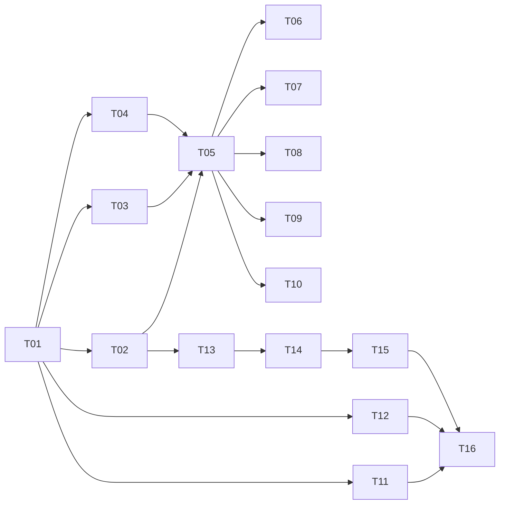

# 订单系统 M0 工程基线：任务级实施计划

| 项目 | 内容 |
| --- | --- |
| 文档编号 | PLAN-M0-001 |
| 版本 | v1.0 |
| 日期 | 2026-10-19 |
| 状态 | 待执行 |
| 依据 | [需求规格 v3.1](./2026-10-18-order-fulfillment-requirements.md) |
| 范围 | M0 工程基线（不含业务实现） |
| 执行方式 | 开发者手写代码；AI 提供方案、接口约定、测试用例建议与评审 |
| 交付目标 | 可运行、可检查、可扩展的工程骨架 |

## 0. 使用说明

- 本计划只覆盖 **M0**。M1–M8 采用滚动式计划：上一个里程碑通过退出标准后，再为下一个里程碑创建任务级计划，避免基于未验证的假设提前排期。
- 每个任务遵循 TDD：先写失败测试，再写最小实现，最后重构并跑门禁。
- 每个任务一个提交或一个 PR；任务之间保持主分支可构建、可测试。
- 任务中的文件路径相对仓库根目录；Go 命令在 `backend/` 下执行。
- 需求编号（FR/NFR）来自需求规格 v3.1；任务只声明**本阶段可验证的部分**，不把后续里程碑的能力提前标记为完成。

## 1. 计划原则

1. **一次只引入计划内的库。** M0 只引入 Gin、Viper、zap、JWT、Prometheus、UUID；GORM、Redis、Kafka、asynq 分别在 M1/M3 首次启用，不提前引入替代实现。
2. **不做临时实现。** 限流在 M0 只定义接口和 no-op 中间件，M3 接入 Redis；不使用内存限流冒充最终方案。
3. **无业务逻辑。** M0 不写订单、库存、支付、秒杀规则；不建业务表；不接 Kafka 消费者。
4. **可验证。** 每个任务都有明确的命令、测试或可观察结果，不以“代码已写”作为完成。
5. **文档随代码提交。** ADR、README、运行手册、API 说明与代码在同一 PR 中更新。
6. **DoR/DoD 生效。** 任务开始前满足需求规格 §10.3；完成时满足 §10.4。
7. **技术栈冻结检查。** 任何新增依赖必须在 ADR-0001 清单内；例外走需求规格 §16.2。

## 2. 当前基线

- 工作区中 `backend/` 当前为空（旧文件已从工作区删除），M0 从零建立，不复用旧实现。
- Go module 路径：`github.com/vevila2020/order-sys`，`go.mod` 位于 `backend/`。
- 本地依赖由 Docker Compose 提供；CI 不依赖宿主机安装 MySQL/Redis/Kafka。
- 仓库已有 `docs/` 与需求规格；旧设计/实施文档已删除，不作为实现依据。
- 默认主分支以仓库当前设置为准；功能开发使用短生命周期分支 + PR。

## 3. M0 范围与退出标准

### 3.1 范围

- Go module、目录骨架、`.gitignore`、README、CHANGELOG。
- 配置：Viper + YAML 默认值 + 环境变量覆盖 + 启动校验；`make setup` 生成本地 `.env`。
- 日志：zap JSON，统一字段，级别可配置。
- HTTP：Gin 服务、统一成功/错误响应、稳定错误码、`request_id`。
- 中间件链：recover、访问日志、超时/取消、认证、角色授权、限流接口、请求体上限。
- 认证：本地 JWT 签发与校验、`buyer`/`operator` 角色、`auth/token` 仅 local/ci 启用。
- 健康检查：`/health/live`、`/health/ready`，支持关键/非关键依赖与 `degraded` 状态。
- 指标：Prometheus 骨架、HTTP 指标、`/metrics`。
- 优雅关闭：SIGTERM/SIGINT，宽限期可配置。
- 本地环境：Compose 依赖（MySQL、Redis、Kafka、Prometheus、Grafana、Jaeger）+ API/worker 容器。
- 工程配套：多阶段非 root 镜像、Makefile、CI（格式、vet、lint、race 测试、构建、secret scan、govulncheck、SBOM）。
- 文档：ADR 模板与初始 ADR、运行手册、API 说明、PR 模板。
- 验收记录与 M0 tag。

### 3.2 明确不在 M0

- 业务表、迁移、GORM、Repository、事务管理器、订单/库存/支付/秒杀用例。
- Redis 客户端、Lua、Kafka 客户端、Outbox relay、消费者、asynq 任务。
- OpenTelemetry 全量埋点（M5）；M0 只保留配置项与日志关联字段。
- 负载测试、故障演练、备份恢复（M5/M6）。
- 撮合引擎（M7）。

### 3.3 退出标准

- [ ] 空环境执行 `make setup && make up` 可拉起依赖、API、worker；API 健康检查可用。
- [ ] 参数错误返回统一错误体；`request_id` 在响应头和响应体中一致。
- [ ] buyer 无法访问 operator 路由；`auth/token` 在非 local/ci 配置下关闭。
- [ ] `/health/live` 与 `/health/ready` 行为符合 FR-025；依赖状态可区分 `ok` / `degraded` / `fail`。
- [ ] `/metrics` 可抓取 HTTP 请求量、延迟、状态码和 Go runtime 指标。
- [ ] 收到 SIGTERM 后在宽限期内完成在途请求并退出。
- [ ] `make ci` 全部通过：格式、vet、lint、`-race` 单测、构建、secret scan、`govulncheck`、SBOM。
- [ ] ADR-0001/0002/0007/0010 已接受；ADR-0003 已起草。
- [ ] README 按文档可从零启动；CHANGELOG 记录 M0。
- [ ] 无业务逻辑、无业务表、无 Kafka 消费者、无临时替代实现。
- [ ] 验收记录归档，打 tag `v0.1.0-m0`。

## 4. 任务总览

| ID | 任务 | 依赖 | 规模 | 主要产物 |
| --- | --- | --- | --- | --- |
| M0-T01 | 初始化 module 与目录骨架 | — | S | `backend/go.mod`、目录、基础 main |
| M0-T02 | 配置加载与校验 | T01 | M | `configx`、示例配置、`make setup` |
| M0-T03 | 结构化日志 | T01 | S | `loggerx` |
| M0-T04 | 错误模型与统一响应 | T01 | M | `httpx`、错误码 |
| M0-T05 | HTTP 服务与中间件链 | T02–T04 | M | Gin 引擎、request_id、recover、访问日志、超时、body limit |
| M0-T06 | JWT 认证与角色授权 | T05 | M | `authx`、`auth/token`、角色中间件 |
| M0-T07 | 健康检查框架 | T05 | S | `healthx`、live/ready、worker 管理端口 |
| M0-T08 | Prometheus 指标骨架 | T05 | S | HTTP 指标、`/metrics` |
| M0-T09 | 优雅关闭 | T05 | S | 信号处理、宽限期、退出码 |
| M0-T10 | 限流接口与请求边界 | T05 | S | `Limiter` 接口、no-op、body/timeout 配置 |
| M0-T11 | Compose 依赖环境 | T01 | M | MySQL/Redis/Kafka/Prometheus/Grafana/Jaeger |
| M0-T12 | 多阶段非 root 镜像 | T01 | S | `backend/Dockerfile`、`.dockerignore` |
| M0-T13 | Makefile | T02 | S | 开发/检查/构建/环境命令 |
| M0-T14 | CI 流水线 | T13 | M | `.github/workflows/ci.yml` |
| M0-T15 | 文档、ADR 与 PR 模板 | T01 | S | `docs/adr`、`docs/runbooks`、`docs/api`、PR 模板 |
| M0-T16 | M0 验收与 tag | 全部 | S | 验收记录、`v0.1.0-m0` |

规模定义：S ≤ 2 小时，M 半天到 1 天；仅作规划参考，不作为工期承诺。

## 5. 任务详情

### M0-T01 初始化 module 与目录骨架

**目标：** 建立可构建、可测试的 Go module 与目标目录结构。

**文件：**

- `backend/go.mod`、`backend/go.sum`
- `backend/cmd/api/main.go`（最小启动，打印版本后退出或启动占位服务）
- `backend/cmd/worker/main.go`（最小占位，M0-T07 接入管理端口）
- `backend/internal/platform/{configx,loggerx,httpx,authx,healthx,observability,ratelimit}/doc.go`
- `backend/migrations/.gitkeep`、`backend/config/.gitkeep`
- `.gitignore`（补充 `.env`、构建产物、测试缓存、IDE 文件）

**步骤：**

1. 创建目录。
2. 在 `backend/` 执行 `go mod init github.com/vevila2020/order-sys`。
3. 初始化时只建立 module，不预先引入未使用的依赖；各任务在首次使用时用 `go get` 引入并锁定版本（Viper、zap、Gin、uuid、JWT、Prometheus 分别见后续任务）。
4. 写最小 `main.go`，确保 `go build ./...` 通过。
5. 添加一个 `version` 包或变量，供日志与指标使用。
6. 不创建业务模块目录；M1 再建 `order/`、`inventory/`、`payment/`、`flashsale/`。

**验证：**

```bash
cd backend
gofmt -l .
go vet ./...
go build ./...
go test ./...
```

**退出标准：** 三条 Go 命令全部通过；目录结构可被后续任务直接使用。

**需求映射：** 支撑 §9.1、NFR-007、NFR-009。

**建议提交：** `chore(bootstrap): initialize backend module and layout`

---

### M0-T02 配置加载与校验

**目标：** 所有关键配置来自 YAML 默认值 + 环境变量覆盖，启动时校验，敏感项只从环境变量读取。

**文件：**

- `backend/internal/platform/configx/config.go`
- `backend/internal/platform/configx/config_test.go`
- `backend/config/local.example.yaml`
- `backend/config/ci.example.yaml`
- `.env.example`

**步骤：**

1. 先写测试：
   - YAML 提供默认值，环境变量覆盖成功。
   - 必填项缺失、数值越界、时长格式错误时返回错误。
   - `APP_ENV=local` 时允许本地开发 JWT 默认值；其他环境必须显式提供 `JWT_SECRET`。
2. 定义配置结构，覆盖需求规格 §9.4 的全部配置项（M0 只使用其中一部分，其余预留给后续里程碑）。
3. 引入 `github.com/spf13/viper`，读取 YAML，`SetEnvKeyReplacer(".", "_")`，`AutomaticEnv`。
4. 实现 `Load(path, envPrefix)` 和 `Validate()`。
5. 提供示例配置；`make setup` 从 `.env.example` 生成 `.env`，并用随机值填充 `JWT_SECRET`、`PAYMENT_CALLBACK_TOKEN`（T13 实现）。
6. 确保配置错误信息不打印密钥值。

**验证：**

```bash
cd backend
go test ./internal/platform/configx -race -count=1
```

**退出标准：** 测试覆盖文件读取、环境覆盖、缺失必填、非法值、敏感项不回显。

**需求映射：** FR-026、NFR-005、NFR-009。

**建议提交：** `feat(config): load and validate service configuration`

---

### M0-T03 结构化日志

**目标：** 统一 JSON 日志，字段可被检索，级别可配置。

**文件：**

- `backend/internal/platform/loggerx/logger.go`
- `backend/internal/platform/loggerx/logger_test.go`

**步骤：**

1. 先写测试：输出为合法 JSON；包含 `service_name`、`env`、`version`、`level`、`ts`；级别过滤生效；`Sync` 不 panic。
2. 引入 `go.uber.org/zap`，实现 `New(cfg)`，支持 `debug/info/warn/error`。
3. 提供从 `context` 提取 `request_id`/`trace_id` 的辅助函数（M0 先空实现，M5 接 OTel）。
4. 不在日志库内部自动记录请求体或敏感字段。

**验证：**

```bash
cd backend
go test ./internal/platform/loggerx -race -count=1
```

**退出标准：** 日志字段与需求规格 FR-028 的字段约定一致；无敏感信息。

**需求映射：** FR-028、NFR-006。

**建议提交：** `feat(logging): add structured zap logger`

---

### M0-T04 错误模型与统一响应

**目标：** 所有 HTTP 响应遵循统一结构；错误码稳定、可区分、不泄露内部细节。

**文件：**

- `backend/internal/platform/httpx/response.go`
- `backend/internal/platform/httpx/errors.go`
- `backend/internal/platform/httpx/response_test.go`

**步骤：**

1. 先写测试，覆盖：
   - 成功：`{"request_id":"...","data":...}`。
   - 错误：`{"request_id":"...","error":{"code":"...","message":"...","details":...}}`。
   - 参数错误 → 400 `VALIDATION_FAILED`；未认证 → 401；无权限 → 403；不存在 → 404；冲突 → 409；依赖故障 → 503；超时 → 504；未分类 → 500 `INTERNAL`。
   - 内部错误不包含堆栈、SQL、DSN。
2. 定义 `AppError`、哨兵错误、`Code` 常量和 HTTP 状态映射。
3. 实现 `WriteData`、`WriteError`、`WriteErrorFrom`。
4. 为后续领域错误预留 `errors.Is/As` 映射入口。

**验证：**

```bash
cd backend
go test ./internal/platform/httpx -race -count=1
```

**退出标准：** 表格驱动测试覆盖需求规格 §8.3 中 M0 涉及的全部错误码。

**需求映射：** FR-024、NFR-005。

**建议提交：** `feat(http): add unified response and error model`

---

### M0-T05 HTTP 服务与中间件链

**目标：** 建立 Gin 服务与固定中间件顺序，保证请求可追踪、异常可恢复、超时有界。

**文件：**

- `backend/internal/platform/httpx/server.go`
- `backend/internal/platform/httpx/middleware/request_id.go`
- `backend/internal/platform/httpx/middleware/recover.go`
- `backend/internal/platform/httpx/middleware/accesslog.go`
- `backend/internal/platform/httpx/middleware/timeout.go`
- `backend/internal/platform/httpx/middleware/bodylimit.go`
- `backend/cmd/api/main.go`
- 对应 `_test.go`

**步骤：**

1. 先写测试：
   - 客户端传 `X-Request-ID` 时原样返回；缺失时生成 UUID；响应头与响应体一致。
   - handler panic 返回 500 统一错误体，日志包含堆栈（仅服务端）。
   - 超过请求体上限返回 413。
   - 超时返回 504 或统一超时错误；context 被取消。
   - 访问日志包含方法、路由模板、状态码、耗时、`request_id`。
2. 引入 `github.com/gin-gonic/gin` 与 `github.com/google/uuid`，实现中间件，顺序固定为：
   `request_id` → `recover` → 访问日志 → 超时/取消 → 认证 → 角色授权 → 限流 → 请求体上限 → handler。
3. 路由使用 `/api/v1` 分组；M0 只注册健康检查与认证端点，业务路由 M1 再挂。
4. 关闭 Gin 默认日志中间件，使用自定义访问日志；关闭 `X-Powered-By`。

**验证：**

```bash
cd backend
go test ./internal/platform/httpx/... -race -count=1
```

**退出标准：** 中间件顺序有测试保护；异常、超时、超限均返回统一错误体。

**需求映射：** FR-024、FR-027、FR-028。

**建议提交：** `feat(http): add server bootstrap and middleware chain`

---

### M0-T06 JWT 认证与角色授权

**目标：** 本地模拟身份可用，buyer/operator 权限边界清晰，认证端点只在 local/ci 启用。

**文件：**

- `backend/internal/platform/authx/claims.go`
- `backend/internal/platform/authx/jwt.go`
- `backend/internal/platform/authx/middleware.go`
- `backend/internal/platform/authx/handler.go`
- 对应 `_test.go`

**步骤：**

1. 先写测试：
   - 有效 token 通过；缺失、过期、签名错误、`alg=none`、错误 `iss`/`aud` 被拒绝。
   - `operator` 路由 buyer 访问返回 403；operator 访问通过。
   - `LOCAL_AUTH_ENABLED=false` 或 `APP_ENV` 非 local/ci 时，`auth/token` 返回 404/403。
   - token 过期时间、`sub`、`role` 正确。
2. 引入 `github.com/golang-jwt/jwt/v5`。Claims：`sub`、`role`、`iss`、`aud`、`exp`、`iat`、`jti`。
3. HS256 签名；密钥至少 32 字节；拒绝非 HS256。
4. `auth/token` 请求体 `{"user_id":"u1","role":"buyer|operator"}`；仅本地启用。
5. 实现 `RequireAuth`、`RequireRole`、`CurrentUser(ctx)`。
6. 登录失败不区分“用户不存在”和“密钥错误”，统一 401。

**验证：**

```bash
cd backend
go test ./internal/platform/authx/... -race -count=1
```

**退出标准：** 负向测试全通过；角色矩阵与需求规格 §8.1 一致。

**需求映射：** FR-024、FR-025（身份上下文）、NFR-005。

**建议提交：** `feat(auth): add local jwt authentication and roles`

---

### M0-T07 健康检查框架

**目标：** live/ready 语义正确，支持关键/非关键依赖与 degraded 状态；worker 有独立管理端口。

**文件：**

- `backend/internal/platform/healthx/registry.go`
- `backend/internal/platform/healthx/handler.go`
- `backend/internal/platform/healthx/registry_test.go`
- `backend/cmd/api/main.go`、`backend/cmd/worker/main.go`

**步骤：**

1. 先写测试：
   - 无检查时 live/ready 返回 200。
   - 关键检查失败 → ready 503；非关键失败 → 200 + `degraded`。
   - 检查超时 → 按失败处理，不阻塞超过配置时间。
   - live 永远不执行依赖检查。
2. 定义 `Check{Name, Critical, Timeout, Func}` 与 `Registry`。
3. API 的 `/health/ready` 规则：MySQL 关键（M1 注册）；Redis/Kafka 非关键，失败只标记 degraded。
4. worker 在 `:8081` 暴露 `/health/live`、`/health/ready`、`/metrics`；worker 的 ready 将 MySQL/Redis/Kafka 视为关键（M3 注册）。
5. 响应体包含每个检查的名称、状态、耗时；不包含 DSN/密码。

**验证：**

```bash
cd backend
go test ./internal/platform/healthx -race -count=1
```

**退出标准：** live/ready 行为有测试保护；M0 只注册配置自检，真实依赖检查在 M1/M3 注册。

**需求映射：** FR-025、NFR-003。

**建议提交：** `feat(health): add live and readiness framework`

---

### M0-T08 Prometheus 指标骨架

**目标：** `/metrics` 暴露 HTTP 与运行时指标，标签基数可控。

**文件：**

- `backend/internal/platform/observability/metrics.go`
- `backend/internal/platform/observability/http.go`
- `backend/internal/platform/observability/metrics_test.go`

**步骤：**

1. 先写测试：抓取 `/metrics` 包含 `http_requests_total`、`http_request_duration_seconds`、`http_requests_in_flight` 和 Go runtime 指标。
2. 引入 `github.com/prometheus/client_golang`，使用 `prometheus.NewRegistry()`，注册 Go collector 与 process collector。
3. HTTP 中间件使用 `c.FullPath()` 作为路由标签，取不到时用 `unknown`，禁止使用原始 URL。
4. 状态码、方法、路由标签基数可控。
5. 预留业务指标注册入口（M3/M4 使用）。

**验证：**

```bash
cd backend
go test ./internal/platform/observability -race -count=1
```

**退出标准：** 指标可抓取；无高基数标签。

**需求映射：** FR-037（M0 骨架）、NFR-006。

**建议提交：** `feat(metrics): add prometheus http metrics skeleton`

---

### M0-T09 优雅关闭

**目标：** 收到 SIGTERM/SIGINT 后停止接收新请求，在宽限期内完成在途请求，按确定退出码退出。

**文件：**

- `backend/internal/platform/httpx/shutdown.go`
- `backend/internal/platform/httpx/shutdown_test.go`
- `backend/cmd/api/main.go`、`backend/cmd/worker/main.go`

**步骤：**

1. 先写测试：用一个阻塞的假服务器验证 `Shutdown(ctx)` 等待在途请求；宽限期到后返回错误。
2. 使用 `signal.NotifyContext(context.Background(), os.Interrupt, syscall.SIGTERM)`。
3. 启动 HTTP 服务后等待信号；收到信号后调用 `server.Shutdown`，超时则强制关闭。
4. 先停止接收新流量，再停止后台循环（worker 在后续里程碑接入消费者后按同样顺序）。
5. 退出码：正常关闭 0；启动失败/关闭超时非 0。

**验证：**

```bash
cd backend
go test ./internal/platform/httpx -race -count=1 -run Shutdown
```

**退出标准：** 关闭行为有测试；宽限期来自配置。

**需求映射：** FR-027、NFR-003。

**建议提交：** `feat(http): add graceful shutdown`

---

### M0-T10 限流接口与请求边界

**目标：** 认证后的请求有统一限流入口；M0 不引入临时限流实现，M3 接 Redis。

**文件：**

- `backend/internal/platform/ratelimit/limiter.go`
- `backend/internal/platform/ratelimit/middleware.go`
- `backend/internal/platform/ratelimit/limiter_test.go`

**步骤：**

1. 先写测试：
   - no-op limiter 放行。
   - 超过限制的假 limiter 返回 429 + `Retry-After`。
   - 限流键优先使用用户 ID，其次 IP；不记录敏感信息。
2. 定义 `Limiter` 接口：`Allow(ctx, key) (allowed bool, retryAfter time.Duration, err error)`。
3. M0 提供 no-op 实现；`RATE_LIMIT_ENABLED` 默认 false。
4. 中间件放在认证和角色之后，避免未认证请求消耗限流存储。
5. 在 ADR-0001/需求规格中注明 Redis 令牌桶实现属于 M3，不提前实现内存替代。

**验证：**

```bash
cd backend
go test ./internal/platform/ratelimit -race -count=1
```

**退出标准：** 接口与中间件可测试；无临时生产实现。

**需求映射：** FR-027、NFR-005、NFR-017。

**建议提交：** `feat(ratelimit): add limiter interface and middleware`

---

### M0-T11 Compose 依赖环境

**目标：** 一条命令拉起 MySQL、Redis、Kafka、Prometheus、Grafana、Jaeger，并具备健康检查。

**文件：**

- `docker-compose.yml`
- `deploy/prometheus/prometheus.yml`
- `deploy/grafana/provisioning/`（M5 再补面板）
- `.env.example`

**步骤：**

1. 定义服务：`mysql:8`、`redis:7`、Kafka（KRaft 单机）、`prom/prometheus`、`grafana/grafana`、`jaegertracing/all-in-one`。
2. 配置健康检查、数据卷、内部网络、端口；只有 API、Grafana、Jaeger 暴露宿主机端口。
3. 镜像使用固定版本或 digest，不使用 `latest`。
4. Kafka 使用单节点 KRaft，创建业务 topic 的脚本放到 `deploy/kafka/`（M3 使用）。
5. `make up` 启动依赖与应用；`make down` 停止；数据卷不自动删除。
6. 验证 MySQL/Redis 可用、Kafka broker 健康、Prometheus 能抓取 API。

**验证：**

```bash
docker compose config
docker compose up -d
docker compose ps
```

**退出标准：** 所有依赖健康；配置可重复执行；端口冲突有文档说明。

**需求映射：** FR-029（M0 部分）、NFR-009。

**建议提交：** `chore(compose): add local dependency environment`

---

### M0-T12 多阶段非 root 镜像

**目标：** API 与 worker 可构建为同一镜像的不同入口，容器非 root。

**文件：**

- `backend/Dockerfile`
- `backend/.dockerignore`

**步骤：**

1. 多阶段：`golang:1.25-alpine` 构建，运行阶段使用固定版本的 `alpine`（保留 `wget` 供 Compose 健康检查），创建非 root 用户。
2. `CGO_ENABLED=0`；二进制静态链接。
3. 通过构建参数 `TARGET=api|worker` 生成两个镜像；Compose 分别构建，避免一个镜像内包含不使用的入口。
4. 镜像标签不可变；CI 记录 digest。
5. `.dockerignore` 排除 `.git`、测试缓存、本地配置、密钥。
6. 构建后用 `docker run --rm <image> --version` 验证；扫描镜像。

**验证：**

```bash
docker build -f backend/Dockerfile --build-arg TARGET=api -t order-sys-api:dev backend
docker run --rm order-sys-api:dev --version
```

**退出标准：** 镜像非 root、无开发密钥、可启动；镜像扫描无高危。

**需求映射：** NFR-005、NFR-009。

**建议提交：** `chore(docker): add multi-stage non-root images`

---

### M0-T13 Makefile

**目标：** 开发者用统一命令完成格式化、检查、测试、构建和本地环境操作。

**文件：**

- `Makefile`

**步骤：**

1. 目标：
   - `setup`：生成 `.env`（随机密钥），不覆盖已有文件。
   - `up` / `down` / `logs` / `ps`：Compose 操作。
   - `fmt` / `fmt-check` / `vet` / `lint` / `test` / `test-race` / `build`。
   - `run-api` / `run-worker`。
   - `security`：`govulncheck` + secret scan。
   - `sbom`：生成 SBOM 文件到 `artifacts/`。
   - `ci`：本地执行 CI 同等检查。
   - `help`：列出目标。
2. 所有 Go 命令显式 `cd backend`；失败即退出。
3. M1 再增加 `migrate-up` / `migrate-down`，M0 不提供空实现。

**验证：**

```bash
make help
make fmt-check
make test
make build
```

**退出标准：** 目标可用、失败传播正确、README 与 Makefile 一致。

**需求映射：** NFR-009、NFR-014。

**建议提交：** `chore(build): add make targets`

---

### M0-T14 CI 流水线

**目标：** 每个 PR 自动执行格式、静态检查、竞态测试、构建与安全扫描。

**文件：**

- `.github/workflows/ci.yml`
- `docs/runbooks/ci.md`

**步骤：**

1. 若仓库托管在 GitHub，使用 Actions；其他平台按同等步骤实现。
2. Job 1：`gofmt -l`、`go vet`、`golangci-lint run`（版本固定）。
3. Job 2：`go test -race -count=1 ./...`、`go build ./...`。
4. Job 3：`govulncheck ./...`、gitleaks、SBOM 生成并作为 artifact。
5. Job 4：Docker 构建 + 镜像扫描（Trivy 或等价工具）。
6. 缓存 Go modules；所有 action 固定版本。
7. 文档记录分支保护要求：必须通过必需检查，禁止直接推送功能代码。
8. M0 不运行集成测试；M1 增加 testcontainers job。

**验证：**

```bash
make ci
```

并在测试分支推送 PR，确认所有检查通过。

**退出标准：** CI 全绿；失败信息可定位；无明文密钥。

**需求映射：** §10.2 门禁、NFR-005、NFR-007、NFR-008。

**建议提交：** `ci: add format, test, build and security gates`

---

### M0-T15 文档、ADR 与 PR 模板

**目标：** 工程决策和操作方式有据可查，后续任务有统一模板。

**文件：**

- `docs/adr/README.md`
- `docs/adr/0001-freeze-technology-stack.md`（Accepted）
- `docs/adr/0002-modular-monolith-boundaries.md`（Accepted）
- `docs/adr/0003-transaction-and-locking.md`（Proposed）
- `docs/adr/0007-local-jwt-auth.md`（Accepted）
- `docs/adr/0010-error-model.md`（Accepted）
- `docs/runbooks/local-dev.md`
- `docs/runbooks/ci.md`
- `docs/api/README.md`（指向需求规格 §8，说明 M1 再补具体 schema）
- `.github/pull_request_template.md`
- `README.md`
- `CHANGELOG.md`

**步骤：**

1. 按 ADR 模板写背景、决策、备选方案、后果、验证、关联需求。
2. 明确 ADR-0001 的库清单与例外流程；ADR-0002 的模块边界；ADR-0007 的 JWT 规则；ADR-0010 的错误码。
3. 运行手册覆盖环境准备、`make setup/up/down`、健康检查、日志查看、常见问题。
4. PR 模板包含：关联 FR/NFR、问题、决策、测试结果、迁移、可观测性、安全、文档、回滚。
5. README 提供 5 分钟快速启动。
6. 检查文档内相对链接有效。

**验证：**

按 README 在干净工作区执行一遍启动流程。

**退出标准：** 文档可执行、链接有效、ADR 状态正确。

**需求映射：** NFR-014、§9.7。

**建议提交：** `docs: add adr, runbooks and pr template`

---

### M0-T16 M0 验收与 tag

**目标：** 用证据确认 M0 退出标准全部满足，并冻结基线。

**文件：**

- `docs/plans/acceptance/m0-acceptance.md`

**步骤：**

1. 在干净环境执行 §3.3 全部检查，记录命令、输出摘要、日期、版本。
2. 记录以下证据：
   - `make up`、`docker compose ps`、健康检查、`request_id`、错误体、`/metrics`。
   - buyer/operator 授权测试结果。
   - SIGTERM 日志与退出码。
   - `make ci` 结果、SBOM、镜像扫描结果。
3. 对照需求规格 §10.4 DoD 检查每个任务。
4. 记录未完成项与豁免（如有），并说明进入 M1 前必须解决的事项。
5. 打 tag `v0.1.0-m0`。
6. 更新本计划状态为“已完成”并归档。

**验证：**

```bash
make ci
make up
curl -s localhost:8080/health/live
curl -s localhost:8080/health/ready
curl -s localhost:8080/metrics | head
```

**退出标准：** §3.3 全部勾选；证据归档；tag 推送。

**需求映射：** M0 全部退出标准。

**建议提交：** `chore(release): complete m0 acceptance`

## 6. 依赖关系与建议顺序



建议执行顺序：T01 → T02 → T03 → T04 → T05 → T10 → T06 → T07 → T08 → T09 → T11 → T12 → T13 → T14 → T15 → T16。

理由：先建立配置与响应模型，再做服务与中间件；认证、健康、指标、限流都依赖中间件链；Compose/镜像/Makefile 可与应用任务交错，但验收必须在全部完成后进行。

## 7. 每个任务的统一完成定义

- 失败测试先于实现，并在提交中可见。
- `gofmt`、`go vet`、`golangci-lint`、`go test -race` 通过。
- 新增配置有示例、有校验、有测试。
- 新增日志字段符合 FR-028；新增指标标签基数可控。
- 新增错误码进入统一错误表；不泄露内部细节。
- 文档/ADR/README 同步更新。
- 无明文密钥、无调试残留、无未跟踪 TODO。
- PR 自审 + AI 评审完成，描述包含问题、决策、测试结果。

## 8. M0 风险与应对

| 风险 | 影响 | 应对 |
| --- | --- | --- |
| Windows 本地环境与 Linux 容器路径/信号差异 | 启动或关闭行为不一致 | 以 Compose 内 Linux 行为为准；Windows 只做开发；CI 使用 Linux |
| Kafka KRaft 单机配置耗时 | 阻塞 M0 验收 | 使用稳定镜像与官方示例配置；先验证 broker 健康，再接入业务 |
| 端口冲突（8080/3306/6379/9092/9090/3000/16686） | 本地启动失败 | 配置可覆盖；端口清单写入运行手册 |
| JWT 本地签发被误用于非本地环境 | 安全风险 | `APP_ENV` 与 `LOCAL_AUTH_ENABLED` 双重校验；测试覆盖 |
| 中间件顺序错误 | 认证前消耗资源、日志缺 request_id | 顺序固定并有测试；变更需评审 |
| 超时/关闭实现依赖 Gin 默认行为 | 在途请求被截断 | 使用 `http.Server.Shutdown`；测试阻塞 handler |
| CI 与本地命令不一致 | “本地绿、CI 红” | 所有检查通过 Makefile 目标执行；CI 调用同一目标 |
| 过早引入业务代码 | 基线失焦 | M0 明确不做清单；PR 评审检查 |

## 9. M1–M8 滚动计划索引

| 里程碑 | 计划文件（届时创建） | 主要任务组 |
| --- | --- | --- |
| M1 订单领域与 MySQL | `YYYY-MM-DD-order-fulfillment-m1-plan.md` | 迁移与表、领域状态机、Repository、事务管理器、SKU/下单/查询/取消/支付回调、幂等、Outbox 写入、集成测试 |
| M2 并发正确性 | `YYYY-MM-DD-order-fulfillment-m2-plan.md` | 条件更新/行锁、锁顺序、死锁重试、并发测试、慢查询与索引、100 并发基线 |
| M3 Redis、Kafka 与秒杀 | `YYYY-MM-DD-order-fulfillment-m3-plan.md` | Redis Lua 准入、活动与限购、请求持久化、Outbox relay、首个消费组、结果查询、对账、降级 |
| M4 可靠消息与恢复 | `YYYY-MM-DD-order-fulfillment-m4-plan.md` | 消费去重、退避、DLQ、重投、通知消费者、超时关单、审计、保留清理、故障演练 |
| M5 可观测性与容量 | `YYYY-MM-DD-order-fulfillment-m5-plan.md` | OTel 全链路、Grafana/告警、SLI/SLO、k6、容量复核、瓶颈分析 |
| M6 容器化与运维 | `YYYY-MM-DD-order-fulfillment-m6-plan.md` | 完整 Compose、备份恢复、SIGTERM/依赖故障演练、运行手册、RPO/RTO 实测 |
| M7 订单簿与撮合 | `YYYY-MM-DD-order-fulfillment-m7-plan.md` | 订单簿、价格时间优先、部分成交、撤单、命令去重、确定性回放、属性测试 |
| M8 结项与复盘 | `YYYY-MM-DD-order-fulfillment-m8-plan.md` | 全量验收、文档收口、已知问题、复盘、发布 tag |

滚动计划规则：

- 只有上一个里程碑通过退出标准，才创建下一个里程碑的详细计划。
- 每个计划必须引用当前需求版本和相关 ADR；若需求变更，先更新需求文档再改计划。
- 每个计划至少包含：任务、依赖、文件、失败测试、验证命令、退出标准、需求映射、风险。
- 任务粒度保持在 2 小时到 1 天；超过 1 天的任务必须拆分。

## 10. M0 退出检查表

- [ ] T01–T16 全部完成并有提交记录。
- [ ] `make ci` 全绿；SBOM 与镜像扫描结果归档。
- [ ] 干净环境 `make setup && make up` 成功。
- [ ] live/ready/metrics 可用；`request_id` 贯穿日志与响应。
- [ ] 认证与角色测试通过；本地签发端点受环境限制。
- [ ] SIGTERM 在宽限期内优雅退出。
- [ ] ADR-0001/0002/0007/0010 接受，ADR-0003 起草。
- [ ] README、运行手册、PR 模板、CHANGELOG 可用。
- [ ] 无业务逻辑、无业务表、无临时替代实现。
- [ ] 验收记录归档并打 tag `v0.1.0-m0`。

## 11. 参考

- [需求规格 v3.1](./2026-10-18-order-fulfillment-requirements.md)
- [需求质量核对表](./checklists/requirements.md)
- ADR 目录：`docs/adr/`
- 运行手册目录：`docs/runbooks/`
- API 说明目录：`docs/api/`
