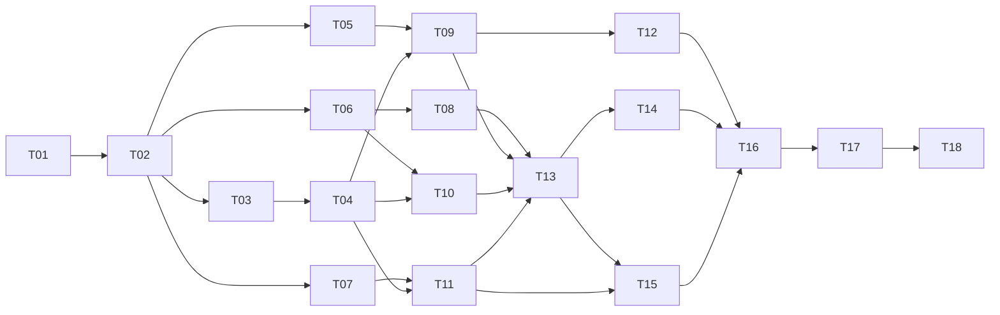

# 订单系统 M1 订单领域与 MySQL：任务级实施计划

| 项目 | 内容 |
| --- | --- |
| 文档编号 | PLAN-M1-001 |
| 版本 | v1.0 |
| 日期 | 2026-10-20 |
| 状态 | 待执行 |
| 依据 | [需求规格 v3.1](./2026-10-18-order-fulfillment-requirements.md)、[ADR-0003](../adr/0003-transaction-and-locking.md) |
| 前置 | M0 已通过全部退出标准并打 tag `v0.1.0-m0`（commit `a8af215`） |
| 范围 | 普通订单主链路 + 数据库正确性（不含秒杀、消息、缓存） |
| 执行方式 | 开发者手写代码；AI 提供方案、接口约定、测试用例建议与评审 |
| 交付目标 | 幂等下单、原子预占、取消与支付终态唯一、迁移可前向可回滚 |

## 0. 使用说明

- 本计划只覆盖 **M1**。M2–M8 在 M1 通过退出标准后再按滚动方式创建。
- 每个任务遵循 TDD：先写失败测试，再写最小实现，最后重构并跑门禁。
- 每个任务一个提交或一个 PR；任务之间保持主分支可构建、可测试。
- 任务中的文件路径相对仓库根目录；Go 命令在 `backend/` 下执行。
- 需求编号（FR/NFR）来自需求规格 v3.1；只声明本阶段可验证的部分。

## 1. 计划原则

1. **一次只引入计划内的库。** M1 引入 GORM、MySQL 驱动、golang-migrate、testcontainers-go；
   Redis、Kafka、asynq 仍在 M3 首次启用，不得提前引入。
2. **不做临时实现。** 事务、幂等、预占全部走数据库约束与条件更新；不用内存锁或
   "先查再写"冒充正确性。
3. **无越界能力。** M1 不写 Outbox relay、不接 Kafka、不做秒杀、不做超时关单任务
   （FR-009 属 M4）、不做审计与保留清理（M4）。Outbox **表**与**事务内写入**在本阶段完成。
4. **领域纯净。** `domain` 不 import Gin/GORM/Viper 等框架；状态迁移只能由领域方法执行。
5. **可验证。** 每个任务都有明确命令与可观察结果，不以"代码已写"作为完成。
6. **文档随代码提交。** ADR、API 契约、运行手册、CHANGELOG 与代码在同一 PR 中更新。

## 2. 当前基线

- M0 已交付：配置、日志、统一响应与错误模型、中间件链、JWT 与角色、健康检查、
  指标、优雅关闭、Compose、非 root 镜像、Makefile、CI 四个 job 全绿。
- 现有代码只到 `internal/platform/` 与 `internal/version/`，**没有任何业务模块**。
- `backend/migrations/` 仅有 `.gitkeep`；数据库尚未建表。
- `go.mod` 为 `go 1.26.10`（M1-T02 由 1.26.9 升补丁版本，见该任务完成记录），
  依赖仅 Gin、Viper、zap、JWT、Prometheus、uuid。
- 测试分层（需求 §10.1）：单元测试不依赖 Docker；集成测试用 build tag 隔离。

## 3. M1 范围与退出标准

### 3.1 范围

- 领域模型与状态机：Order、Inventory（含 SKU/Reservation）、Payment。
- 数据库迁移：`skus`、`inventories`、`orders`、`order_items`、`reservations`、
  `reservation_items`、`payments`、`idempotency_records`、`outbox_events`。
- 用例：创建 SKU、查询/更新 SKU、普通下单、订单查询、取消订单、模拟支付回调。
- 基础设施：GORM 连接、`TransactionManager`、死锁重试、Repository 适配器、
  Outbox 事务内写入。
- 集成测试：testcontainers 启动真实 MySQL，验证行锁与条件更新。
- ADR-0003 转为 Accepted，新增 ADR-0006（幂等键与响应快照）。

### 3.2 明确不在 M1

- 秒杀活动、Redis 准入与限购、Kafka 生产/消费、asynq 任务。
- Outbox relay 与任何事件发布（M3）；M1 只保证事件与业务变更同事务落库。
- 超时关单（FR-009，M4）、库存对账（M3）、死信与审计（M4）、保留清理（M4）。
- OpenTelemetry 全量埋点（M5）；M1 只复用现有 `request_id` 关联。
- 前端、撮合引擎。

### 3.3 退出标准

- [ ] 同幂等键重复提交只产生一个订单、一次预占；同键异体返回 409。
- [ ] 多 SKU 下单中任一 SKU 不足时整单回滚，所有库存保持原值。
- [ ] 取消与支付成功并发时只有一个合法终态，释放/确认最多一次。
- [ ] 迁移可从空库 `up` → `down` → `up`，版本一致，无手工改库。
- [ ] 所有 M1 集成测试通过；`go test -race`、lint、vet、gofmt 全绿。
- [ ] 核心领域包（order/inventory/payment 的 domain）覆盖率 ≥ 80%，整体 ≥ 60%。
- [ ] 订单查询返回 `payment_id` 与 `payment_status`。
- [ ] 无明文密钥；日志不含请求体、DSN 或金额明细以外的敏感信息。
- [ ] ADR-0003 Accepted、ADR-0006 Accepted；API 文档与运行手册已更新。
- [ ] CI 新增 integration job 并全绿；tag `v0.2.0-m1`。

## 4. 任务总览

| ID | 任务 | 依赖 | 规模 | 主要产物 |
| --- | --- | --- | --- | --- |
| M1-T01 | ADR-0003 定稿与 ADR-0006 起草 | — | S | `docs/adr/0003`、`0006` |
| M1-T02 | 模块骨架与依赖引入 | T01 | S | `internal/{order,inventory,payment}/{domain,app,infra,http}`、`go.mod` |
| M1-T03 | 数据库迁移 | T02 | M | `backend/migrations/*.sql` |
| M1-T04 | 数据库连接与事务管理器 | T03 | M | `internal/platform/db/` |
| M1-T05 | inventory 领域模型 | T02 | S | `inventory/domain/` |
| M1-T06 | order 领域模型 | T02 | S | `order/domain/` |
| M1-T07 | payment 领域模型 | T02 | S | `payment/domain/` |
| M1-T08 | 幂等记录与请求指纹 | T06 | M | `platform/idempotency/` |
| M1-T09 | inventory 仓储与条件更新 | T04,T05 | M | `inventory/infra/` |
| M1-T10 | order 仓储与 Outbox 写入 | T04,T06 | M | `order/infra/`、`platform/outbox/` |
| M1-T11 | payment 仓储 | T04,T07 | S | `payment/infra/` |
| M1-T12 | SKU 用例与 HTTP | T09 | M | `inventory/app`、`inventory/http` |
| M1-T13 | 下单用例（事务+幂等+预占） | T08,T09,T10,T11 | M | `order/app/place_order.go` |
| M1-T14 | 订单查询与取消 | T13 | M | `order/app/{get,cancel}.go` |
| M1-T15 | 支付回调用例与鉴权 | T11,T13 | M | `payment/app`、回调中间件 |
| M1-T16 | 路由装配与 main 注入 | T12–T15 | M | `httpserver`、`cmd/api`、`cmd/worker` |
| M1-T17 | 集成测试与并发测试 | T16 | M | `*_integration_test.go`、CI job |
| M1-T18 | 文档、验收与 tag | 全部 | S | API 文档、`migrate.md`、CHANGELOG |

规模定义：S ≤ 2 小时，M 半天到 1 天；仅作规划参考，不作为工期承诺。

## 5. 任务详情

### M1-T01 ADR-0003 定稿与 ADR-0006 起草

**目标：** 在写代码前固定事务边界、锁顺序、重试策略与幂等语义，避免实现过程中反复推翻。

**文件：**

- `docs/adr/0003-transaction-and-locking.md`（Proposed → Accepted）
- `docs/adr/0006-idempotency-and-response-snapshot.md`（新建）
- `docs/adr/README.md`（状态更新）

**步骤：**

1. 补全 ADR-0003 的待办项：
   - `TransactionManager` 接口签名：`Do(ctx, fn func(ctx context.Context, tx *gorm.DB) error) error`。
   - 死锁判定：MySQL error 1213（deadlock）、1205（lock wait timeout）；最多重试 3 次，
     指数退避 10ms/20ms/40ms + ±20% 抖动；重试耗尽返回 `DEPENDENCY_UNAVAILABLE` 或
     `CONFLICT`（在 ADR 中明确二选一）。
   - 明确"事务内禁止外部 I/O"，并说明 Outbox 写入属于本地写而非外部 I/O。
2. 新增 ADR-0006，决策要点：
   - 键格式 `(scope, user_id, key)`，`scope` 一期只有 `order.create`。
   - 请求指纹为规范化 JSON 的 SHA-256（排序键、去空白），同键异指纹 → `IDEMPOTENCY_CONFLICT`。
   - 首次请求先插入 `IN_PROGRESS` 记录（依赖唯一约束，插入冲突即并发同键）：
     冲突方返回 `IDEMPOTENCY_IN_PROGRESS` + `Retry-After`。
   - 成功后在**同一事务**内把记录更新为 `COMPLETED` 并写入响应快照；
     重放时直接返回快照，不再执行用例。
   - 事务回滚时 `IN_PROGRESS` 记录随之回滚（同库同事务），不会留下永远处理中的键。
3. 备选方案与后果：说明为何不用 Redis 幂等、为何不缓存"仅订单号"。

**验证：** 人工评审；两份 ADR 均含背景、决策、备选、后果、验证方式、关联。

**退出标准：** ADR-0003 状态为 Accepted 且无待办；ADR-0006 为 Accepted 或明确标注
"Accepted at M1-T08 完成时"（不晚于 T08）。

**完成记录（2026-10-21）：** ADR-0003 已转 Accepted，待办项全部落实；ADR-0006 直接
以 Accepted 状态建立，并在文首声明"实现不得静默偏离文档"。两处需要下游任务遵守的
新增约束：

- `Do` 的整次尝试共享调用方 `ctx` 预算，`fn` 必须可重入（重试会重复执行）。
- 幂等键 `INSERT` 上的 1205/ctx 超时映射为 `IDEMPOTENCY_IN_PROGRESS`，**不**走
  整事务死锁重试；该例外只允许出现在 `platform/idempotency`。

**需求映射：** §7.3、§7.4、FR-003、FR-008。

**建议提交：** `docs(adr): accept transaction strategy and draft idempotency`

---

### M1-T02 模块骨架与依赖引入

**目标：** 建立符合需求 §9.1 的目录与依赖方向，使后续任务可以直接落位。

**文件：**

- `backend/internal/order/{domain,app,infra,http}/doc.go`
- `backend/internal/inventory/{domain,app,infra,http}/doc.go`
- `backend/internal/payment/{domain,app,infra,http}/doc.go`
- `backend/internal/platform/db/doc.go`
- `backend/go.mod`、`backend/go.sum`

**步骤：**

1. 按 §9.1 建目录，每个包写 package doc 说明职责与允许的导入方向。
2. `go get` 引入并锁定：
   - `gorm.io/gorm`、`gorm.io/driver/mysql`
   - `github.com/golang-migrate/migrate/v4`（含 `database/mysql`、`source/file`）
   - `github.com/testcontainers/testcontainers-go`（含 `modules/mysql`）
3. 加一个架构测试：`domain` 包不得 import `gin`、`gorm`、`viper`（可用 `go list -deps`
   或 AST 扫描实现），防止后续无意破坏依赖方向。
4. 此时不写任何业务逻辑，`go build ./...` 必须通过。

**验证：**

```powershell
cd backend
go build ./...
go test ./... -count=1
```

**退出标准：** 目录存在、依赖已锁定、架构测试通过、无未使用依赖。

**完成记录（2026-10-21）：**

- 架构测试实现在 `internal/archtest`（独立包，不占业务模块目录）。只检查直接
  import，不做传递闭包——传递依赖会随上游库变动而误报。三条规则均已用临时违规
  文件验证会真实失败，不是空转。
- **"依赖已锁定"与"无未使用依赖"在 Go 里互相冲突**：T02 没有任何代码 import
  GORM，`go mod tidy` 会直接删掉。用标准做法 `//go:build tools` 标记的
  `backend/tools.go` 解决：它不参与构建，但 tidy 会把它算进依赖图。T04/T03/T17
  落地真实 import 后逐步清空并删除该文件。
- 顺带修复：`go.mod` 由 1.26.9 升至 **1.26.10**。govulncheck 报告
  `GO-2026-6809`（crypto/x509 不可信中间证书）为可达漏洞，1.26.10 修复，
  该镜像标签此时已可用。Dockerfile 的 `FROM golang:...` 同步更新。
- 新增 `make test-integration`，与默认 `go test ./...` 用 build tag 隔离。

**需求映射：** §9.1、§9.2、ADR-0001、ADR-0002。

**建议提交：** `chore(order): add business module skeleton and persistence deps`

---

### M1-T03 数据库迁移

**目标：** 用版本化 SQL 建立 M1 所需全部表与索引，可前向、可回滚、可重复执行。

**文件：**

- `backend/migrations/000001_init.up.sql`
- `backend/migrations/000001_init.down.sql`

**步骤：**

1. 先写迁移测试（T17 落地的 harness 提供）：空库 `up` → 表齐全 → `down` → 表清空 → `up`。
2. 按需求 §4.5 建表，逐项对照列类型与约束：
   - `skus`、`inventories`（含 `CHECK (available + allocated + reserved + sold = total)`）。
   - `orders`、`order_items`（`uk_order_items_order_sku`）。
   - `reservations`、`reservation_items`（`order_id` UNIQUE）。
   - `payments`（`order_id` UNIQUE）。
   - `idempotency_records`（`uk_idempotency (scope, user_id, key)`）。
   - `outbox_events`（`idx_outbox_pending (status, available_at, id)`）。
3. 统一 `utf8mb4_unicode_ci`（与部署服务器一致；`utf8mb4_0900_ai_ci` 的等价字符集
   不同，混用会导致本地与生产查询结果不一致）、`DATETIME(6)`、金额 `BIGINT UNSIGNED`。
4. 每个索引在注释中写清查询场景（需求 §9.3 要求）。
5. `down` 按外键/依赖逆序删除；不使用 `CASCADE` 删除业务表。
6. 禁用 GORM `AutoMigrate`，迁移文件是唯一事实来源。

**验证：**

```powershell
# 需 Docker（testcontainers 或本地 compose MySQL）
cd backend
go test -tags=integration ./internal/platform/db -run TestMigrations -count=1
```

**退出标准：** 空库 up/down/up 成功；`SHOW TABLES` 与设计一致；
迁移失败时 `migrate` 版本不前进（`dirty` 标记有处置说明）。

**完成记录（2026-10-21）：** 9 张表、6 个集成测试通过（11.5s）。

- **`idem_key` 而非 `key`**：`key` 是 MySQL 保留字，直接用会导致每次写 SQL 都要
  反引号，容易漏。列名改为 `idem_key`，唯一索引仍按需求命名为 `uk_idempotency`。
  需求 §4.5 的物理列名以迁移文件为准（文档已说明"物理类型以迁移文件为准"）。
- **不设 `DEFAULT` / `ON UPDATE` 时间戳**：由应用在同一事务内显式写同一个 now，
  保证一次事务的多行时间一致；`ON UPDATE` 还会让 DBA 手工修数时静默改写时间。
- **状态列用 VARCHAR 不用 ENUM**：ENUM 增删取值要 `ALTER TABLE` 锁表，且让迁移
  与代码强耦合。
- **两条真实缺陷在实现中被测试抓出**：
  1. `migrate.WithInstance` 会接管传入的 `*sql.DB`，`Close` 时把它关掉，
     导致第一次迁移后测试连接失效（`sql: database is closed`）。改为迁移独占连接。
  2. harness 初版每个测试起一个容器，6 个测试耗时 65s。改为共享容器 + 每测试独立
     schema（CREATE/DROP DATABASE），降到 11.5s，隔离性不变。
- **验证了测试本身有效**：故意把 down 中的 `skus` 移到 `inventories` 之前，
  测试如期失败并报 3730（外键引用），随后恢复。

**需求映射：** FR-001、FR-017、NFR-010、AC-015。

**建议提交：** `feat(db): add m1 schema migrations`

---

### M1-T04 数据库连接与事务管理器

**目标：** 提供受控的连接池与统一事务边界，事务内只允许使用同一个 `*gorm.DB`。

**文件：**

- `backend/internal/platform/db/db.go`
- `backend/internal/platform/db/tx.go`
- `backend/internal/platform/db/errors.go`
- 对应 `_test.go`

**步骤：**

1. 先写测试（可用 sqlmock 或集成标签下的真实 MySQL）：
   - 连接池参数来自配置；`MaxIdle <= MaxOpen`。
   - `Do` 在 fn 返回错误时回滚；panic 时回滚并重新抛出。
   - 死锁错误（模拟 1213/1205）重试至上限后返回可识别错误；非死锁错误不重试。
   - 事务上下文传递：fn 内拿到的 `*gorm.DB` 与提交使用的是同一个事务。
2. 实现 `Open(cfg)`：DSN 校验、`SetMaxOpenConns`/`SetMaxIdleConns`、
   连接寿命、`PingContext` 启动自检。
3. 实现 `TransactionManager`：
   - `Do(ctx, fn)` 用 `db.WithContext(ctx).Transaction(...)`。
   - 重试仅包裹整个事务（不能只重试语句，否则事务已中止）。
   - 错误映射：死锁/锁等待 → 重试；耗尽 → 稳定错误码。
4. 明确注释：事务内禁止调用 Kafka/HTTP/Redis；Outbox 写属于本地写。

**验证：**

```powershell
cd backend
go test ./internal/platform/db -count=1
go test -tags=integration ./internal/platform/db -count=1
```

**退出标准：** 回滚、panic、重试、错误映射均有测试；无全局 DB 单例。

**需求映射：** §7.3、ADR-0003、FR-008、NFR-004。

**建议提交：** `feat(db): add connection pool and transaction manager`

---

### M1-T05 inventory 领域模型

**目标：** 用纯逻辑表达 SKU、库存与预占的状态与不变量。

**文件：**

- `backend/internal/inventory/domain/sku.go`
- `backend/internal/inventory/domain/inventory.go`
- `backend/internal/inventory/domain/reservation.go`
- `backend/internal/inventory/domain/errors.go`
- 对应 `_test.go`

**步骤：**

1. 先写表驱动测试：
   - 数量不可为负；`available + allocated + reserved + sold = total` 恒成立。
   - `Reserve` 在 `available < qty` 时返回领域错误且不改状态。
   - 预占状态只允许 `RESERVED → CONFIRMED` 和 `RESERVED → RELEASED`；重复迁移返回错误。
   - 释放回填规则：普通订单回 `available`，活动订单回 `allocated`（M1 只有普通订单，
     但接口预留 `source` 参数，避免 M3 改签名）。
2. 金额用 `int64`（最小货币单位），禁止 `float64`。
3. 状态用 `type Status string` + 常量 + `Valid()`。
4. `domain` 不 import 任何框架包。

**验证：**

```powershell
cd backend
go test ./internal/inventory/domain -race -count=1 -cover
```

**退出标准：** 覆盖率 ≥ 80%；所有状态迁移与不变量有测试。

**需求映射：** FR-001、FR-008、§4.3。

**建议提交：** `feat(inventory): add sku, inventory and reservation domain models`

---

### M1-T06 order 领域模型

**目标：** 表达订单状态机、明细与金额快照。

**文件：**

- `backend/internal/order/domain/order.go`
- `backend/internal/order/domain/item.go`
- `backend/internal/order/domain/money.go`
- `backend/internal/order/domain/errors.go`
- 对应 `_test.go`

**步骤：**

1. 先写测试：
   - 合法迁移：`PENDING_PAYMENT → COMPLETED / CANCELLED / PAYMENT_FAILED / PAYMENT_EXPIRED`。
   - 终态不可再迁移；重复取消返回稳定结果（不是错误）。
   - 明细：数量 > 0；同一 SKU 重复行按契约合并或拒绝（二选一并在注释中固定）。
   - `total_cents = Σ quantity × unit_price_cents`，溢出检测。
   - 价格快照：构造后修改 SKU 价格不影响已有 `OrderItem`。
2. 状态迁移只经领域方法（`Complete`、`Cancel`、`FailPayment`、`ExpirePayment`），
   字段不导出可变 setter。
3. 领域错误是哨兵错误，供 `errors.Is` 判断，由 app 层映射为 `httpx.Code`。

**验证：**

```powershell
cd backend
go test ./internal/order/domain -race -count=1 -cover
```

**退出标准：** 覆盖率 ≥ 80%；非法迁移有测试；金额无浮点。

**需求映射：** FR-002、FR-004、FR-005、FR-007、§4.3。

**建议提交：** `feat(order): add order aggregate and state machine`

---

### M1-T07 payment 领域模型

**目标：** 表达模拟支付单状态与"每单最多一个有效支付单"。

**文件：**

- `backend/internal/payment/domain/payment.go`
- `backend/internal/payment/domain/errors.go`
- 对应 `_test.go`

**步骤：**

1. 先写测试：
   - `PENDING → SUCCEEDED / FAILED / CANCELLED`；终态不可覆盖。
   - 相同结果重复回调幂等（返回 nil）；相反结果返回冲突错误。
   - 金额必须与订单总额一致，否则领域错误。
2. 状态迁移方法 `Succeed`、`Fail`、`Cancel`，均返回是否发生迁移（供上层判重）。

**验证：**

```powershell
cd backend
go test ./internal/payment/domain -race -count=1 -cover
```

**退出标准：** 覆盖率 ≥ 80%；相反结果覆盖有测试。

**需求映射：** FR-006、§4.3。

**建议提交：** `feat(payment): add payment domain model`

---

### M1-T08 幂等记录与请求指纹

**目标：** 把幂等语义落成可复用的平台能力，供下单用例与后续接口共享。

**文件：**

- `backend/internal/platform/idempotency/idempotency.go`
- `backend/internal/platform/idempotency/fingerprint.go`
- 对应 `_test.go`

**步骤：**

1. 先写测试：
   - 指纹：字段顺序不同但语义相同 → 相同结果；数值/字符串类型变化 → 不同结果。
   - 键校验：长度 8–128、字符集受限、按用户隔离。
   - `Begin` 在唯一约束冲突时区分"并发同键"与"已完成"。
   - `Complete` 在同一事务内写入快照；事务回滚后记录不存在。
2. 接口草案（供 T13 使用）：

   ```go
   type Record struct { Scope, UserID, Key, RequestHash, Status string; Snapshot []byte }
   type Store interface {
       Begin(ctx, tx, rec) (existing *Record, err error) // 冲突返回 existing
       Complete(ctx, tx, rec, snapshot) error
   }
   ```

3. 快照只存响应体 `data` 部分；`request_id` 每次重新生成（避免重放旧 request_id）。
4. `IN_PROGRESS` 的过期代理由保留清理任务处理（M4），M1 只保证回滚不留残留。

**验证：**

```powershell
cd backend
go test ./internal/platform/idempotency -race -count=1 -cover
```

**退出标准：** 指纹稳定、并发同键语义有测试、事务回滚行为有测试。

**需求映射：** FR-003、§7.4、ADR-0006。

**建议提交：** `feat(idempotency): add record store and request fingerprint`

---

### M1-T09 inventory 仓储与条件更新

**目标：** 用条件更新实现原子预占、确认与释放，并校验影响行数。

**文件：**

- `backend/internal/inventory/infra/repository.go`
- `backend/internal/inventory/infra/inventory_repo.go`
- `backend/internal/inventory/infra/reservation_repo.go`
- `backend/internal/inventory/app/ports.go`
- 集成测试

**步骤：**

1. 先写集成测试（真实 MySQL）：
   - 并发预占 N 次，成功次数 ≤ 库存，`available` 不为负。
   - `rowsAffected != 1` 时返回领域冲突，不静默成功。
   - 多 SKU 按 `sku_id` 字典序加锁；人为造死锁验证重试。
2. 条件更新 SQL 与需求 §4.5 一致，参数化，不使用字符串拼接。
3. 同一事务内完成 `inventories` 与 `reservation_items` 写入。
4. 显式 SQL 边界按需求 §3.4：关键交易用显式 SQL，常规读用 GORM。

**验证：**

```powershell
cd backend
go test -tags=integration ./internal/inventory/... -count=1
```

**退出标准：** 条件更新 100% 校验影响行数；并发不超卖测试通过。

**需求映射：** FR-008、§3.4、§7.3、ADR-0003。

**建议提交：** `feat(inventory): add repositories with conditional updates`

---

### M1-T10 order 仓储与 Outbox 写入

**目标：** 订单聚合持久化，并与 Outbox 事件同事务写入。

**文件：**

- `backend/internal/order/infra/repository.go`
- `backend/internal/platform/outbox/writer.go`
- 对应测试

**步骤：**

1. 先写测试：
   - 订单与明细在一次事务内写入；明细失败则订单不存在。
   - Outbox 记录与订单同事务：事务回滚后 `outbox_events` 无记录。
   - 订单状态更新使用条件更新（`WHERE status = ?`），`rowsAffected != 1` 视为冲突。
   - 查询订单返回关联的 `payment_id`/`payment_status`（LEFT JOIN 或两次查询）。
2. 事件信封按需求 §9.6 字段填充；`payload` 含 `schema_version`。
3. M1 只写 `PENDING`，不触碰 `published_at`、`attempts`。

**验证：**

```powershell
cd backend
go test -tags=integration ./internal/order/... ./internal/platform/outbox/... -count=1
```

**退出标准：** 回滚无事件有测试；状态条件更新有测试；查询含支付字段。

**需求映射：** FR-004、FR-017、§9.6。

**建议提交：** `feat(order): add repository and outbox writer`

---

### M1-T11 payment 仓储

**目标：** 支付单持久化，保证每单最多一个有效支付单。

**文件：**

- `backend/internal/payment/infra/repository.go`
- 集成测试

**步骤：**

1. 先写测试：同一 `order_id` 二次插入触发唯一约束；条件更新迁移状态
   `WHERE status = 'PENDING'`，重复回调 `rowsAffected = 0` 但不报错。
2. 回调查询按 `payment_id`；不存在返回领域 `ErrNotFound`。

**验证：** `go test -tags=integration ./internal/payment/... -count=1`

**退出标准：** 唯一约束与条件迁移均有测试。

**需求映射：** FR-006。

**建议提交：** `feat(payment): add payment repository`

---

### M1-T12 SKU 用例与 HTTP

**目标：** 实现 FR-001 的创建、查询、更新，含版本冲突。

**文件：**

- `backend/internal/inventory/app/create_sku.go`、`get_sku.go`、`update_sku.go`
- `backend/internal/inventory/http/handler.go`、`dto.go`、`routes.go`
- 集成测试

**步骤：**

1. 先写测试：
   - 创建：初始库存 < 0 → `VALIDATION_FAILED`；成功 201。
   - 查询：不存在 404。
   - 更新：携带 `version`，不匹配 409；改价不影响历史订单（与 T14 联动验证）。
2. handler 只做绑定、调用用例、映射响应；事务在 app 层。
3. 路由挂 operator 角色（需求 §8.1 授权矩阵）。
4. 创建 SKU 与 `inventories` 记录在同一事务内完成。

**验证：**

```powershell
cd backend
go test -tags=integration ./internal/inventory/... -count=1
```

**退出标准：** 三个端点行为符合 §8.2；错误码稳定；无 handler 内事务。

**需求映射：** FR-001、FR-026、AC-020。

**建议提交：** `feat(inventory): add sku endpoints`

---

### M1-T13 下单用例（事务 + 幂等 + 预占）

**目标：** M1 的核心用例：一次事务内完成幂等记录、订单、预占、支付单与 Outbox。

**文件：**

- `backend/internal/order/app/place_order.go`
- `backend/internal/order/app/ports.go`
- `backend/internal/order/http/place_order.go`
- 集成测试

**步骤：**

1. 先写失败测试（对应用例的验收场景）：
   - 成功：201，订单 `PENDING_PAYMENT`，预占 `RESERVED`，支付单 `PENDING`，
     Outbox 有 `order.created` 与 `inventory.reserved`。
   - 同键同体重试：200 + 同一 `order_id`，库存只扣一次。
   - 同键异体：409 `IDEMPOTENCY_CONFLICT`。
   - 并发同键：一个成功，其余 409 `IDEMPOTENCY_IN_PROGRESS`。
   - 库存不足：409 `INSUFFICIENT_STOCK`，订单、预占、支付、Outbox 全部不落库。
   - 多 SKU 一行不足：整单回滚，所有库存原值不变。
2. 事务内顺序固定并在注释中写明：幂等占位 → 读 SKU 价格 → 按 `sku_id` 排序预占 →
   写订单与明细 → 写支付单 → 写 Outbox → 完成幂等快照。
3. 价格快照取自事务内读取的 SKU，避免下单过程中改价导致金额不一致。
4. 不调用任何外部 I/O。

**验证：**

```powershell
cd backend
go test -tags=integration ./internal/order/... -count=1
go test -race -tags=integration ./internal/order/... -run TestConcurrent -count=1
```

**退出标准：** 上述六类场景全部通过；`rowsAffected` 校验齐全。

**需求映射：** FR-002、FR-003、FR-007、FR-008、FR-017、AC-002、AC-003、AC-004。

**建议提交：** `feat(order): implement idempotent place order use case`

---

### M1-T14 订单查询与取消

**目标：** FR-004 与 FR-005。

**文件：**

- `backend/internal/order/app/get_order.go`、`cancel_order.go`
- `backend/internal/order/http/get_order.go`、`cancel_order.go`
- 集成测试

**步骤：**

1. 先写测试：
   - 查询：返回状态、金额快照、明细、`payment_id`/`payment_status`、关闭原因；他人订单 404（不泄露存在性）。
   - 取消：`PENDING_PAYMENT` → `CANCELLED` 并释放预占、取消支付单；
     重复取消返回 200 稳定结果；`COMPLETED` 取消 → 409 `INVALID_STATE_TRANSITION`。
   - 取消与支付成功并发：只有一个终态，释放最多一次。
2. 取消用例在同一事务内：条件更新订单状态 → 条件更新预占 → 取消支付单 → 写 Outbox。
3. 所有条件更新校验影响行数，0 行视为"已被其他流程处理"，返回稳定结果而非 500。

**验证：**

```powershell
cd backend
go test -tags=integration ./internal/order/... -count=1
```

**退出标准：** 并发终态唯一测试通过。

**需求映射：** FR-004、FR-005、AC-005。

**建议提交：** `feat(order): add order query and cancel use cases`

---

### M1-T15 支付回调用例与鉴权

**目标：** FR-006 的模拟支付回调，含独立于 JWT 的令牌鉴权。

**文件：**

- `backend/internal/payment/app/callback.go`
- `backend/internal/platform/authx/payment_token.go`（或 `payment/http/middleware.go`）
- 集成测试

**步骤：**

1. 先写测试：
   - 缺失或错误 `X-Simulated-Payment-Token` → 401，错误信息不回显期望值。
   - 成功回调：支付单 `SUCCEEDED`，订单 `COMPLETED`，预占 `CONFIRMED`，库存 `reserved→sold`。
   - 重复成功：200 且无副作用（库存不再变化）。
   - 成功后失败回调：409；失败后成功回调：409。
   - 订单已取消后回调：订单不重新打开，支付单保持不变，记录忽略。
2. 令牌比较使用常量时间比较（`subtle.ConstantTimeCompare`）。
3. 回调用例在同一事务内完成支付、订单、预占、库存与 Outbox。

**验证：**

```powershell
cd backend
go test -tags=integration ./internal/payment/... ./internal/order/... -count=1
```

**退出标准：** 相反结果与重复回调均有测试；令牌不落日志。

**需求映射：** FR-006、§8.1、AC-005。

**建议提交：** `feat(payment): add simulated callback endpoint`

---

### M1-T16 路由装配与 main 注入

**目标：** 把 M1 路由接入现有中间件链，依赖在 `main` 中显式组装。

**文件：**

- `backend/internal/platform/httpserver/server.go`
- `backend/cmd/api/main.go`
- `backend/cmd/worker/main.go`
- 对应测试

**步骤：**

1. 扩展 `ServerDeps`，加入各模块的应用服务与仓储；保持所有依赖显式注入。
2. 路由按 §8.2 挂载，角色与中间件顺序不变：
   `request_id → recover → access_log → metrics → timeout → auth → role → ratelimit → body_limit → handler`。
3. 支付回调使用令牌鉴权，不经过 JWT；但仍经过 request_id、recover、访问日志、超时、体限。
4. `ready` 注册 MySQL 关键检查（连接 `PingContext`），失败返回 503。
5. 数据库连接失败时启动失败并退出非 0，不进入半初始化。

**验证：**

```powershell
cd backend
go test ./internal/platform/httpserver -count=1
go build ./...
```

**退出标准：** 路由矩阵（buyer/operator/回调）有测试；ready 反映 MySQL。

**需求映射：** FR-025、FR-029、§9.2。

**建议提交：** `feat(http): wire m1 routes and dependencies`

---

### M1-T17 集成测试与并发测试

**目标：** 建立可复用的 testcontainers harness，覆盖 M1 退出标准与迁移。

**文件：**

- `backend/internal/platform/testdb/testdb.go`（build tag `integration`）
- `backend/internal/platform/testdb/migrate_test.go`
- 各模块 `*_integration_test.go`
- `.github/workflows/ci.yml`

**步骤：**

1. harness：启动 `mysql:8.4.3` 容器、等待就绪、执行迁移、每个用例独立 schema 或事务回滚。
2. 并发用例使用固定种子与可复现步骤；失败时保留容器日志。
3. 迁移测试：空库 up → down → up，版本一致。
4. CI 新增 job `integration`：`go test -tags=integration -count=1 ./...`，依赖 ubuntu Docker。
5. 本地文档说明：集成测试需要 Docker；Windows 上可用 WSL 或启动 Docker Desktop。

**验证：**

```powershell
cd backend
go test -tags=integration -count=1 ./...
```

**退出标准：** 本地与 CI 均通过；测试不依赖共享可变夹具。

**需求映射：** §10.1、§10.7、NFR-004。

**建议提交：** `test(integration): add testcontainers harness and concurrency tests`

---

### M1-T18 文档、验收与 tag

**目标：** 收口 M1 文档、归档证据、打 tag。

**文件：**

- `docs/api/README.md`
- `docs/runbooks/migrate.md`
- `docs/plans/acceptance/m1-acceptance.md`
- `README.md`、`CHANGELOG.md`

**步骤：**

1. API 文档补齐 §8.2 中 M1 已实现的端点 schema 与示例。
2. 新增迁移运行手册：前向、回滚、空库/有数据、失败处置（`dirty` 状态）。
3. 验收记录列出每条退出标准的命令与结果。
4. 打 tag `v0.2.0-m1`。

**验证：** `make ci`、集成测试、迁移演练、文档链接可用。

**退出标准：** §3.3 全部勾选；证据归档；tag 推送。

**建议提交：** `docs(release): complete m1 acceptance`

## 6. 依赖关系与建议顺序



建议执行顺序：T01 → T02 → T03 → T04 → T05 → T06 → T07 → T08 → T09 → T10 → T11 →
T12 → T13 → T14 → T15 → T16 → T17 → T18。

理由：先固定决策与事务边界，再建表与基础设施，然后按"领域 → 仓储 → 用例 → 路由"
自内向外推进；集成测试 harness 在 T17 统一落地，但 T04 起即可用临时脚本验证 SQL。

## 7. 每个任务的统一完成定义

- 失败测试先于实现，并在提交中可见。
- `gofmt`、`go vet`、`golangci-lint`、`go test -race` 通过。
- 集成测试在 Docker 可用时通过。
- 新增配置有示例、有校验、有测试。
- 新增日志字段符合 FR-028；新增指标标签基数可控。
- 新增错误码进入统一错误表；不泄露内部细节。
- 文档/ADR/README 同步更新。
- 无明文密钥、无调试残留、无未跟踪 TODO。
- PR 自审 + AI 评审完成，描述包含问题、决策、测试结果。

## 8. M1 风险与应对

| 风险 | 影响 | 应对 |
| --- | --- | --- |
| 死锁在并发测试中不稳定复现 | 测试 flaky | 固定种子 + 人为构造相反加锁顺序；重试策略单独单测 |
| testcontainers 在 Windows/WSL 上端口或卷映射失败 | 本地跑不了集成测试 | 文档写明用 Docker Desktop 或 WSL；CI 以 Linux 为准 |
| 幂等 `IN_PROGRESS` 残留 | 客户端永远收到 409 | 记录与业务同事务，回滚即消失；M4 清理任务兜底 |
| 条件更新漏校验 `rowsAffected` | 静默丢更新 | 仓储层统一封装并要求返回受影响行数；代码评审检查 |
| 金额溢出 | 数据错误 | 金额运算集中到 `money.go`，带溢出检测与单测 |
| 迁移 `dirty` 状态 | 部署卡住 | 运行手册写明处置步骤；CI 演练 up/down/up |
| 过早接入 Kafka/Redis | 违反里程碑边界 | M1 范围明确列出不做项；PR 评审检查 |

## 9. M2–M8 滚动计划索引

| 里程碑 | 计划文件（届时创建） | 主要任务组 |
| --- | --- | --- |
| M2 并发正确性 | `YYYY-MM-DD-order-fulfillment-m2-plan.md` | 条件更新/行锁复核、锁顺序、死锁重试、并发测试、慢查询与索引、100 并发基线 |
| M3 Redis、Kafka 与秒杀 | `YYYY-MM-DD-order-fulfillment-m3-plan.md` | Redis Lua 准入、活动与限购、请求持久化、Outbox relay、首个消费组、结果查询、对账、降级 |
| M4 可靠消息与恢复 | `YYYY-MM-DD-order-fulfillment-m4-plan.md` | 消费去重、退避、DLQ、重投、通知消费者、超时关单、审计、保留清理、故障演练 |
| M5 可观测性与容量 | `YYYY-MM-DD-order-fulfillment-m5-plan.md` | OTel 全链路、Grafana/告警、SLI/SLO、k6、容量复核、瓶颈分析 |
| M6 容器化与运维 | `YYYY-MM-DD-order-fulfillment-m6-plan.md` | 完整 Compose、备份恢复、SIGTERM/依赖故障演练、运行手册、RPO/RTO 实测 |
| M7 订单簿与撮合 | `YYYY-MM-DD-order-fulfillment-m7-plan.md` | 订单簿、价格时间优先、部分成交、撤单、命令去重、确定性回放、属性测试 |
| M8 结项与复盘 | `YYYY-MM-DD-order-fulfillment-m8-plan.md` | 全量验收、文档收口、已知问题、复盘、发布 tag |

## 10. M1 退出检查表

- [ ] T01–T18 全部完成并有提交记录。
- [ ] `make ci` 全绿；集成测试在 CI 通过。
- [ ] 同幂等键只产生一单；同键异体 409。
- [ ] 多 SKU 不足整单回滚。
- [ ] 取消与支付并发只有唯一终态。
- [ ] 迁移空库 up → down → up 成功。
- [ ] 核心领域包覆盖率 ≥ 80%，整体 ≥ 60%。
- [ ] ADR-0003 Accepted、ADR-0006 Accepted。
- [ ] API 文档、迁移运行手册、CHANGELOG 更新。
- [ ] 无业务范围外能力（无 Kafka/Redis/asynq）。
- [ ] 验收记录归档并打 tag `v0.2.0-m1`。

## 11. 参考

- [需求规格 v3.1](./2026-10-18-order-fulfillment-requirements.md)
- [M0 实施计划](./2026-10-19-order-fulfillment-m0-implementation-plan.md)
- ADR 目录：`docs/adr/`
